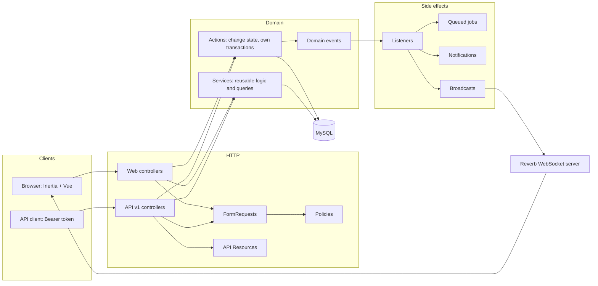
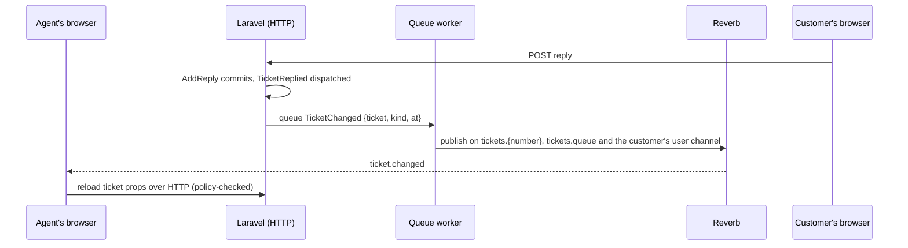

# 03 · Architecture

How the application is put together: the layers, where each kind of code lives, how a request flows, how side effects and realtime updates are wired, and how the frontend is organised. The reasons behind each choice are in [11 · Technical decisions](11-technical-decisions.md) (TD-xxx references below). The data model is in [05 · Database design](05-database-design.md).

## 1. Stack

| Item | Choice |
|---|---|
| Framework | Laravel 13 on PHP 8.3+ (TD-002) |
| UI | Inertia 3 + Vue 3 (`<script setup lang="ts">`), Tailwind 4, shadcn-vue, from the Laravel Vue starter kit (TD-002) |
| API | Versioned REST JSON under `/api/v1`, Sanctum personal access tokens (TD-003) |
| Database | MySQL 8 for development, tests and CI (TD-004, TD-031) |
| Authorization | spatie/laravel-permission for capabilities + Laravel Policies for ownership (TD-010) |
| Audit history | spatie/laravel-activitylog, written explicitly from listeners (TD-026) |
| Queues, cache, sessions | `database` drivers by default (TD-005, TD-072) |
| Realtime | Laravel Reverb (WebSockets) + Laravel Echo in the browser (TD-073) |
| API docs | Scramble, generated from the code (TD-033) |
| Quality | Pest 4, Vitest for frontend logic, Larastan level 6, Pint (TD-030) |

## 2. Layers



**Rules (TD-001)**

1. **Controllers are thin.** Authorize (route `can:` middleware or the FormRequest's `authorize()`), validate with a FormRequest, call one Action or Service, return an Inertia response or an API Resource. Web and API controllers share the same FormRequests, Actions and Policies.
2. **Only Actions change domain state.** Each Action has one public `handle()` method, owns its `DB::transaction()` (TD-053), and dispatches domain events. Status changes go only through `ChangeTicketStatus` (TD-040). SLA columns are written only by `SlaCalculator` (called from Actions) and the escalation scan.
3. **Services hold reusable logic that is not a use case**: calculations (`BusinessCalendar`, `SlaCalculator`), query objects (`TicketListQuery`, `TicketFilter`, `ConversationQuery`, `AgentDirectory`), and small helpers. `BusinessCalendar` is pure: no facades, no `config()`, no `now()`.
4. **Side effects live in listeners**, never inline in Actions (TD-070): activity history, notifications, auto-assignment, cache invalidation, broadcasts. Domain events implement `ShouldDispatchAfterCommit`, so nothing runs for a rolled-back change.
5. **Domain errors** are `DomainException` subclasses with an HTTP status and a stable `code`, rendered once in `bootstrap/app.php` (TD-110).

## 3. Where the code lives

```
app/
  Actions/            the only code that changes domain state
    Admin/            CreateUser, UpdateUser, ChangeUserRole, SyncAgentProfile, UpdateRolePermissions,
                      Create/Update/DeleteCategory, Create/Update/DeleteHoliday, UpdateSlaSettings
    Assignment/       AssignTicket, ClaimTicket, AssignTicketAutomatically
    Auth/             RegisterCustomer, IssueApiToken, RevokeCurrentApiToken, SendPasswordResetLink, ResetUserPassword
    Conversation/     AddReply
    Imports/          StartTicketImport, ImportTicketRow
    Notifications/    MarkNotificationRead, MarkAllNotificationsRead
    Profile/          UpdateProfile, ChangePassword, UpdateAvatar
    SavedReplies/     CreateSavedReply, UpdateSavedReply, DeleteSavedReply
    Sla/              DeliverEscalation
    Tickets/          CreateTicket, UpdateTicket, ChangeTicketStatus, ChangeTicketPriority, RecalculateTicketSla
  Services/
    Sla/              BusinessCalendar (pure), SlaCalculator, SlaQuery, SlaSettings, SlaSettingsRepository,
                      SlaSettingsRules, HolidayRepository
    Tickets/          TicketNumberGenerator, TicketListQuery, TicketFilter, FulltextSearchTerm, ResponseQuery,
                      TicketVisibility, TicketPageData, TicketQueueCounts, TicketDataVersion, TicketDataCache
    Assignment/       AgentSelector, AgentEligibility, UnassignedTicketAssigner
    Attachments/      AttachmentStorer, StagedUpload
    Conversation/     ConversationQuery
    Imports/          TicketCsvReader, ImportTicketRowRules, ImportDuplicateTracker, ImportErrorCsvWriter, TicketImportQuery
    Agents/           AgentDirectory
    Dashboard/        DashboardStats
    Notifications/    Recipients, NotificationFeed
    SavedReplies/     SavedReplyQuery
    Users/            UserDirectory, AvatarRules, AvatarStorer
    Auth/             PasswordLength, PasswordResetLinks, UserSessions
    Admin/            AdminCatalog
  Enums/              Role, Permission, TicketStatus, TicketPriority, SlaState, EscalationLevel, ActivityType,
                      AssignmentMethod, ImportStatus, SavedReplyScope, SavedReplyPlaceholder, TicketChangeKind
  Events/             domain events (TicketCreated, TicketAssigned, TicketReplied, ...)
  Events/Broadcast/   realtime events (TicketChanged, TicketQueueChanged, InternalNoteAdded, NotificationReceived)
  Listeners/          RecordTicketActivity, Send*Notifications, QueueAutoAssignment, BroadcastTicketChanges, ...
  Jobs/               AutoAssignTicket, PrepareTicketImport, ImportTicketsChunk, FinalizeTicketImport,
                      RecalculateActiveTicketSlas, AutoAssignImportedTickets
  Notifications/      one class per message, queued on `notifications`
  Policies/           TicketPolicy, TicketReplyPolicy, AttachmentPolicy, SavedReplyPolicy, SlaSettingPolicy,
                      UserPolicy, CategoryPolicy, HolidayPolicy, TicketImportPolicy, NotificationPolicy, DashboardPolicy
  Console/Commands/   ScanSlaCommand (sla:scan), prune commands
  Exceptions/Domain/  DomainException and its subclasses
  Http/
    Controllers/Web/        Inertia controllers (Admin/ for the admin area)
    Controllers/Api/V1/     JSON controllers (Admin/ for the admin area)
    Requests/<Feature>/     shared FormRequests, named <Verb>Request
    Resources/V1/           API Resources (also used to shape Inertia props)
    Middleware/             HandleInertiaRequests, ForceJsonResponse, TrackLastSeen, AuthorizeApiDocs
config/               sla.php, business_hours.php, tickets.php, attachments.php, avatars.php, imports.php,
                      retention.php, broadcasting.php, reverb.php, ...
routes/web/*.php, routes/api/v1/*.php   one file per feature, loaded automatically (bootstrap/app.php)
routes/channels.php   broadcast channel authorization
routes/console.php    the schedule
```

## 4. Request flow, by example

**A customer posts a reply with a file**

1. `POST /tickets/{ticket}/replies` (web) or `POST /api/v1/tickets/{ticket}/replies` (API), throttled by the `uploads` limiter.
2. The conversation `StoreRequest` authorizes through `TicketPolicy::reply` (404 if the customer may not see the ticket, 403 on a Closed ticket) and validates body and files.
3. `AddReply` locks the ticket row, saves the reply, stores the attachments, and, because the author is the customer and the ticket was Waiting for Customer or Resolved, calls `ChangeTicketStatus` to move it to In Progress (which resumes or reopens the SLA). One transaction; stored files are deleted if it fails.
4. After commit, `TicketReplied` and `TicketStatusChanged` reach their listeners: the timeline entry, the agent's notification (queued), the cache-version rotation and the realtime broadcast (queued).
5. The web gets a redirect back; the API gets a `TicketReplyResource`.

**Two agents claim the same ticket**

`ClaimTicket` runs one conditional `UPDATE … WHERE assigned_agent_id IS NULL`. The database serializes the two updates; one affects a row and wins, the other affects none and gets `TicketAlreadyClaimed` (409). See TD-051.

## 5. Authorization model

- **Capabilities** are `Permission` enum values seeded per role by `RolesAndPermissionsSeeder` from `Permission::forRole()`; admins can edit the matrix at runtime (TD-010).
- **Policies** combine a capability with ownership or state and are the single entry point. `TicketVisibility` turns a user's permissions into one visibility rule (sees all tickets, sees own tickets, sees internal content) that every ticket query, policy and page uses.
- **404 vs 403**: a ticket the user may not see is denied as not found; a visible ticket with a forbidden action is 403 (TD-012).
- Details and the full matrix: [06 · Security and authorization](06-security-and-authorization.md).

## 6. Events and listeners

Listeners are discovered automatically from their `handle*` method signatures. Run `php artisan event:list` for the live list.

| Event | Listeners (what they do) |
|---|---|
| `TicketCreated` | `RecordTicketActivity` (created or imported entry) · `SendTicketCreatedNotifications` (customer confirmation; admins if auto-assign is off; nothing for imports) · `QueueAutoAssignment` (queues `AutoAssignTicket`; never for imports) · `RotateTicketDataVersion` · `BroadcastTicketChanges` (skipped for imports) |
| `TicketUpdated` | `RecordTicketActivity` · `RotateTicketDataVersion` (category changes only) · `BroadcastTicketChanges` |
| `TicketStatusChanged` | `RecordTicketActivity` (status, SLA paused/resumed) · `RotateTicketDataVersion` · `BroadcastTicketChanges` |
| `TicketResolved` | `SendTicketResolvedNotifications` |
| `TicketPriorityChanged` | `RecordTicketActivity` · `RotateTicketDataVersion` · `BroadcastTicketChanges` |
| `TicketAssigned` | `RecordTicketActivity` (assigned or claimed) · `SendTicketAssignedNotifications` · `RotateTicketDataVersion` · `BroadcastTicketChanges` |
| `TicketUnassigned` | `RecordTicketActivity` · `RotateTicketDataVersion` · `BroadcastTicketChanges` |
| `TicketAutoAssignmentFailed` | `SendTicketNeedsAssignmentNotifications` (admins; not for imports) |
| `TicketReplied` | `RecordTicketActivity` (reply or internal note) · `SendTicketRepliedNotifications` · `BroadcastTicketChanges` (internal notes only on the staff channel) |
| `TicketSlaApproaching` / `TicketSlaBreached` | `SendSlaNotifications` (idempotent delivery: activity + notifications + announced level in one transaction) · `RotateTicketDataVersion` · `BroadcastTicketChanges` |
| `TicketSlaRecalculated` | `RecordTicketActivity` ("Deadline updated") · `RotateTicketDataVersion` · `BroadcastTicketChanges` (as an `updated` change) |
| `SlaRulesChanged` | `QueueSlaRecalculation` (queues `RecalculateActiveTicketSlas` when the admin asked for it) |
| `TicketImportFinished` | `SendImportFinishedNotification` · `QueueImportedTicketsAutoAssignment` (queues `AutoAssignImportedTickets` when the import opted in) · `BroadcastTicketChanges` (one queue update) |
| `ImportedTicketsAutoAssigned` | `SendImportedTicketsAssignedNotifications` (one summary per agent) |
| `NotificationSent` (framework) | `BroadcastNotificationReceived` (database channel only) |

`RecordTicketActivity` runs synchronously after commit, so the timeline is complete when the request returns (TD-026).

## 7. Background processing

| Piece | Queue | Purpose |
|---|---|---|
| `AutoAssignTicket` | `default` | Pick and assign an agent for a new ticket (unique per ticket, 3 tries) |
| `RecalculateActiveTicketSlas` | `default` | Re-apply SLA rules to active tickets, one locked ticket at a time (no overlap) |
| Broadcast events | `broadcasts` | Identifier-only realtime messages |
| Notifications | `notifications` | Mail and database notifications, after commit |
| `PrepareTicketImport`, `ImportTicketsChunk`, `FinalizeTicketImport` | `imports` | Streamed, chunked, batched CSV import |
| `sla:scan` | scheduler, every minute | Escalate and (re)deliver escalation announcements |
| prune commands | scheduler, nightly | Retention for activity, notifications, batches, failed jobs |

Workers process `default,broadcasts,notifications,imports` in that order (TD-072). Details: [08 · Background processing and realtime](08-background-processing-and-realtime.md).

## 8. Realtime architecture (TD-073)



- **Identifier-only payloads.** Every broadcast carries `{ticket, kind, at}`; clients refetch through the normal, permission-checked HTTP endpoints. A broadcast can never leak content the receiver may not see.
- **Channels** (authorized in `routes/channels.php` with the same policies as the pages):

  | Channel | Who may join | Used for |
  |---|---|---|
  | `private-tickets.{number}` | anyone who may view the ticket | `ticket.changed` |
  | `private-tickets.{number}.staff` | internal-notes permission on that ticket | `ticket.internal-note`, internal-note typing whispers |
  | `private-tickets.queue` | `tickets.view.any` | `ticket.changed`, `queue.changed` for list pages |
  | `private-App.Models.User.{id}` | that user only | `notification.received`; `ticket.changed` for tickets where the user is the customer (live customer lists) |
  | `presence-presence.tickets.{number}` | anyone who may view the ticket | who is here, public typing whispers |

- **Client events (whispers)** are accepted only from channel members (`REVERB_APP_ACCEPT_CLIENT_EVENTS_FROM=members`).
- **Graceful degradation.** Without a Reverb key or server, the Echo client is never created and pages work without live updates.

## 9. Frontend structure

```
resources/js/
  app.ts              Inertia app bootstrap
  pages/<feature>/    one Vue page per Inertia route: tickets, dashboard, agents, saved-replies, profile,
                      notifications, admin/{users,roles,categories,holidays,imports,sla}, auth
  components/<feature>/  feature components: tickets, chat, agents, saved-replies, profile, dashboard,
                      admin, imports, notifications; ui/ holds the shadcn-vue primitives
  composables/        useRealtime (subscribe and refetch), usePresence, useTyping, useChatScroll,
                      useClientValidation, ...
  lib/                echo.ts (lazy Echo client), savedReplies.ts (placeholder rendering), format.ts,
                      validation.ts, ...
  layouts/            AppLayout (sidebar shell), AuthLayout
  config/navigation/  sidebar entries, shown according to the shared `auth.can` flags
  types/              shared TypeScript types for props and resources
  routes/, actions/, wayfinder/   generated by Wayfinder at build time (gitignored)
```

- **Server-authorized props.** Pages receive props the server has already filtered (for example, no internal replies for customers). `HandleInertiaRequests` shares only the user's id, name, email, avatar URL, roles, a set of boolean abilities (`auth.can`), flash messages, the unread count, password rules and the business timezone. The UI hides controls with these flags, but the server enforces every rule again.
- **Typed routes.** Wayfinder generates TypeScript helpers from Laravel routes, so links and form actions are type-checked.
- **Realtime in the client.** `useRealtime` subscribes to the channels a page needs and reloads the relevant Inertia props when a message arrives. `usePresence` joins the ticket's presence channel. `useTyping` throttles and expires typing signals and picks the presence channel or the staff channel by mode.

## 10. Error handling

| Kind | API | Web |
|---|---|---|
| Domain rule refused (`DomainException`) | `{message, code}` with the exception's status (409 or 422) | redirect back with a flash error (toast) |
| Validation | 422 with `errors` | Inertia error bag under each field |
| Not allowed | 403, or 404 when existence must be hidden | same |
| Rate limited | 429 | 429 |

Domain exceptions are not reported to the error log, because they are expected outcomes (TD-110). Jobs log in `failed()`.

## 11. Configuration

Domain settings live in dedicated config files, overridable by environment variables, and code never calls `env()` outside `config/` (TD-130). SLA rules are the exception: the config values are defaults and the seed source, and the live values are the admin-edited database settings (TD-046).
