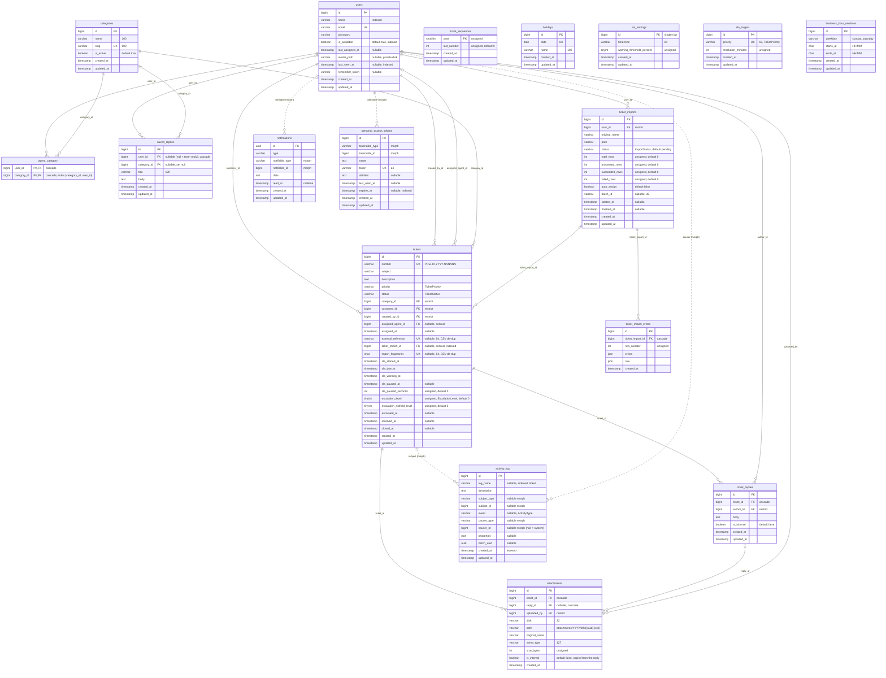

# 05 · Database design

Source of truth: the migrations in `database/migrations`. Decisions: TD-020 to TD-026 and TD-046 in [11 · Technical decisions](11-technical-decisions.md). Solid lines in the diagram are real foreign keys; dotted lines are polymorphic or framework references without a foreign key. Enum columns are `varchar` cast to PHP backed enums (TD-020). Times are stored in UTC.

`tests/Feature/Database/SchemaTest.php` asserts the indexes and foreign-key delete rules below against `information_schema`.

## 1. Entity–relationship diagram

Not drawn, but present:
- **spatie/laravel-permission tables** (`roles`, `permissions`, `model_has_roles`, `model_has_permissions`, `role_has_permissions`), from the `2026_10_29_000100_create_permission_tables` migration; all their foreign keys cascade.
- **Framework tables**: `sessions` (with `user_id`, no FK), `password_reset_tokens`, `cache`, `cache_locks`, `jobs`, `job_batches`, `failed_jobs`, `migrations`.

## 2. Tables in plain words

| Table | Holds | Notes |
|---|---|---|
| `users` | everyone: customers, agents, admins | role via spatie tables; `is_available` and `agent_category` only matter for agents; `avatar_path` points at the private disk; `last_seen_at` is written at most once a minute |
| `categories` | ticket categories | deactivated instead of deleted when tickets use them |
| `agent_category` | which agent handles which category | drives auto-assignment and manual eligibility |
| `tickets` | the tickets | see the column groups below |
| `ticket_sequences` | one counter row per year | `INSERT … ON DUPLICATE KEY UPDATE` inside the creation transaction (TD-022) |
| `ticket_replies` | public replies and internal notes | one table, `is_internal` flag (TD-060) |
| `attachments` | files on tickets and replies | denormalized `ticket_id` and `is_internal` for one-step authorization (TD-024) |
| `saved_replies` | reusable reply texts | `user_id` set = personal, null = team |
| `holidays` | closed dates | one row per date |
| `sla_settings` | timezone and warning percentage | a single row (`id = 1`) |
| `sla_targets` | resolution minutes per priority | one row per priority |
| `business_hour_windows` | weekly opening windows | several per day allowed, at most 6 (validated) |
| `ticket_imports` | one CSV import run | progress counters updated with atomic increments; `auto_assign` records whether imported tickets should be auto-assigned |
| `ticket_import_errors` | rejected rows | line number, reasons, original values |
| `activity_log` | ticket timeline | written only by `RecordTicketActivity` (TD-026) |
| `notifications` | in-app inbox | Laravel database notifications |

**Ticket column groups**

| Group | Columns | Written by |
|---|---|---|
| Identity | `number`, `external_reference`, `ticket_import_id`, `import_fingerprint` | `CreateTicket`, `ImportTicketRow` |
| Content | `subject`, `description`, `priority`, `category_id` | create, `UpdateTicket`, `ChangeTicketPriority` |
| People | `customer_id`, `created_by_id`, `assigned_agent_id`, `assigned_at` | create, assignment Actions |
| Status | `status`, `resolved_at`, `closed_at` | `ChangeTicketStatus` (and the claim/assign "Open → In Progress" step) |
| SLA | `sla_started_at`, `sla_due_at`, `sla_warning_at`, `sla_paused_at`, `sla_paused_seconds` | `SlaCalculator`, called from Actions |
| Escalation | `escalation_level`, `escalated_at` | the `sla:scan` command; lowered by `SlaCalculator` on recalculation |
| Escalation bookkeeping | `escalation_notified_level` | the escalation delivery (highest level already announced) |

`sla_paused_seconds` is the business time, in seconds, the clock has been stopped (waiting for the customer, or resolved before a reopen). Every recalculation is `start + resolution minutes + sla_paused_seconds` in business time, so credited time is never lost and short pauses do not drift.

## 3. Delete behaviour (TD-025)

| Relationship | On delete |
|---|---|
| ticket → replies, attachments | cascade |
| reply → attachments | cascade |
| ticket → category, customer, creator | restrict |
| ticket → assigned agent | set null |
| ticket → import | set null |
| reply → author, attachment → uploader, import → user | restrict |
| agent_category | cascade both ways |
| saved reply → owner | cascade |
| saved reply → category | set null |
| import → errors | cascade |

No soft deletes. Users are never deleted through the application.

## 4. Indexes (TD-021)

Each index serves a named query.

| Table | Index | Serves |
|---|---|---|
| tickets | `number` unique | lookup by ticket number, route binding |
| tickets | `external_reference` unique | CSV de-duplication by reference |
| tickets | `import_fingerprint` unique | CSV de-duplication of rows without reference or date |
| tickets | `(status, sla_due_at)` | breach scan, "breached" filter, dashboard breached count |
| tickets | `(status, sla_warning_at)` | approaching scan and filter |
| tickets | `(assigned_agent_id, status)` | "my tickets", agent workload, by-agent dashboard, agents directory |
| tickets | `(customer_id, created_at)` | a customer's own ticket list |
| tickets | `(customer_id, subject)` | import duplicate detection against existing tickets |
| tickets | `(category_id, status)` | category filter, candidate workload |
| tickets | `(status, category_id, assigned_agent_id)` | queue counts |
| tickets | `(priority, status)` | priority filter, critical count, by-priority breakdown |
| tickets | `(created_at)` | date-range filter, default sort, created-per-day trend |
| tickets | `(status, resolved_at)` | resolved-in-window count, resolved-per-day trend |
| tickets | `(updated_at)` | sort by last update |
| tickets | `ticket_import_id` | tickets of one import |
| tickets | `tickets_escalation_redelivery_index (status, escalated_at, escalation_notified_level, escalation_level)` | escalation redelivery pass of `sla:scan` |
| tickets | FULLTEXT `(subject, description)` | keyword search |
| users | `(name)` | user list sort and name-prefix search |
| users | `(is_available)` + `model_has_roles(role_id, model_id, model_type)` | eligible agents |
| users | `(last_seen_at)` | presence "last active" |
| agent_category | `(category_id, user_id)` | agents per category |
| ticket_replies | `(ticket_id, is_internal, created_at)` | conversation with internal notes filtered out; response filters |
| attachments | `(ticket_id, is_internal)`, `(reply_id)` | attachment lists with visibility |
| saved_replies | `(user_id, title)` | "My replies", sorted by title |
| saved_replies | `(category_id, title)` | category-first picker |
| business_hour_windows | `(weekday, starts_at)` | loading the week in order |
| activity_log | `(subject_type, subject_id, created_at)` | ticket timeline |
| activity_log | `(created_at)` | chunked retention prune |
| notifications | `(notifiable_type, notifiable_id, created_at)` | inbox page and unread count |
| notifications | `(read_at, created_at)` | chunked prune of old read notifications |
| ticket_imports | `(user_id, created_at)` | an admin's imports |
| ticket_import_errors | `(ticket_import_id, row_number)` | paginated error report |

`tests/Feature/Performance/IndexUsageTest.php` runs the real lists, filters, SLA scan, dashboard, timeline and inbox against a few thousand tickets and checks with `EXPLAIN` that none of them does a full table scan.

## 5. Changing the schema

During development nothing is deployed, so a new column or index on an existing table is added by editing that table's migration and rebuilding with `php artisan migrate:fresh --seed`. A new migration file is created only for a new table (TD-140). Once the app is deployed, normal additive migrations apply.
