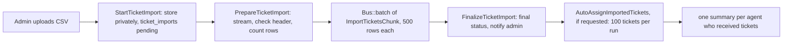

# 08 · Background processing and realtime

What runs outside the request, in which order, and how live updates reach the browser. Decisions: TD-044, TD-047, TD-072, TD-073, TD-090 in [11 · Technical decisions](11-technical-decisions.md).

## 1. The processes

`composer run dev` runs `php artisan dev`, which starts all of these together (`php artisan dev:list` shows them):

| Name | Command | Purpose |
|---|---|---|
| server | `php artisan serve` | the web app on http://127.0.0.1:8000 |
| queue | `php artisan queue:listen --queue=default,broadcasts,notifications,imports --tries=1 --timeout=0` | runs queued work, highest-priority queue first |
| scheduler | `php artisan schedule:work` | runs `sla:scan` every minute and the nightly prunes |
| reverb | `php artisan reverb:start` | the WebSocket server on port 8080 |
| logs | `php artisan pail --timeout=0` | live log tail |
| vite | `npm run dev` | frontend dev server with hot reload |

In production run the same pieces as separate supervised processes: a web server, one or more `php artisan queue:work --queue=default,broadcasts,notifications,imports` workers (restart them on deploy: `php artisan queue:restart`), a cron entry for `php artisan schedule:run` every minute, and `php artisan reverb:start` behind TLS.

## 2. Queues and their order (TD-072)

| Order | Queue | What goes there | Why this position |
|---|---|---|---|
| 1 | `default` | `AutoAssignTicket`, `RecalculateActiveTicketSlas` | a new ticket's SLA runs while it waits for an agent |
| 2 | `broadcasts` | realtime events | live updates should feel instant and are tiny |
| 3 | `notifications` | every mail and database notification | user-facing, but a few seconds are fine |
| 4 | `imports` | `PrepareTicketImport`, `ImportTicketsChunk`, `FinalizeTicketImport`, `AutoAssignImportedTickets` | bulk work must never delay the rest; in production give it its own workers |

The order is defined once in `config/queue.php` (`worker_queues`) and used by the dev command.

**Retries**

| Job | Tries | Backoff | Notes |
|---|---|---|---|
| `AutoAssignTicket` | 3 | 10 s, 60 s, 300 s | unique per ticket; re-checks the ticket before assigning |
| `RecalculateActiveTicketSlas` | until 3 exceptions | 10 s, 60 s, 300 s | unique until processing; `WithoutOverlapping` so only one runs |
| `PrepareTicketImport`, `FinalizeTicketImport`, `AutoAssignImportedTickets` | 3 | 10 s, 60 s, 300 s | |
| `ImportTicketsChunk` | 1 | | a chunk commits row by row, so a retry would re-run committed rows; a failed chunk is recorded on the import |
| Broadcast events | 3 | | dispatched after commit, `ShouldRescue` so a broadcasting failure never breaks the request |

Notifications and broadcast events are queued after the database commit (`afterCommit` / `ShouldDispatchAfterCommit`), so a rolled-back change never sends anything.

With `QUEUE_CONNECTION=sync` everything runs inside the request instead. That works for a quick look, but the request then waits for mail and imports.

## 3. The scheduler

Defined in `routes/console.php`:

| When | Command | What it does |
|---|---|---|
| every minute, without overlapping, on one server | `sla:scan` | redeliver lost escalation announcements, then escalate approaching, then breached tickets |
| daily 02:00 | `activity:prune` | delete activity older than `activitylog.delete_records_older_than_days` (365), in chunks |
| daily 02:15 | `notifications:prune` | delete read notifications older than 90 days, in chunks |
| daily 02:30 | `queue:prune-batches --hours=168` | finished job batches |
| daily 02:45 | `queue:prune-failed --hours=168` | old failed jobs |

Without the scheduler nothing escalates. Run `php artisan sla:scan` by hand to trigger one scan.

## 4. Escalation, step by step (TD-044)

```mermaid
sequenceDiagram
    participant S as sla:scan (every minute)
    participant DB as tickets
    participant L as SendSlaNotifications
    participant Q as notifications queue
    S->>DB: 1. redeliver: escalation_notified_level < escalation_level AND escalated_at older than 120 s
    S->>L: dispatch TicketSlaApproaching / TicketSlaBreached again
    S->>DB: 2. approaching: running clock, warning passed, due not passed, level < 1
    S->>DB: 3. breached: running clock, due passed, level < 2
    Note over S,DB: per chunk of 500, one transaction: lock rows, raise level, set escalated_at, dispatch events
    S->>L: events (after commit)
    L->>DB: lock ticket; skip if this level was already announced
    L->>DB: write activity, set escalation_notified_level
    L->>Q: queue notifications (same transaction)
```

- **At least once, never twice.** Raising the level and dispatching the event share one transaction. The delivery (`DeliverEscalation`) locks the ticket, returns early if `escalation_notified_level` already reached this level, and otherwise writes the timeline entry, queues the notifications and records the announced level in one transaction. If the process dies before delivery commits, the redelivery pass picks the ticket up after the grace period (`SLA_REDELIVERY_GRACE_SECONDS`, default 120).
- **Re-escalation.** When a recalculation lowers the level, the announced level is capped with it, so a later rise is announced again.
- **Recipients.** Approaching: the assigned agent, or all admins when unassigned. Breached: the assigned agent and all admins. Never the customer.
- **Imports** set the level and the announced level together, so importing old tickets does not trigger a wave of messages.

## 5. SLA recalculation (TD-047)

1. An admin saves SLA settings, or creates, edits or deletes a holiday, with "Recalculate active tickets" ticked.
2. `SlaRulesChanged(recalculate: true)` is dispatched; `QueueSlaRecalculation` queues `RecalculateActiveTicketSlas` on `default`.
3. The job walks active tickets by id in chunks (`SLA_SCAN_CHUNK_SIZE`). For each one `RecalculateTicketSla` locks the row, recomputes due and warning times from `sla_started_at + target + sla_paused_seconds`, lowers the escalation level if the new deadline allows it, saves, and records a timeline entry when the deadline moved.
4. The next `sla:scan` raises levels where the new deadline has already passed.

Without the box ticked only new tickets use the new rules.

## 6. CSV import pipeline (TD-090)



- Memory stays flat: the file is read with `SplFileObject` and each chunk seeks straight to its start offset.
- Each row has its own transaction, so one bad row never discards the others. Rejected rows go to `ticket_import_errors`.
- Imported tickets send no per-ticket emails and are not broadcast one by one; the queue gets one `queue.changed` when the import finishes.
- Auto-assignment of imported tickets is opt-in per upload and runs only when automatic assignment is enabled. Resolved and Closed rows are never assigned.

## 7. Realtime (TD-073)

**Server side**

- Broadcasting uses Laravel Reverb (`BROADCAST_CONNECTION=reverb`). Events live in `app/Events/Broadcast` and are queued on `broadcasts`.
- `BroadcastTicketChanges` turns domain events into `TicketChanged`, `TicketQueueChanged` or `InternalNoteAdded`. `BroadcastNotificationReceived` turns every database notification into `NotificationReceived`.

**Payload contract**

Every event has the same body:

```json
{ "ticket": "TKT-2026-000042", "kind": "replied", "at": "2026-11-01T09:15:00+00:00" }
```

| Event name (`broadcastAs`) | Channels | `kind` values |
|---|---|---|
| `ticket.changed` | `private-tickets.{number}`, `private-tickets.queue`, and the ticket customer's `private-App.Models.User.{id}` | `created`, `updated` (also sent when an SLA recalculation moved the deadline), `replied`, `status_changed`, `priority_changed`, `assigned`, `unassigned` |
| `ticket.changed` (staff only) | `private-tickets.{number}.staff`, `private-tickets.queue` | `sla_approaching`, `sla_breached` |
| `ticket.internal-note` | `private-tickets.{number}.staff` | `internal_note` |
| `queue.changed` | `private-tickets.queue` | `import_finished` (`ticket` is null) |
| `notification.received` | `private-App.Models.User.{id}` | `notification` (`ticket` is null) |

Clients never render the payload; they reload the affected Inertia props over HTTP, where the normal policies apply. A page runs at most one refresh at a time and adds one trailing refresh when many messages arrive together; refreshes reload only the props that can change. Customers' ticket lists listen on their own user channel, so new tickets appear too.

**Presence and typing**

- `presence-presence.tickets.{number}` is joined by everyone viewing the ticket page who may view the ticket. Member info: `id`, `name`, `avatar_url`, `role` (`customer` or `staff`, relative to that ticket).
- Typing is sent as client whispers (`typing`, `typing-stopped`): public typing on the presence channel, internal-note typing on the private staff channel. Senders throttle to one signal per 2 seconds; receivers expire a typer after 4 seconds of silence.
- Reverb accepts client events only from channel members (`REVERB_APP_ACCEPT_CLIENT_EVENTS_FROM=members`).
- "Last seen" is written by the `TrackLastSeen` middleware at most once a minute per user (a cache key guards it); "Active now" means in the presence channel or seen within 5 minutes.

**Configuration**

`.env.example` ships working local values:

```
BROADCAST_CONNECTION=reverb
REVERB_APP_ID=techzu-local
REVERB_APP_KEY=techzu-local-key
REVERB_APP_SECRET=techzu-local-secret
REVERB_HOST=127.0.0.1
REVERB_PORT=8080
REVERB_SCHEME=http
VITE_REVERB_APP_KEY="${REVERB_APP_KEY}"
...
```

The `VITE_*` values are baked into the frontend at build time, so rebuild (`npm run build`) after changing them. Use your own random values in any shared environment.

**Without Reverb**

If the WebSocket server is not running, the browser simply fails to connect and pages behave as before, without live updates. Set `BROADCAST_CONNECTION=log` (or `null`) to stop the queue from trying to publish.
