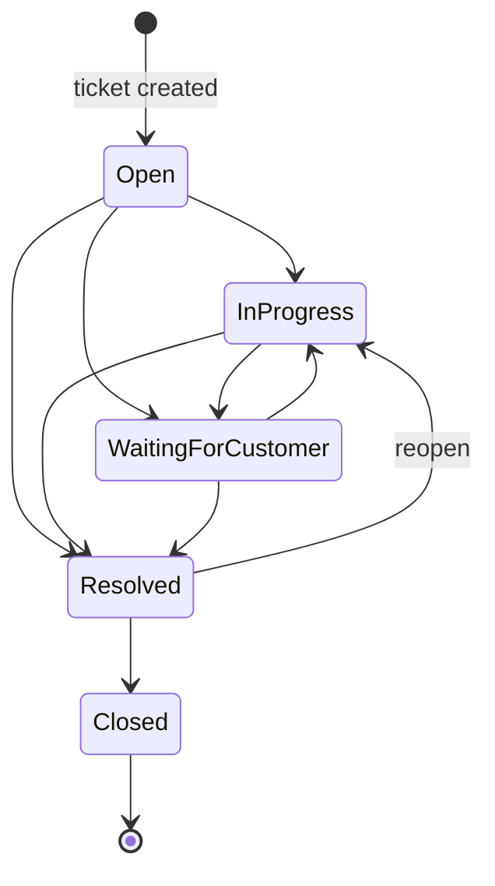

# 14 · Core Features Guide: How the System Works

This guide explains every core feature of Techzu Support in plain language: what it is, how it works, how it behaves in real situations, and how the features depend on each other. It assumes you have never worked with a helpdesk or SLA system before.

Everything here was checked against the code (file references are given so you can verify). Where the system does **not** do something you might expect, this guide says so explicitly. Look for the **"Not implemented"** boxes.

All worked examples use the default settings and were computed by running the system's own calculator classes (`BusinessCalendar`, `SlaCalculator`), not worked out by hand.

---

## Contents

1. [The big picture in one page](#1-the-big-picture-in-one-page)
2. [People and roles](#2-people-and-roles)
3. [Tickets and the ticket lifecycle](#3-tickets-and-the-ticket-lifecycle)
4. [SLA (Service Level Agreement)](#4-sla-service-level-agreement)
5. [Business hours](#5-business-hours)
6. [Holidays and time slots](#6-holidays-and-time-slots)
7. [SLA pausing, resuming, reopening and recalculation](#7-sla-pausing-resuming-reopening-and-recalculation)
8. [SLA escalation: what happens when a deadline is near or missed](#8-sla-escalation-what-happens-when-a-deadline-is-near-or-missed)
9. [Automatic ticket assignment](#9-automatic-ticket-assignment)
10. [Manual assignment, claiming and hand-off](#10-manual-assignment-claiming-and-hand-off)
11. [Ticket queue management](#11-ticket-queue-management)
12. [Conversation: replies and internal notes](#12-conversation-replies-and-internal-notes)
13. [Attachments](#13-attachments)
14. [Notifications](#14-notifications)
15. [Activity history (audit trail)](#15-activity-history-audit-trail)
16. [Search, filters, sorting and pagination](#16-search-filters-sorting-and-pagination)
17. [Dashboard](#17-dashboard)
18. [Agent directory](#18-agent-directory)
19. [Saved replies](#19-saved-replies)
20. [CSV ticket import](#20-csv-ticket-import)
21. [Categories](#21-categories)
22. [Users, roles and the permission matrix](#22-users-roles-and-the-permission-matrix)
23. [Realtime updates, presence and typing](#23-realtime-updates-presence-and-typing)
24. [Accounts, profile and avatars](#24-accounts-profile-and-avatars)
25. [REST API](#25-rest-api)
26. [Background work: queues and the scheduler](#26-background-work-queues-and-the-scheduler)
27. [How the features depend on each other](#27-how-the-features-depend-on-each-other)
28. [End-to-end walkthrough: one ticket from creation to closure](#28-end-to-end-walkthrough-one-ticket-from-creation-to-closure)
29. [Summary: implemented vs. not implemented](#29-summary-implemented-vs-not-implemented)

---

## 1. The big picture in one page

A **customer** has a problem and opens a **ticket** (a support request). The system:

1. Gives the ticket a unique number such as `TKT-2026-000042`.
2. Starts an **SLA clock**: a promise to resolve the ticket within a set amount of *working* time, which depends on the ticket's **priority**.
3. Tries to **assign** the ticket automatically to a suitable, available **agent** (a support staff member).
4. Lets the customer and the agent talk through **replies**, while staff can also leave private **internal notes**.
5. **Pauses** the SLA clock while the team waits for the customer to answer.
6. Checks every minute whether a ticket is **approaching** or has **breached** its deadline, and **notifies** the right people.
7. Records every important change in an **activity history**.
8. Ends when the ticket is **Resolved** and then **Closed**.

Around this core sit supporting features: queues, search, a dashboard, an agent directory, saved replies, CSV import, admin settings for SLA, business hours and holidays, realtime updates, email and in-app notifications, and a REST API.

---

## 2. People and roles

There are three roles (`app/Enums/Role.php`):

| Role | Who they are | What they mainly do |
|---|---|---|
| **Customer** | The person who needs help | Opens tickets, replies, sees only their own tickets, can close or reopen a resolved ticket |
| **Agent** (Support Agent) | Support staff | Sees all tickets, claims and works tickets, replies, writes internal notes, hands tickets off |
| **Admin** (Administrator) | Team lead / system owner | Everything an agent can do, plus assigning anyone, managing users, categories, holidays, SLA rules, imports and the permission matrix |

What a role can do is controlled by **permissions** (for example `tickets.view.any` or `tickets.claim`), not by the role name itself. Admins can edit which permissions each role has (see [§22](#22-users-roles-and-the-permission-matrix)). The descriptions in this guide assume the **default** permission matrix.

Anyone can **self-register** on the sign-up page. Self-registered users always become **Customers** (`app/Actions/Auth/RegisterCustomer.php`). Agents and admins are created by an admin.

---

## 3. Tickets and the ticket lifecycle

### 3.1 What a ticket contains

| Field | Meaning |
|---|---|
| Number | `TKT-YYYY-NNNNNN`, e.g. `TKT-2026-000042` |
| Subject, Description | What the problem is |
| Priority | Low, Medium, High or Critical. **Drives the SLA deadline.** |
| Category | e.g. Billing, Technical. **Drives auto-assignment** (agents are linked to categories) |
| Customer | Whose problem it is |
| Created by | Who actually filed it (an agent can file a ticket *on behalf of* a customer) |
| Assigned agent | Who is working it (may be empty = "unassigned") |
| Status | Where the ticket is in its life (below) |
| SLA timestamps | Start, warning time, due time, paused-at, total paused time |
| Escalation level | None → Approaching → Breached |

### 3.2 Ticket numbers

- Format: prefix `TKT` (configurable with `TICKET_NUMBER_PREFIX`), the year, then a counter padded to six digits.
- The counter is **per year** and restarts at 1 every new year: `TKT-2026-000001`, `TKT-2026-000002`, … then `TKT-2027-000001`.
- The year is taken in the **business timezone** (default `Asia/Dhaka`), so a ticket created at 23:30 on 31 December Dhaka time belongs to that year even though it is already "next day" elsewhere.
- Numbers are generated with an atomic database operation (`INSERT … ON DUPLICATE KEY UPDATE` plus a row lock), so two tickets created at the same moment never get the same number (`app/Services/Tickets/TicketNumberGenerator.php`).
- If a year ever passes 999,999 tickets, the number simply gets a seventh digit; nothing breaks.

### 3.3 Statuses and allowed moves

There are five statuses (`app/Enums/TicketStatus.php`):

| Status | Meaning | Counts as "active"? | SLA clock |
|---|---|---|---|
| **Open** | New, nobody has started on it yet | Yes | Running |
| **In Progress** | An agent is working on it | Yes | Running |
| **Waiting for Customer** | The team asked the customer something and is waiting | Yes | **Paused** |
| **Resolved** | The team believes the problem is fixed | No | **Stopped** |
| **Closed** | Final. No more changes or replies. | No | Stopped |

Only these moves are allowed. Anything else is rejected with an "invalid status transition" error:



Text version:

| From | Can go to |
|---|---|
| Open | In Progress, Waiting for Customer, Resolved |
| In Progress | Waiting for Customer, Resolved |
| Waiting for Customer | In Progress, Resolved |
| Resolved | Closed, In Progress (reopen) |
| Closed | nothing (final) |

### 3.4 Automatic status changes

Some status changes happen by themselves:

| When this happens | Status change |
|---|---|
| The ticket gets an agent (auto-assign, claim, or manual assign) while it is **Open** | Open → **In Progress** |
| The **customer** posts a public reply while the ticket is **Waiting for Customer** | → **In Progress** (SLA resumes) |
| The **customer** posts a public reply while the ticket is **Resolved** | → **In Progress** (ticket reopens, SLA resumes with the remaining time) |

> **Not implemented**
> - An agent's reply does **not** change the status automatically. The agent moves it to "Waiting for Customer" or "Resolved" by hand.
> - Resolved tickets are **never closed automatically** after some number of days. Closing is always a manual action.

### 3.5 Who can change what (default permissions)

| Action | Customer (own ticket) | Agent | Admin |
|---|---|---|---|
| Create a ticket | Yes, for themselves | Yes, also on behalf of a customer | Yes, also on behalf of a customer |
| Edit subject / category | Only while **Open** | Only tickets **assigned to them** | Any ticket |
| Edit description | Only while **Open** | No | No |
| Change status | Only from **Resolved**, to Closed or back to In Progress | Tickets assigned to them | Any ticket |
| Change priority | No | Tickets assigned to them (active only) | Any active ticket |
| Reply | Yes (not when Closed) | Yes (not when Closed) | Yes (not when Closed) |

Rules from `app/Policies/TicketPolicy.php`. A user who is not allowed to *see* a ticket gets **404 Not Found** rather than 403, so ticket numbers cannot be probed.

---

## 4. SLA (Service Level Agreement)

### 4.1 What does SLA mean?

An **SLA** is a promise about *how fast* the support team will deal with a request. For example: "We will resolve Critical problems within 2 working hours."

In this system, each ticket gets a **resolution deadline** the moment it is created. The deadline depends on the ticket's priority and is counted in **business time** (only working hours count; see [§5](#5-business-hours)).

### 4.2 Default targets

From `config/sla.php`. Admins can change them in **Admin → SLA** (stored in the `sla_targets` table).

| Priority | Resolution target | Same in hours | Warning at 75% |
|---|---|---|---|
| Critical | 120 business minutes | 2 business hours | after 90 business minutes |
| High | 480 business minutes | 8 business hours | after 6 business hours |
| Medium | 1,440 business minutes | 24 business hours | after 18 business hours |
| Low | 2,880 business minutes | 48 business hours | after 36 business hours |

With the default schedule of 9 working hours a day, "24 business hours" is about 2⅔ working days, not one calendar day.

### 4.3 How the deadlines are calculated

Every ticket stores two moments (`app/Services/Sla/SlaCalculator.php`):

- **Due time** (`sla_due_at`) = start time + the priority's target, counted in business time only.
- **Warning time** (`sla_warning_at`) = start time + *warning percentage* × target, also in business time. Default warning percentage is **75%** (admin-configurable, 1–99%).

Step by step:

1. The start time is when the ticket is created (for imported tickets, the `created_at` given in the CSV).
2. The calculator walks forward from the start, counting only minutes that fall inside a business-hours window, skipping closed days and holidays.
3. When the counted business time equals the target, that moment is the due time.

If a ticket is created **outside** working hours (at night, on a weekend, on a holiday), nothing is counted until the next working window opens. In effect, the clock starts at the next opening.

### 4.4 Worked examples (default settings: Sunday–Thursday 09:00–18:00, Friday and Saturday closed, Asia/Dhaka)

| Ticket created | Priority | Warning at | Due at | Why |
|---|---|---|---|---|
| Thu 5 Nov, 17:00 | Critical (2 h) | Sun 8 Nov, 09:30 | **Sun 8 Nov, 10:00** | 1 h on Thursday (17–18), Friday and Saturday skipped, last 1 h on Sunday. *This is the example from the assignment brief.* |
| Mon 2 Nov, 10:00 | High (8 h) | Mon 2 Nov, 16:00 | Mon 2 Nov, 18:00 | Exactly 8 h left in the day |
| Mon 2 Nov, 10:00 | Medium (24 h) | Wed 4 Nov, 10:00 | Wed 4 Nov, 16:00 | 8 h Mon + 9 h Tue + 7 h Wed |
| Mon 2 Nov, 10:00 | Low (48 h) | Sun 8 Nov, 10:00 | Mon 9 Nov, 13:00 | Mon 8 + Tue 9 + Wed 9 + Thu 9 + Sun 9 + Mon 4 |
| Fri 6 Nov, 14:00 (closed day) | Critical | Sun 8 Nov, 10:30 | Sun 8 Nov, 11:00 | Clock effectively starts Sunday 09:00 |
| Mon 2 Nov, 07:00 (before opening) | Critical | Mon 2 Nov, 10:30 | Mon 2 Nov, 11:00 | Clock effectively starts at 09:00 |

### 4.5 The five SLA states

What you see on the badge is computed from the stored timestamps at the moment you look (`Ticket::slaState()`):

| State | Label shown | Rule |
|---|---|---|
| **Within** | Within SLA | Active, not paused, before the warning time |
| **Approaching** | Approaching breach | Active, not paused, past the warning time but before the due time |
| **Breached** | Breached | Active, not paused, at or past the due time |
| **Paused** | Paused | Status is Waiting for Customer |
| **Stopped** | Stopped | Status is Resolved or Closed |

Because the badge is calculated when the page loads, it is correct even if the background scheduler is not running. The scheduler is needed only for the *notifications and escalation flags* described in [§8](#8-sla-escalation-what-happens-when-a-deadline-is-near-or-missed).

### 4.6 Where the SLA shows up

- A badge and due time on the ticket list and the ticket page, for staff and customers.
- An **SLA state filter** on the ticket list (Within / Approaching / Breached / Paused / Stopped).
- "Due soonest" / "Due latest" sorting.
- The dashboard's **SLA health** chart and the per-agent **breached** counts.
- The agent directory's **SLA breached** tab and counts.
- **Countdown.** Next to the badge, every active ticket shows the SLA time left in **business time** ("1h 20m left", "Overdue 40m"). On the ticket page it ticks every second while the business is open ("1h 20m 15s left · business hours"), stands still outside opening hours ("1h 20m left · clock resumes …"), and is frozen while waiting for the customer ("1h 20m left when the customer replies"). It never uses the wall clock: on Thursday evening a ticket due Sunday 10:00 shows 1 hour left, not 62. A "d" means 24 business hours.

> **Not implemented**
> - **No first-response SLA.** There is only one deadline per ticket: the **resolution** deadline. There is no separate "first reply within X hours" target. The ticket list does have an **"Unresponded"** filter (tickets where no staff member has replied publicly yet) and an **"Awaiting reply"** filter (the customer spoke last), but these are filters only, with no deadline or alerts attached.
> - **One SLA policy for the whole system.** Targets depend only on priority. There are no per-category, per-customer, or per-plan SLAs.
> - **The SLA is not paused** for statuses other than Waiting for Customer, and there is no manual "pause SLA" button.

---

## 5. Business hours

### 5.1 What are business hours, and why are they needed?

**Business hours** are the times when the support team is actually working. Without them, a ticket created on Thursday evening with a 2-hour target would be "breached" by Thursday night, while nobody is at work. That would be unfair and useless.

With business hours, the SLA clock only runs while the team is working. A 2-hour promise means "2 hours of our working time".

### 5.2 Default schedule

From `config/business_hours.php`. Once the database is seeded, the schedule lives in the `business_hour_windows` table and can be edited in **Admin → SLA**.

| Day | Hours |
|---|---|
| Sunday | 09:00 – 18:00 |
| Monday | 09:00 – 18:00 |
| Tuesday | 09:00 – 18:00 |
| Wednesday | 09:00 – 18:00 |
| Thursday | 09:00 – 18:00 |
| Friday | Closed |
| Saturday | Closed |

Timezone: **Asia/Dhaka** (admin-editable; any valid timezone).

### 5.3 How they affect SLA calculations

- **Working day**: a day with at least one window. Only the minutes inside the windows count.
- **Non-working day**: a day with no windows (Friday and Saturday by default), or a holiday. The whole day is skipped.
- **Outside the window on a working day** (before 09:00 or after 18:00): skipped.
- All times are interpreted in the **business timezone**, whatever timezone the customer or agent is in.

Example: a High ticket (8 business hours) created on **Thursday at 16:30**:

- Thursday 16:30–18:00 → 1.5 h counted
- Friday, Saturday → 0 h (closed)
- Sunday from 09:00 → the remaining 6.5 h end at **Sunday 15:30**

### 5.4 Editing business hours (admins)

In **Admin → SLA** an admin can change, all in one form (`app/Actions/Admin/UpdateSlaSettings.php`, rules in `app/Services/Sla/SlaSettingsRules.php`):

- the four priority targets (each 1 to 43,200 business minutes, which is 30 days of minutes);
- the warning percentage (1–99%);
- the timezone;
- each weekday's windows.

The rules for windows:

- Times use `HH:MM`. `24:00` is allowed as an **end** time only (meaning midnight).
- A window must end after it starts.
- Windows on the same day must not overlap.
- At most 6 windows per day.
- The whole week must have at least one open window. Otherwise no deadline could ever be reached.

**Important:** by default, saving new settings affects **only tickets created afterwards**. Existing tickets keep their deadlines unless the admin ticks **"recalculate active tickets"** ([§7.5](#75-recalculation-after-the-admin-changes-the-rules)).

---

## 6. Holidays and time slots

### 6.1 Holidays

A **holiday** is a specific calendar date on which the team does not work, for example a national holiday.

- Admins manage them in **Admin → Holidays**: add, edit, delete. Each holiday has a **date** and a **name** (`app/Models/Holiday.php`). Each date can appear only once.
- On a holiday, the business-hours windows for that weekday are **ignored**. The whole day counts as closed (`BusinessCalendar::windowsOn()`).
- Holidays are matched by date in the business timezone.

**Example:** with Sunday 8 November marked as a holiday, a Critical ticket created Thursday 5 November at 17:00:

| | Without the holiday | With the holiday |
|---|---|---|
| Warning | Sun 8 Nov, 09:30 | **Mon 9 Nov, 09:30** |
| Due | Sun 8 Nov, 10:00 | **Mon 9 Nov, 10:00** |

When creating, editing or deleting a holiday, the admin can tick **"recalculate active tickets"**. Without it, only tickets created afterwards are affected (the form says so: "existing tickets don't change unless you recalculate them").

> **Not implemented**
> - **No recurring holidays.** A holiday is one specific date. Next year's date must be added again.
> - **No half-day holidays or special hours for one date.** A holiday always closes the whole day, and time slots are set per *weekday*, not per date. A shortened day (for example closing at 13:00 on one particular Monday) cannot be expressed.
> - **One calendar for everyone.** There are no per-team, per-region or per-agent schedules.

### 6.2 Time slots (business-hour windows)

A **time slot** (the code calls it a *business-hour window*) is one continuous working period within a day, such as 09:00–13:00. A day can have **up to six** slots, which lets you model breaks:

| Day | Slots | Working time |
|---|---|---|
| Monday | 09:00–13:00 and 14:00–18:00 | 8 h (one-hour lunch break excluded) |
| Sunday | 09:00–18:00 | 9 h |
| Friday | none | closed |

**Example with a lunch break:** a Critical ticket (2 h) created **Monday at 12:00**:

- 12:00–13:00 → 1 h counted
- 13:00–14:00 → lunch, not counted
- 14:00–15:00 → the last 1 h
- **Due Monday 15:00**, warning Monday 14:30

Without the break the ticket would be due at 14:00.

### 6.3 How holidays, weekends and schedules combine

The calculator applies these rules in order for each day it walks through:

1. **Is the date a holiday?** → The day is closed, whatever the weekday says.
2. **Otherwise, what slots does this weekday have?** → None means closed (the "weekend").
3. **Count only the minutes inside the slots**, after the clock's start time.

The longer a ticket's target, the more closed days it is likely to cross, so priorities feel very different in calendar terms. A Low ticket created Monday at 10:00 is due the **next Monday at 13:00**, a full week later in calendar time.

Safety net: if the calendar has no open window for 366 consecutive days (for example every weekday emptied and a year of holidays), the calculator stops with a clear error instead of looping forever. The admin form already prevents an all-closed week.

---

## 7. SLA pausing, resuming, reopening and recalculation

### 7.1 Why pause?

If an agent asks the customer "Can you send a screenshot?", the team cannot make progress until the customer answers. It would be unfair to let the clock run during that time. So the clock **pauses** while the ticket is **Waiting for Customer**.

### 7.2 Pause and resume

| Event | What happens to the SLA (`SlaCalculator::pause()` / `resume()`) |
|---|---|
| Status becomes **Waiting for Customer** | The pause start is recorded (`sla_paused_at`). The badge shows **Paused**. Escalation checks skip the ticket. |
| Status leaves Waiting for Customer (to In Progress or Resolved), including automatically when the customer replies | The calculator measures how much **business** time was left at the moment of pausing, and sets the new deadlines to *now + that remaining business time*. The business time spent paused is added to a running total (`sla_paused_seconds`). |

Only **business** time during the pause matters. If a ticket is paused on Thursday evening and resumed Sunday morning, the closed Friday and Saturday were never going to count anyway.

**Worked example:** High ticket created **Monday 2 Nov, 10:00** → due Monday 18:00, warning Monday 16:00.

1. Monday 12:00: the agent asks a question and sets **Waiting for Customer**. At that moment, 6 business hours remain.
2. Tuesday 11:00: the customer replies. The ticket goes back to In Progress automatically.
3. New due time = Tuesday 11:00 + 6 business hours = **Tuesday 17:00**. New warning = **Tuesday 15:00**.
4. Business time paused: Monday 12:00–18:00 (6 h) + Tuesday 09:00–11:00 (2 h) = **8 business hours**, added to `sla_paused_seconds`.

The activity history records "SLA paused while waiting for the customer" and "SLA resumed".

### 7.3 Priority change

When a staff member changes the priority of an **active** ticket (`app/Actions/Tickets/ChangeTicketPriority.php`), the deadlines are recalculated as:

> original start time + **new** target + all business time already spent paused

so time the ticket spent waiting for the customer is never lost.

Continuing the example above: on Tuesday the priority is changed from High to **Medium**. New due = Monday 10:00 + 24 h + 8 h paused = **Thursday 5 Nov, 15:00**; warning **Wednesday 4 Nov, 18:00**.

A priority change can move a ticket *into* breach (for example raising it to Critical after many hours). The next escalation scan (within a minute) then flags it and notifies people. If the change moves the deadline *later*, the escalation level is lowered to match. For example a ticket that was "Approaching" goes back to "None", so it can warn again later.

Resolved and closed tickets cannot change priority.

### 7.4 Resolve and reopen

- **Resolved** stops the clock and records `resolved_at`.
- **Reopen** (Resolved → In Progress, either by staff, by the customer's "reopen" action, or by the customer replying) **continues the remaining budget** from the moment of resolving (`SlaCalculator::reopen()`). The days spent in "Resolved" do not count against the team.

**Example:** after the steps above, the ticket is due Tuesday 17:00. It is resolved Tuesday 15:00 (2 business hours left). On Sunday 8 Nov, 10:00 the customer replies "Still broken". The ticket reopens and is now due **Sunday 12:00**.

- **Closed** is final: no more replies, status changes, or SLA.

### 7.5 Recalculation after the admin changes the rules

When an admin saves new SLA settings or creates, edits or deletes a holiday:

| Admin choice | Effect |
|---|---|
| Recalculate box **not** ticked (default) | Only tickets created from now on use the new rules. Existing tickets keep their stored deadlines. All screens stay consistent, because they all read the same stored deadline. |
| Recalculate box **ticked** | A background job (`RecalculateActiveTicketSlas`) goes through every **active** ticket and recomputes its deadlines as *original start + current target + paused time*, using the new calendar. Tickets whose deadline moved get a "Deadline updated" history entry, and open screens refresh live. |

Resolved and closed tickets are never recalculated. The job is protected against running twice at once.

---

## 8. SLA escalation: what happens when a deadline is near or missed

### 8.1 The escalation scan

The scheduler runs `php artisan sla:scan` **every minute** (`routes/console.php`, `app/Console/Commands/ScanSlaCommand.php`). It is set to `withoutOverlapping` and `onOneServer`, so it never runs twice in parallel.

Each run:

1. **Approaching:** finds active, not-paused tickets that are past their warning time but before their due time and have not yet been flagged. It sets escalation level 1 (Approaching).
2. **Breached:** finds active, not-paused tickets at or past their due time not yet flagged as breached. It sets escalation level 2 (Breached).
3. **Redelivery:** finds tickets that were flagged more than 2 minutes ago (`SLA_REDELIVERY_GRACE_SECONDS`, default 120) but whose notification was never confirmed as sent (for example the worker crashed), and sends it again.

Each level is announced **at most once per level**. The system records which level was last *notified* (`escalation_notified_level`) and only sends when that is lower than the current level (`app/Actions/Sla/DeliverEscalation.php`). A ticket that jumps straight past its due time, for example because the scheduler was off, goes straight to Breached without a separate "approaching" message.

### 8.2 What happens at each level

| | **Approaching** (warning time reached) | **Breached** (due time reached) |
|---|---|---|
| Badge | "Approaching breach" | "Breached" |
| Who is notified (email + in-app) | The **assigned agent**. If nobody is assigned, **all admins**. | The **assigned agent** and **all admins** |
| Activity history entry | "SLA breach approaching" (staff-only) | "Ticket escalated: SLA breached" (staff-only) |
| Realtime | Staff-only live update for the ticket | Staff-only live update for the ticket |
| Where it shows | SLA filter, dashboard SLA health | SLA filter, dashboard, agent "breached" counts, agent directory "SLA breached" tab |
| Customer sees | The SLA badge only. Escalation notices and the escalation level are hidden from customers. | Same |

### 8.3 What a breach does *not* do

> **Not implemented**
> - A breach does **not** reassign the ticket, raise its priority, change its status, or block any action. The ticket stays workable and can still be resolved normally.
> - There is **no multi-step escalation chain** (for example "after breach + 2 h, notify the manager's manager"). There are exactly two levels: Approaching and Breached.
> - The **customer is not notified** about warnings or breaches.

### 8.4 What if the scheduler isn't running?

Badges, filters and the dashboard are still correct, because they are computed from the stored timestamps. But **nobody is notified** and the escalation level is not updated until the scheduler runs again. When it does, it catches up straight away. `composer run dev` starts the scheduler for local development. In production a cron entry for `php artisan schedule:run` (or `schedule:work`) is required.

---

## 9. Automatic ticket assignment

### 9.1 How does auto-assignment work?

When a ticket is created through the web or the API (`app/Listeners/QueueAutoAssignment.php` → `app/Jobs/AutoAssignTicket.php` → `app/Actions/Assignment/AssignTicketAutomatically.php`):

1. If auto-assignment is switched on (`TICKETS_AUTO_ASSIGN`, **on by default**), a background job is queued for the ticket.
2. The job checks the ticket is still **unassigned** and **active**. If someone claimed it in the meantime, it does nothing.
3. It builds a list of **eligible agents** (below), picks the best one (below), and assigns the ticket.
4. If the ticket was **Open**, it moves to **In Progress**.
5. The agent and the customer are notified ("assigned to …"), and the history records "Assigned to *name*".

Because it runs in the background, creating a ticket is never slowed down by the assignment logic. The job is unique per ticket and retries up to 3 times (after 10 s, 60 s, 5 min) on errors.

### 9.2 Who is eligible?

An agent is eligible only if **all** of these are true (`User::scopeAvailableAgents()`, `app/Services/Assignment/AgentSelector.php`):

| Criterion | Meaning |
|---|---|
| Has the **Agent** role | Admins are **never** auto-assigned, even though they can work tickets |
| Is marked **available** (`is_available`) | An admin can mark an agent unavailable (holiday, sick leave) in **Admin → Users** |
| Handles the ticket's **category** | Each agent is linked to one or more categories (their "skills"), set by an admin |

### 9.3 How is the best agent chosen?

Among eligible agents, the system sorts by these rules, in order, and takes the first:

1. **Lowest workload:** the fewest *active* tickets currently assigned (Open + In Progress + Waiting for Customer).
2. **Never assigned before** comes first (new agents get work first).
3. **Waited longest since their last assignment** (`last_assigned_at`): spreads work fairly when workloads are equal.
4. **Lowest user ID:** a final, deterministic tie-breaker.

**Example:** a Billing ticket arrives. Billing agents:

| Agent | Available | Active tickets | Last assigned |
|---|---|---|---|
| A | Yes | 3 | 10:05 |
| B | Yes | 2 | 10:20 |
| C | Yes | 2 | 09:40 |
| D | **No** | 0 | — |

D is skipped (unavailable). B and C tie on workload (2). C was assigned longer ago, so **C gets the ticket**.

### 9.4 Does it consider availability, workload, skills, queues?

| Factor | Considered? | How |
|---|---|---|
| Availability | **Yes** | Only agents marked available |
| Workload | **Yes** | Fewest active tickets first |
| Skills | **Yes, as categories** | Agent must be linked to the ticket's category |
| Fairness | **Yes** | Longest time since last assignment breaks ties |
| Ticket queues | **Indirectly** | Assignment moves the ticket out of the "Unassigned" queue; see [§11](#11-ticket-queue-management) |
| Priority | **No** | A Critical ticket is matched the same way as a Low one |
| Online / working hours | **No** | "Online" presence and business hours are not checked; only the manual availability flag |
| Maximum capacity | **No** | There is no per-agent cap; the busiest-but-only eligible agent still gets the ticket |
| Skill levels | **No** | Category membership is yes/no, with no proficiency levels |

### 9.5 Safe under concurrency

Two things could happen at the same time: two auto-assign jobs, or an agent clicking "Claim" while the job runs. The system locks the ticket and the candidate agents' rows during selection, and the final write only succeeds `WHERE assigned_agent_id IS NULL`. Exactly one assignment wins; the other quietly does nothing.

### 9.6 What happens when no suitable agent is available?

1. The ticket **stays unassigned** and **Open**, and appears in the **Unassigned** queue.
2. A log entry is written.
3. **All admins** receive a **"Ticket needs assignment"** notification (email + in-app).
4. From there, an admin assigns it manually, or an agent claims it.

> **Not implemented**
> - **No automatic retry.** If no agent was eligible at creation time, the system does **not** try again later (for example when an agent becomes available). A person must assign or claim the ticket.
> - **No re-balancing.** Marking an agent *unavailable* does **not** move their existing tickets to someone else. It only keeps new assignments away from them.
> - Auto-assignment runs only **when a ticket is created** (and optionally after a CSV import, [§20](#20-csv-ticket-import)). Changing a ticket's category later does not reassign it.

### 9.7 When auto-assignment is switched off

If `TICKETS_AUTO_ASSIGN=false`, no job is queued. Instead, **all admins** get a "new ticket" notification for every ticket created, so someone can triage it. Tickets wait in the Unassigned queue.

---

## 10. Manual assignment, claiming and hand-off

There are three ways a person can assign a ticket. All of them move an **Open** ticket to **In Progress**, update the agent's `last_assigned_at` (so fairness in auto-assignment stays accurate), notify the agent and customer, and are recorded in history.

| Method | Who (default) | Rules | Code |
|---|---|---|---|
| **Claim** ("take it myself") | Agents and admins (`tickets.claim`) | Ticket must be active and **unassigned**. The claimer must be marked available. **First click wins.** A second claimer gets "already claimed" (HTTP 409 in the API). Category is **not** checked. | `app/Actions/Assignment/ClaimTicket.php` |
| **Assign** (admin picks the agent) | Admins (`tickets.assign.any`) | Ticket must be active. The target must be an **available Agent** who handles the ticket's **category**, unless the admin ticks **"outside category"**. Can also **re-assign** an already-assigned ticket. | `app/Actions/Assignment/AssignTicket.php` |
| **Hand-off** (agent passes it on) | The currently assigned agent (`tickets.handoff.own`) | Same as Assign, but only for their own tickets, and **always** within the category. Only admins may assign outside the category. | same action, `TicketPolicy::assign()` |

### Unassigning

> **Not implemented:** there is **no "unassign" button**. A ticket only returns to the Unassigned queue in one case: when an admin changes an agent's role to something other than Agent (`app/Actions/Admin/ChangeUserRole.php`). All that person's active tickets are then released (history: "Unassigned from *name*"). They are **not** auto-reassigned; they wait in the Unassigned queue.

---

## 11. Ticket queue management

### 11.1 What is a ticket queue?

A **queue** is a waiting line of work: "the tickets that still need someone to look at them". In this system, a queue is a **saved view of the ticket list**, shown in the left-hand sidebar of the Tickets page (`resources/js/components/tickets/TicketQueuePanel.vue`). It is not a separate database table. A ticket is "in" a queue simply because its status, assignee or category match that queue's rule.

### 11.2 The queues

Staff (anyone with `tickets.view.any`) see:

| Queue | Shows | Rule |
|---|---|---|
| **All active** | Every ticket still being worked | Status is Open, In Progress or Waiting for Customer |
| **Assigned to me** | My personal workload | Active **and** assigned to the viewer |
| **Unassigned** | Tickets nobody owns yet: the pick-up pool | Active **and** no assigned agent |
| **Resolved & closed** | Finished work | Status Resolved or Closed |
| **One queue per category** (e.g. Billing, Technical) | Active tickets of that category | Active **and** in that category |

Customers see only **All active** and **Resolved & closed**, limited to their own tickets.

Each queue shows two numbers: how many are **Open** (not yet started) and the **total**. Counts are cached for 60 seconds (`TICKETS_QUEUE_COUNTS_CACHE_TTL_SECONDS`), and the cache is refreshed immediately whenever a ticket changes (`app/Services/Tickets/TicketQueueCounts.php`).

### 11.3 How tickets enter and leave queues

| Queue | A ticket **enters** when… | A ticket **leaves** when… |
|---|---|---|
| Unassigned | It is created and auto-assign fails or is turned off; it is imported without auto-assign; its agent is demoted | It is auto-assigned, claimed, or manually assigned; or it is resolved |
| Assigned to me | It is assigned to me by any method | It is reassigned/handed off to someone else, or resolved |
| Category queue | It is created in that category, or its category is changed to it | Its category is changed, or it is resolved |
| All active | It is created, or reopened | It is resolved |
| Resolved & closed | It is resolved | It is reopened (Resolved → In Progress) |

### 11.4 How queues interact with automatic assignment

```
            ┌──────────── ticket created ────────────┐
            │                                        │
   auto-assign ON                             auto-assign OFF
            │                                        │
   eligible agent found?                   admins notified "new ticket"
      │            │                                 │
     yes           no ───► admins notified ──┐       │
      │                    "needs assignment"│       │
      ▼                                      ▼       ▼
 "Assigned to me"                     ┌──── UNASSIGNED queue ────┐
 (that agent),                        │  agents Claim            │
 status → In Progress                 │  admin Assigns           │
                                      └──────────┬───────────────┘
                                                 ▼
                                       "Assigned to me" of the new owner
```

- Auto-assignment is the main way tickets **skip** the Unassigned queue.
- The Unassigned queue is the **safety net** for everything auto-assignment could not place.
- Agents should watch the Unassigned queue, because the system will not retry by itself ([§9.6](#96-what-happens-when-no-suitable-agent-is-available)).
- The queue list updates live for staff through the `tickets.queue` realtime channel ([§23](#23-realtime-updates-presence-and-typing)).

Useful combinations inside any queue: sort by **Due soonest** to work in SLA order, or filter by **SLA state = Breached / Approaching**, **Unresponded**, or **Awaiting reply**.

---

## 12. Conversation: replies and internal notes

Every ticket has a conversation thread (`app/Actions/Conversation/AddReply.php`).

| | **Public reply** | **Internal note** |
|---|---|---|
| Who can write | Customer, agents, admins | Staff only (`tickets.notes.internal`) |
| Who can read | Everyone who can see the ticket | **Staff only.** Never shown to the customer: not in the page, not in the API, not in notifications, attachments, history, or realtime events |
| Can have attachments | Yes | Yes (those attachments are also staff-only) |
| Effect on status | A **customer** reply on a *Waiting for Customer* or *Resolved* ticket moves it to **In Progress** | None |
| Notifies | Staff reply → the **customer**. Customer reply → the **assigned agent**, or **all admins** if unassigned | The **assigned agent** (unless they wrote it) |

- **Closed** tickets accept no replies or notes.
- Staff can insert **saved replies** with placeholders ([§19](#19-saved-replies)).
- Live **typing indicators** and new messages appear without reloading ([§23](#23-realtime-updates-presence-and-typing)). Internal-note typing is never shown to the customer.

---

## 13. Attachments

Files can be attached when creating a ticket or posting a reply or note (`config/attachments.php`, `app/Services/Attachments/AttachmentStorer.php`).

| Rule | Default |
|---|---|
| Max files per message | 5 (`ATTACHMENTS_MAX_FILES`) |
| Max size per file | 10 MB (`ATTACHMENTS_MAX_KB`) |
| Allowed types | pdf, png, jpg, jpeg, gif, txt, csv, doc, docx, xls, xlsx, zip |
| Storage | Private disk with random (UUID) file names; files are never publicly reachable |
| Download | Through the app, which checks the viewer can see the ticket. Internal-note attachments are staff-only (`app/Policies/AttachmentPolicy.php`). |
| Inline preview | Images only (png, jpeg, gif), served with a strict security policy |
| Upload rate limit | `throttle:uploads` |

Files are first **staged**, then committed together with the ticket or reply. If saving the ticket fails, the staged files are deleted, so no orphan files are left behind.

---

## 14. Notifications

Every notification is sent two ways: **email** and an **in-app notification** (the bell icon with a counter, and the Notifications page). Both are queued on the `notifications` queue and sent only after the database change is saved (`app/Notifications/BaseNotification.php`), so a slow mail server never slows the user down. The bell updates live.

| Event | Who is notified | Not notified |
|---|---|---|
| Ticket created | The customer. All admins too, **only if auto-assignment is off**. | Whoever created it (if they are the admin) |
| Ticket assigned (any method) | The new agent and the customer | The person who did the assigning |
| Auto-assignment found nobody | All admins ("needs assignment") | — |
| Public reply by staff | The customer | The author |
| Public reply by the customer | The assigned agent, or all admins if unassigned | — |
| Internal note | The assigned agent | The customer, always |
| Ticket resolved | The customer | The person who resolved it |
| SLA approaching | Assigned agent, or all admins if unassigned | The customer |
| SLA breached | Assigned agent + all admins | The customer |
| CSV import finished | The admin who started it | — |
| Imported tickets auto-assigned | Each agent, **one summary** ("you received N tickets") | Customers of imported tickets |

Users can mark one or all notifications as read. Notifications older than **90 days** are deleted every night at 02:15 (`NOTIFICATIONS_RETENTION_DAYS`).

> **Not implemented:** there are no per-user notification preferences (for example "email me only for breaches"). Every notification goes to both email and the bell.

---

## 15. Activity history (audit trail)

Every important change is written to the activity log and shown in the **Activity** tab of the ticket page, and through `GET /api/v1/tickets/{number}/activities` (`app/Enums/ActivityType.php`, `app/Listeners/RecordTicketActivity.php`).

Recorded events: created, updated (which fields), assigned / reassigned, claimed, unassigned, status changed, priority changed, category changed, agent or customer replied, internal note added, SLA paused, SLA resumed, SLA approaching, escalated (breached), imported from CSV (with row number), deadline updated (recalculation).

**Customers do not see** the staff-only entries: internal notes, SLA approaching, and escalated. History is kept for **365 days** and pruned nightly at 02:00.

---

## 16. Search, filters, sorting and pagination

The ticket list (`app/Services/Tickets/TicketFilter.php`) supports:

| Feature | Details |
|---|---|
| Scope | Active / Resolved & closed / All |
| Ticket number | Prefix match, e.g. `TKT-2026-0001` |
| Keyword | Full-text search over subject and description (MySQL FULLTEXT) |
| Status, Priority | Multi-select |
| Category, Assigned agent, Customer | Single value |
| Unassigned only | Yes/no |
| Created date range | From / to, in the business timezone |
| SLA state | Within, Approaching, Breached, Paused, Stopped |
| Response | **Unresponded** (no public staff reply yet) / **Awaiting reply** (customer spoke last) |
| Sort | Newest, Oldest, Recently updated, Least recently updated, Due soonest, Due latest, Highest priority, Lowest priority |
| Pagination | 20 per page by default, max 100 |

A global **search box** in the header (shortcut **Ctrl K**, **⌘ K** or **/**) opens the ticket list with what you typed as the **keyword** search. That search covers subject and description only. To find a ticket by its number, use the list's **Number** filter. All filters respect visibility: a customer can never filter their way into someone else's tickets.

---

## 17. Dashboard

For staff (`dashboard.view`). Computed with a few aggregate queries and cached for 60 seconds (`app/Services/Dashboard/DashboardStats.php`, `config/tickets.php`):

- **Totals (KPI tiles):** active tickets, unassigned, active Critical tickets, breached, approaching, and tickets resolved in the last 30 days.
- **SLA health:** how many active tickets are Within / Approaching / Breached / Paused.
- **By status** and **by priority** breakdowns of active tickets.
- **By agent:** each agent's active tickets and how many of those are breached.
- **Trend:** tickets created vs. resolved per day over the last 14 days.
- **My tickets:** a short list of the viewer's own assigned tickets.

The page refreshes periodically while open.

---

## 18. Agent directory

The **Agents** menu (`app/Services/Agents/AgentDirectory.php`) lists staff with, per person:

- availability, categories, avatar and "last seen";
- counts: total assigned, active, **unresponded**, **awaiting reply**, **SLA breached**, recently resolved.

The list can be filtered by name, role (Agents / Admins / All staff), availability and category, and sorted by name, most active, most unresponded or most breaches. An agent's profile page shows their tickets in tabs: Active, Unresponded, Awaiting reply, SLA breached, Resolved, All assigned. These use the same definitions as the ticket-list filters, so the numbers always match.

This is the main tool for a team lead to see who is overloaded before re-assigning work by hand.

---

## 19. Saved replies

Ready-made answers that staff can insert into a reply (`app/Enums/SavedReplyScope.php`, `app/Enums/SavedReplyPlaceholder.php`):

| Type | Who can create/edit | Who can use |
|---|---|---|
| **Personal** ("mine") | Any staff member, for themselves (`saved_replies.use`) | Only the owner |
| **Team** (shared) | Admins (`saved_replies.manage_shared`) | All staff |

Placeholders are filled in automatically when inserted: `{customer_name}`, `{customer_first_name}`, `{ticket_number}`, `{ticket_subject}`, `{agent_name}`, `{agent_first_name}`. Unknown placeholders are rejected when saving, so typos are caught early.

---

## 20. CSV ticket import

Admins (`imports.manage`) can bulk-load tickets, for example when migrating from an old helpdesk (`app/Actions/Imports/StartTicketImport.php`, `app/Jobs/PrepareTicketImport.php`, `app/Jobs/ImportTicketsChunk.php`, `app/Actions/Imports/ImportTicketRow.php`). A sample file is in [samples/tickets-import-sample.csv](samples/tickets-import-sample.csv).

### 20.1 File format

| Column | Required | Rule |
|---|---|---|
| `subject` | Yes | ≤ 255 characters |
| `description` | Yes | |
| `priority` | Yes | low / medium / high / critical |
| `category` | Yes | Slug of an **active** category |
| `customer_email` | Yes | Must belong to an **existing customer** |
| `external_reference` | No | ≤ 64 characters, must be unique (the old system's ID) |
| `status` | No | Any status; defaults to Open |
| `created_at` | No | A valid date, not in the future, in the business timezone; defaults to now |

Unknown, duplicated or missing required header columns fail the import immediately with a clear message. Upload limit: **50 MB** (`IMPORTS_MAX_UPLOAD_KB`).

### 20.2 Step by step

1. The admin uploads the file and optionally ticks **auto-assign**. The file is stored and the import is marked **Pending**.
2. A background job checks the header, counts the rows and splits the file into **chunks of 500 rows** (`IMPORTS_CHUNK_SIZE`).
3. The chunks run as a batch on the `imports` queue. Each row is validated and turned into a ticket. Bad rows are recorded with their row number and reasons, and the import carries on.
4. **Duplicates** are rejected: the same `external_reference`, or, when there is none, the same customer + subject + created time (or description).
5. The import page shows **live progress** (it polls while processing).
6. At the end the status is **Completed**, **Completed with errors**, or **Failed**. The admin is notified and can download an **error CSV** listing every rejected row (with spreadsheet-formula escaping for safety).

### 20.3 How imported tickets behave

- They get normal `TKT-YYYY-NNNNNN` numbers, using the **year of their `created_at`**.
- Their SLA starts at their **`created_at`**, so an old Open ticket is often **already breached** the moment it arrives. To avoid a flood of alerts, the system marks the current escalation level as *already notified*: no approaching/breached messages are sent for the state they arrive in.
- Status from the file is respected: Waiting for Customer arrives paused, Resolved and Closed arrive stopped.
- **Customers are not notified**, and staff are not told about each ticket individually.
- If **auto-assign** was ticked, after the import the active, unassigned imported tickets are assigned with the normal algorithm ([§9](#9-automatic-ticket-assignment)), in batches. Each agent then gets **one summary notification**. If not ticked, they all land in the **Unassigned** queue.
- The history entry reads "Ticket imported from CSV (row N)".

---

## 21. Categories

Categories (Billing, Technical, …) are managed in **Admin → Categories** (`categories.manage`). They matter in three places:

1. Customers choose one when creating a ticket. Only **active** categories are offered.
2. **Auto-assignment and manual assignment** match agents to tickets by category.
3. Each active category gets its own **queue** in the sidebar.

**Deleting** a category that already has tickets does not delete it. It is **deactivated** instead, so history stays intact (`app/Actions/Admin/DeleteCategory.php`). An unused category is really deleted.

---

## 22. Users, roles and the permission matrix

In **Admin → Users** an admin can create and edit users, set their role, password and avatar, and for agents set their **categories** and **availability**.

Things that happen automatically:

| Change | Side effect |
|---|---|
| Role changed away from Agent | Their categories are removed and **all their active tickets are unassigned** (back to the Unassigned queue) |
| Role changed to Customer | Their staff notifications are deleted |
| Any role change | Their API tokens are revoked |
| Password changed by an admin | Their API tokens and other web sessions are ended |
| An admin tries to change their **own** role | Refused, so the last admin cannot lock themselves out |

In **Admin → Roles** an admin can edit which **permissions** each role has. Every screen, list, query and API endpoint uses the same permission-based visibility rule (`app/Services/Tickets/TicketVisibility.php`), so a change applies consistently everywhere. The system refuses to remove user management from the Admin role.

> **Not implemented:** agents **cannot** toggle their own availability. Only an admin can mark someone available or unavailable.

---

## 23. Realtime updates, presence and typing

The app uses **Laravel Reverb** (WebSockets) so pages update without reloading (`routes/channels.php`, `app/Listeners/BroadcastTicketChanges.php`):

| Channel | Who may listen | What it carries |
|---|---|---|
| `tickets.{number}` | Anyone who can see the ticket | "This ticket changed" (reply, status, priority, assignment, deadline) |
| `tickets.{number}.staff` | Staff only | Internal note added, SLA approaching/breached |
| `tickets.queue` | Staff only | "The queue changed" (new ticket, import finished, …) |
| `App.Models.User.{id}` | That user only | New notification for the bell |
| `presence.tickets.{number}` | Anyone who can see the ticket | Who is viewing the ticket right now, plus typing indicators |

Payloads carry **identifiers only** (ticket number, kind of change), never message text. The page then reloads the data through the normal, permission-checked request. So even a misconfigured listener cannot leak content.

On the ticket page you see who else is viewing it, and "… is typing". Staff typing an internal note is shown only to other staff.

---

## 24. Accounts, profile and avatars

- Sign up (customers only), sign in, sign out, "forgot password" email link and reset. Sign-in and reset are rate-limited (5 attempts per minute).
- **Profile:** change your name, password (which ends your other sessions and API tokens) and avatar image.
- "Last seen" is tracked for the agent directory and presence.

---

## 25. REST API

Everything a user can do in the web app is also available through a versioned REST API at `/api/v1`, authenticated with **Sanctum** bearer tokens (`routes/api/v1/`). The API calls the **same Actions** as the web pages, so the business rules (SLA, assignment, visibility, notifications) are identical. Documentation is generated automatically as OpenAPI ([api/openapi.json](api/openapi.json), or `/docs/api` in the running app). See [07 · API](07-api.md).

---

## 26. Background work: queues and the scheduler

Several features depend on two background processes. **If they are not running, those features silently stop.**

**Queue worker** (`php artisan queue:work --queue=default,broadcasts,notifications,imports`). The default connection is `database`.

| Queue | Used for |
|---|---|
| `default` | Auto-assignment, SLA recalculation after rule changes |
| `notifications` | All emails and in-app notifications |
| `imports` | CSV import preparation and chunks |
| `broadcasts` | Realtime events |

**Scheduler** (`php artisan schedule:work`, or a cron job running `schedule:run` every minute):

| Task | When | Purpose |
|---|---|---|
| `sla:scan` | Every minute | SLA approaching/breached escalation and notification redelivery |
| `activity:prune` | Daily 02:00 | Delete history older than 365 days |
| `notifications:prune` | Daily 02:15 | Delete notifications older than 90 days |
| `queue:prune-batches` / `queue:prune-failed` | Daily 02:30 / 02:45 | Housekeeping |

`composer run dev` starts the web server, queue worker (all queues), scheduler, Reverb and Vite together.

---

## 27. How the features depend on each other

```
 Admin settings ─────────────┐
 (SLA targets, warning %,    │
  timezone, time slots)      ▼
 Holidays ───────────► BUSINESS CALENDAR ──► SLA CALCULATOR ◄── Priority
                                                │      ▲
                       Status changes ──────────┘      │ pause / resume / reopen
                       (Waiting, Resolved, Reopen)     │ priority change
                                                       │ recalculation job
                                                       ▼
                                            Stored deadlines (due, warning)
                                                       │
            ┌──────────────────────┬───────────────────┼──────────────────────┐
            ▼                      ▼                   ▼                      ▼
     SLA badges/filters     Escalation scan       Dashboard SLA         Agent directory
     (computed live)        (every minute)        health                breached counts
                                   │
                                   ▼
                     Notifications (assignee / admins)
                     + staff-only history + realtime

 Category ──► Agent skills ──► AUTO-ASSIGNMENT ◄── Availability flag, workload, fairness
                                   │
                    success ───────┼─────── failure
                       ▼                       ▼
          "Assigned to me" queue,       "Unassigned" queue +
          Open → In Progress,           admins notified
          agent + customer notified           │
                                              ▼
                                   Claim / manual Assign / Hand-off
```

Key dependencies in words:

- **SLA depends on** priority (target), business hours + holidays + timezone (what time counts), and status (pause, stop, reopen).
- **Escalation depends on** stored SLA deadlines, the **scheduler**, and the **queue worker** (to deliver notifications). Who gets notified depends on **assignment**.
- **Auto-assignment depends on** category (skills), the availability flag, current workload (active tickets), and the **queue worker**. It changes **status** (Open → In Progress) and feeds the **queues** and **notifications**.
- **Queues are just views** over status + assignee + category. Assignment and status changes move tickets between them.
- **Replies affect status and SLA:** a customer reply resumes a paused or reopens a resolved ticket, which restarts the clock.
- **Permissions** decide who sees what in *every* feature: lists, queues, counts, history, attachments, notifications, realtime channels and the API.
- **CSV import** reuses ticket numbering, SLA calculation and (optionally) auto-assignment, but deliberately suppresses per-ticket notifications.

---

## 28. End-to-end walkthrough: one ticket from creation to closure

Default settings (Sunday–Thursday 09:00–18:00, Asia/Dhaka, auto-assign on). Times computed by the system's calculator.

| # | When | What happens | Status | SLA |
|---|---|---|---|---|
| 1 | **Thu 5 Nov, 16:30** | A customer opens a **High** ticket in **Billing**: "I was charged twice". It gets number `TKT-2026-000123`. The customer gets a "ticket created" email. | Open | Started. High = 8 business h → **warning Sun 13:30, due Sun 15:30** (1.5 h Thu + 6.5 h Sun) |
| 2 | Thu 16:30 (seconds later) | The auto-assign job finds Billing agents who are available, picks the one with the fewest active tickets. Agent and customer are notified. History: "Assigned to …". | **In Progress** (automatic) | Running |
| 3 | Thu 17:00 | The agent writes an internal note: "Check the payment gateway log". The customer never sees it. | In Progress | Running |
| 4 | Thu 17:10 | The agent replies publicly: "Please send the last 4 digits of the card", and sets **Waiting for Customer**. The customer is emailed. History: "SLA paused…". | Waiting for Customer | **Paused** |
| 5 | Fri–Sat | Nothing happens: closed days. | Waiting | Paused (and these days would not count anyway) |
| 6 | **Sun 8 Nov, 10:00** | The customer replies with the digits. The ticket moves to In Progress by itself, and the agent is notified. Business time paused: Thu 17:10–18:00 (50 min) + Sun 09:00–10:00 (60 min) = **110 min**. | **In Progress** (automatic) | Resumed → **warning Sun 15:20, due Sun 17:20** |
| 7 | Sun 15:20 | The minute-by-minute scan sees the warning time has passed. The agent is notified "SLA approaching". Staff-only history entry. | In Progress | **Approaching** |
| 8 | Sun 16:00 | The agent refunds the duplicate charge, replies, and sets **Resolved**. The customer gets "ticket resolved". | Resolved | **Stopped**, 1 h 20 min of budget left, never breached |
| 9a | Mon 9 Nov | The customer confirms and clicks **Close**. | **Closed** (final) | — |
| 9b | *(alternative)* Mon 9 Nov, 11:00 | The customer replies "Still charged twice". The ticket **reopens** automatically. | In Progress | Remaining 1 h 20 min resumes → due Mon 12:20 |

If at step 2 **no Billing agent were available**, the ticket would stay **Open** in the **Unassigned** queue, admins would get "Ticket needs assignment", and an admin would assign it or an agent would claim it. The SLA clock would keep running the whole time. If nobody acted by Sun 15:30, the ticket would become **Breached** and **all admins** would be notified.

---

## 29. Summary: implemented vs. not implemented

### Implemented

- Ticket CRUD, per-year `TKT-YYYY-NNNNNN` numbering, five statuses with enforced transitions.
- One **resolution SLA** per ticket, by priority, in **business minutes**; configurable targets and warning percentage.
- **Business hours** with up to 6 time slots per weekday, configurable **timezone**, and full-day **holidays**, all editable by admins, with an optional **recalculation** of active tickets.
- SLA **pause** while Waiting for Customer, **resume** with the remaining time, **reopen** with the remaining budget, **priority change** keeping paused time.
- Five SLA states; every-minute **escalation** to Approaching and Breached with at-least-once, no-duplicate notifications.
- **Auto-assignment** by category + availability + lowest workload + fairness, concurrency-safe; admin alert when no agent fits.
- **Claim**, **manual assign** (with optional outside-category override), **hand-off**.
- **Queues**: All active, Assigned to me, Unassigned, Resolved & closed, per category, with live counts.
- Replies, **internal notes** (never leaked to customers), attachments, saved replies with placeholders.
- Email + in-app **notifications**, **activity history**, realtime updates with presence and typing.
- Search, filters (including SLA state, Unresponded, Awaiting reply), sorting, pagination; dashboard; agent directory.
- Large **CSV import** with chunking, validation, duplicate detection, error CSV, live progress and optional auto-assignment.
- Editable **permission matrix**, REST API with OpenAPI docs.

### Not implemented (as of this version)

| Area | Missing behaviour |
|---|---|
| SLA | No **first-response** SLA (resolution only); no per-category or per-customer SLA; no manual pause |
| Calendar | No recurring holidays; no half-day holidays or date-specific hours; one calendar for the whole system |
| Escalation | Only two levels; no auto-reassignment or priority bump on breach; customers are not told about breaches |
| Auto-assignment | No retry when no agent was available; no re-balancing when an agent becomes unavailable; ignores priority, online status and working hours; no per-agent capacity limit; no skill levels; runs only at creation (and after an opted-in import) |
| Assignment | No "unassign" button (release only happens on an agent's role change); claim does not check category |
| Lifecycle | No auto-close of resolved tickets; agent replies don't change status automatically |
| Agents | Agents cannot set their own availability |
| Notifications | No per-user notification preferences |
