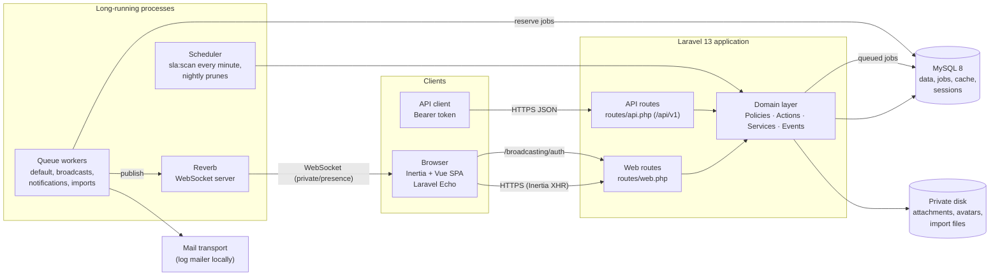
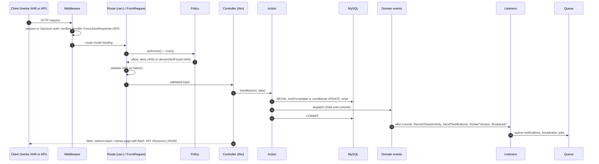
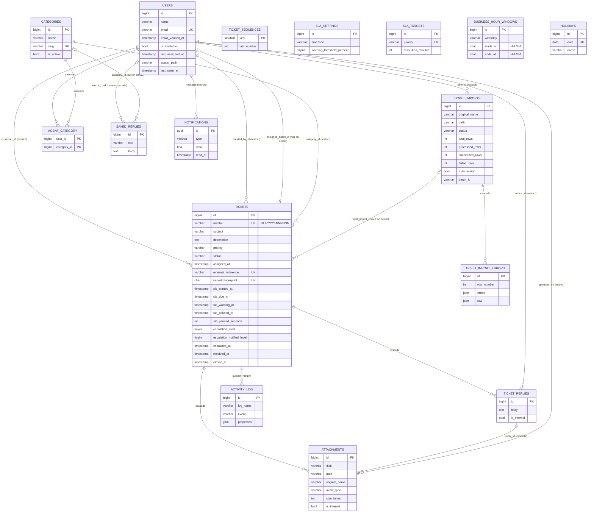
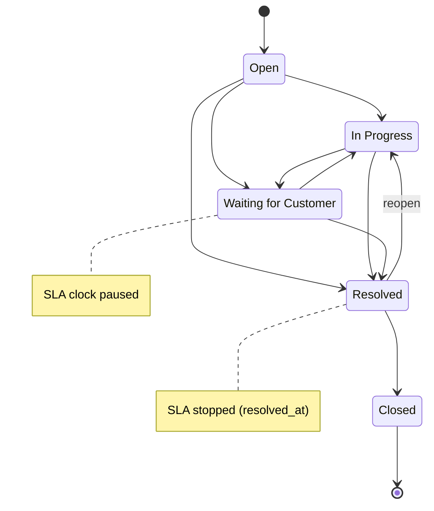
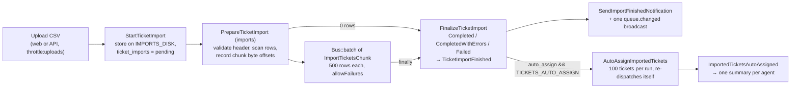

# 15 · Technical documentation

A single technical reference for an engineer joining Techzu Support, a help desk with SLA tracking: what the system is, how it is built, how a request moves through it, how each subsystem works, and how to run, test and ship it. It summarises and links to the numbered documents rather than repeating them. Go to those for depth:

- rules in plain language: [04 · Business logic](04-business-logic.md)
- the reasons behind each design choice: [11 · Technical decisions](11-technical-decisions.md) (cited below as TD-xxx)
- house rules for contributors: [CLAUDE.md](../CLAUDE.md)

Everything here was checked against the code on 2026-11-01, after the controller and route reorganisation (TD-007) and the addition of email verification (TD-006). Where this document and the code disagree, the code wins and this document should be fixed ([document authority](README.md#document-authority)).

## Contents

1. [System overview](#1-system-overview)
2. [Technology stack](#2-technology-stack)
3. [Codebase layout](#3-codebase-layout)
4. [Request lifecycle](#4-request-lifecycle)
5. [Domain model](#5-domain-model)
6. [Core subsystems](#6-core-subsystems)
   - [6.1 Authentication](#61-authentication)
   - [6.2 Authorization](#62-authorization)
   - [6.3 Ticket lifecycle](#63-ticket-lifecycle)
   - [6.4 Assignment](#64-assignment)
   - [6.5 Conversation and attachments](#65-conversation-and-attachments)
   - [6.6 SLA engine](#66-sla-engine)
   - [6.7 Escalation scan](#67-escalation-scan)
   - [6.8 Notifications](#68-notifications)
   - [6.9 Real-time](#69-real-time)
   - [6.10 Search and filters](#610-search-and-filters)
   - [6.11 Dashboard, queue counts and caching](#611-dashboard-queue-counts-and-caching)
   - [6.12 CSV import pipeline](#612-csv-import-pipeline)
   - [6.13 Activity log](#613-activity-log)
   - [6.14 Saved replies](#614-saved-replies)
   - [6.15 Profile, avatars and the agent directory](#615-profile-avatars-and-the-agent-directory)
   - [6.16 Administration](#616-administration)
7. [Background processing](#7-background-processing)
8. [Frontend architecture](#8-frontend-architecture)
9. [Configuration](#9-configuration)
10. [Data and performance](#10-data-and-performance)
11. [Security summary](#11-security-summary)
12. [Testing and quality gates](#12-testing-and-quality-gates)
13. [Local development and deployment](#13-local-development-and-deployment)
14. [Known limitations](#14-known-limitations)

---

## 1. System overview

Techzu Support is a single Laravel application that has two front ends over one domain layer:

- **Web front end.** A browser single-page app built with Inertia 3 and Vue 3. Laravel renders the first page; after that, Inertia swaps page components and props over XHR. It uses session authentication.
- **REST API.** Versioned JSON under `/api/v1`, authenticated with Sanctum personal access tokens (TD-003).

There are three roles: **customers** open tickets and talk to support; **agents** work tickets; **admins** also manage users, the permission matrix, categories, holidays, SLA rules and imports.



Key properties:

- **One domain, two front ends.** Web and API controllers share the same FormRequests, Policies and Actions (TD-001), so a rule enforced for one front end is enforced for the other.
- **MySQL holds everything by default.** It stores application data and also backs the queue, cache and sessions (`database` drivers, TD-005). Nothing needs Redis.
- **Side effects happen after commit.** Domain events implement `ShouldDispatchAfterCommit`. Notifications and broadcasts are queued after commit, so a rolled-back change sends nothing (TD-070, TD-071).
- **Realtime is optional.** If Reverb isn't configured or reachable, pages still work; they just don't update live (TD-073).

Further reading: [03 · Architecture](03-architecture.md), [02 · Product requirements](02-product-requirements.md).

---

## 2. Technology stack

Versions are the ones currently installed (`composer show --direct`, `package-lock.json`).

### Backend

| Package | Version | Role | Why (TD) |
|---|---|---|---|
| PHP | 8.3 (8.3.17 locally) | runtime | typed enums, readonly properties, `final` classes |
| `laravel/framework` | 13.39.0 | framework | TD-001, TD-002 |
| `inertiajs/inertia-laravel` | 3.5.2 | server-side Inertia adapter | TD-002: SPA feel without a separate API for the UI |
| `laravel/sanctum` | 4.3.3 | API personal access tokens | TD-003 |
| `spatie/laravel-permission` | 8.3.2 | roles and permissions, editable matrix | TD-010, TD-011 |
| `spatie/laravel-activitylog` | 4.12.3 | ticket audit trail, written from listeners | TD-026 |
| `laravel/reverb` | 1.12.0 | first-party WebSocket server | TD-073 |
| `laravel/wayfinder` | 0.1.23 | generates typed TypeScript route and action helpers | TD-002 |
| `dedoc/scramble` | 0.13.52 | OpenAPI 3.1 generated from the code | TD-033 |
| `laravel/tinker` | 3.0.2 | REPL | |
| MySQL | 8 | only supported database, also used in tests and CI | TD-004, TD-031 |

### Development and quality

| Package | Version | Role | Why (TD) |
|---|---|---|---|
| `pestphp/pest` + `pest-plugin-laravel` | 4.7.8 / 4.1.0 | test runner | TD-030 |
| `larastan/larastan` | 3.13.2 | PHPStan level 6 | TD-030 |
| `laravel/pint` | 1.32.1 | code style | TD-030 |
| `laravel/boost` | 2.10.3 | MCP tools for agent-driven development | TD-141 |
| `laravel/pail` | 1.2.7 | log tail in `composer run dev` | |
| `laravel/pao`, `nunomaduro/collision`, `mockery/mockery`, `fakerphp/faker` | | test output, CLI errors, mocks, fake data | |

### Frontend

| Package | Version | Role |
|---|---|---|
| `vue` | 3.5.44 | UI, Composition API with `<script setup lang="ts">` |
| `@inertiajs/vue3` / `@inertiajs/vite` | 3.9.1 / 3.x | client adapter and Vite plugin |
| `typescript` / `vue-tsc` | 5.9.3 / 3.x | type checking |
| `tailwindcss` (+ `@tailwindcss/vite`) | 4.3.3 | styling |
| `reka-ui`, `class-variance-authority`, `tailwind-merge`, `clsx`, `tw-animate-css` | 2.11.0, … | shadcn-vue primitives in `components/ui` |
| `@lucide/vue` | 1.x | icons |
| `vue-sonner` | 2.0.9 | toasts |
| `laravel-echo` + `pusher-js` | 2.6.3 / 8.6.0 | WebSocket client for Reverb |
| `@vueuse/core` | 12.x | composable utilities |
| `vite-plus` (`vp`), with `vite` aliased to `@voidzero-dev/vite-plus-core` | 1.4.0 | build, dev server, lint and format (`vp check`), tests (`vp test`, which bundles Vitest 5.0.5) |
| `@laravel/vite-plugin-wayfinder` | 0.1.11 | regenerates Wayfinder TS at build time |
| `happy-dom` | 21.x | DOM for frontend unit tests |

The application started from the official Laravel Vue starter kit (TD-002). Fortify was removed. Authentication is hand-written: session login, registration, password reset (TD-002) and email verification (TD-006).

---

## 3. Codebase layout

### 3.1 `app/`

| Folder | What lives there | Rules |
|---|---|---|
| `Actions/<Area>/` | **The only code that changes domain state.** One `final` class per use case with one public `handle()`. Each Action owns its `DB::transaction()` and dispatches domain events. Areas: `Admin` (users, roles, permission matrix, categories, holidays, SLA settings, agent profile), `Assignment` (`AssignTicket`, `ClaimTicket`, `AssignTicketAutomatically`), `Auth` (`RegisterCustomer`, `IssueApiToken`, `RevokeCurrentApiToken`, `SendPasswordResetLink`, `ResetUserPassword`, `VerifyEmailAddress`, `ResendEmailVerification`), `Conversation` (`AddReply`), `Imports` (`StartTicketImport`, `ImportTicketRow`), `Notifications`, `Profile`, `SavedReplies`, `Sla` (`DeliverEscalation`), `Tickets` (`CreateTicket`, `UpdateTicket`, `ChangeTicketStatus`, `ChangeTicketPriority`, `RecalculateTicketSla`) | TD-001, TD-053 |
| `Services/<Area>/` | Reusable logic that isn't a use case: calculations (`Sla/BusinessCalendar`, `Sla/SlaCalculator`, `Sla/SlaClock`), query objects (`Tickets/TicketListQuery`, `Tickets/TicketFilter`, `Conversation/ConversationQuery`, `Agents/AgentDirectory`, `Imports/TicketImportQuery`), caches and versions (`Tickets/TicketDataVersion`, `Tickets/TicketDataCache`, `Sla/SlaRulesCache`, `Agents/AgentDirectoryVersion`), repositories (`Sla/SlaSettingsRepository`, `Sla/HolidayRepository`), and helpers (`Tickets/TicketNumberGenerator`, `Tickets/TicketVisibility`, `Attachments/AttachmentStorer`, `Users/AvatarStorer`, `Notifications/Recipients`, `Auth/UserSessions`, …) | `BusinessCalendar` is pure: no facades, no `config()`, no `now()` |
| `Policies/` | `TicketPolicy`, `TicketReplyPolicy`, `AttachmentPolicy`, `SavedReplyPolicy`, `SlaSettingPolicy`, `UserPolicy`, `CategoryPolicy`, `HolidayPolicy`, `TicketImportPolicy`, `NotificationPolicy` (registered for `DatabaseNotification`), `DashboardPolicy` (gate `viewDashboard`) | single authorization entry point (TD-010) |
| `Events/` | Domain events, past tense (`TicketCreated`, `TicketAssigned`, `TicketReplied`, `TicketStatusChanged`, `TicketSlaBreached`, `SlaRulesChanged`, `TicketImportFinished`, …), all `ShouldDispatchAfterCommit` | TD-070 |
| `Events/Broadcast/` | Realtime events (`TicketChanged`, `StaffTicketChanged`, `TicketQueueChanged`, `InternalNoteAdded`, `NotificationReceived`) on the base `RealtimeBroadcast`, plus the `RealtimeChannels` helper | TD-073 |
| `Listeners/` | 16 listeners, discovered automatically from their `handle()` signatures: `RecordTicketActivity`, `Send*Notifications`, `QueueAutoAssignment`, `QueueSlaRecalculation`, `QueueImportedTicketsAutoAssignment`, `RotateTicketDataVersion`, `RotateAgentDirectoryVersion`, `BroadcastTicketChanges`, `BroadcastNotificationReceived`. All run synchronously after commit; any heavy work is passed on to a queue as a job, a notification or a broadcast | TD-070 |
| `Jobs/` | `AutoAssignTicket`, `AutoAssignImportedTickets`, `PrepareTicketImport`, `ImportTicketsChunk`, `FinalizeTicketImport`, `RecalculateActiveTicketSlas` | TD-072, TD-090 |
| `Notifications/` | `BaseNotification` (queued on `notifications`, `afterCommit`, mail + database), `TicketNotification`, and one class per message | TD-071 |
| `Enums/` | `Role`, `Permission` (with `forRole()` seeding defaults), `TicketStatus` (state machine), `TicketPriority`, `SlaState`, `EscalationLevel`, `ActivityType`, `AssignmentMethod`, `ImportStatus`, `SavedReplyScope`, `SavedReplyPlaceholder`, `TicketChangeKind` | varchar columns cast to enums (TD-020) |
| `Exceptions/Domain/` | abstract `DomainException` (`status()`, `errorCode()`) and 12 subclasses | TD-110 |
| `Http/Controllers/Web/` | non-admin web controllers (Inertia pages, attachment download and preview, avatar image, home redirect, customer lookup) | TD-007 |
| `Http/Controllers/Web/Auth/` | `LoginController`, `RegisterController`, `PasswordResetController`, `EmailVerificationController` | TD-006, TD-007 |
| `Http/Controllers/Admin/` | web admin area: users, roles, categories, holidays, SLA settings, imports | TD-007 |
| `Http/Controllers/Api/V1/` and `Api/V1/Admin/` | JSON API controllers | TD-003, TD-007 |
| `Http/Requests/<Feature>/` | FormRequests named `<Verb>Request` (e.g. `Tickets/StoreRequest`), shared by web and API | TD-001 |
| `Http/Resources/V1/` | API Resources, also used to shape Inertia props (`TicketResource`, `TicketListResource`, `TicketReplyResource`, …) | TD-003 |
| `Http/Middleware/` | `HandleInertiaRequests` (shared props), `ForceJsonResponse` (API), `TrackLastSeen` (web + API), `AuthorizeApiDocs` (Scramble docs) | |
| `Models/` | `User`, `Ticket`, `TicketReply`, `Attachment`, `Category`, `Holiday`, `TicketImport`, `TicketImportError`, `SavedReply`, `SlaSetting`, `SlaTarget`, `BusinessHourWindow` | explicit `$fillable`, no soft deletes (TD-025) |
| `Console/Commands/` | `ScanSlaCommand` (`sla:scan`), `PruneActivityLogCommand` (`activity:prune`), `PruneNotificationsCommand` (`notifications:prune`) | TD-044 |
| `Providers/` | `AppServiceProvider` (defaults, rate limiters, gates, dev processes), `SlaServiceProvider` (builds `BusinessCalendar`, `SlaCalculator`, `SlaClock` from the stored settings as request-scoped singletons) | TD-041, TD-046 |

### 3.2 `routes/`

| File | Contents |
|---|---|
| `routes/web.php` | Every web route, in nested groups: guest auth (login, register, password reset) → `auth` (logout, email verification) → the avatar image (`auth:sanctum`) → `auth` + `verified` app (dashboard, tickets, assignment, replies, attachments, notifications, profile, saved replies, agents, customer lookup) → `admin.` prefix (users, roles, categories, holidays, SLA, imports) |
| `routes/api.php` | Every `/api/v1` route inside one `api.v1.` name group: the public `POST auth/tokens`, then an `auth:sanctum` group with an `admin` prefix group inside. `bootstrap/app.php` applies the prefix (`apiPrefix: 'api/v1'`) and the `api` middleware |
| `routes/channels.php` | Broadcast channel authorization (section 6.9) |
| `routes/console.php` | The schedule (section 7.3) |

`php artisan route:list --except-vendor` currently lists 119 routes, 49 of them under `/api/v1`. Route-level authorization uses `->can(...)` wherever a policy can decide from the route alone; the rest is authorized in the FormRequest's `authorize()` or with `Gate::authorize` in the controller.

### 3.3 `resources/js/`

```
resources/js/
  app.ts                  createInertiaApp: per-page layout (auth/* → AuthLayout, else AppLayout), v-focus directive, flash toasts
  pages/<feature>/        one Vue page per Inertia route: tickets/{Index,Create,Show}, dashboard, agents/{Index,Show},
                          notifications, profile/Edit, saved-replies, admin/{users,roles,categories,holidays,imports,sla},
                          auth/{Login,Register,ForgotPassword,ResetPassword,VerifyEmail}
  components/<feature>/   tickets, chat, agents, dashboard, admin, imports, notifications, profile, saved-replies;
                          ui/ holds shadcn-vue primitives; app shell pieces at the root (AppShell, AppSidebar, AppHeader, GlobalSearch, …)
  composables/            useRealtime, usePresence, useTyping, useSlaCountdown, useChatScroll, useClientValidation, useCurrentUrl, useInitials
  layouts/                AppLayout (→ app/AppSidebarLayout), AuthLayout (→ auth/AuthSimpleLayout)
  config/navigation.ts    collects config/navigation/*.ts entries (tickets, dashboard, agents, imports, admin, …), each with a visible(props) guard
  lib/                    echo.ts (lazy Echo client), flashToast.ts, format.ts, forms.ts, validation.ts, replyMode.ts,
                          savedReplies.ts (placeholder rendering), slaWeek.ts, notificationSound.ts, utils.ts
  types/                  shared prop and resource types (tickets, auth, shared, pagination, admin, …)
  actions/, routes/, wayfinder/   generated by Wayfinder at build time (gitignored); never edit
```

Frontend unit tests live in `__tests__/` folders next to the code they test (`composables/`, `lib/`, `pages/admin/`).

### 3.4 `database/`

| Path | Contents |
|---|---|
| `migrations/` | 20 migrations: framework tables (users, cache, jobs), permission tables, Sanctum tokens, activity log, then the domain tables (section 5). During development a column on an existing table goes into that table's create migration, followed by `migrate:fresh` (TD-140) |
| `factories/` | `User` (with role states and `unverified()`), `Ticket`, `TicketReply`, `Attachment`, `Category`, `Holiday`, `SavedReply` |
| `seeders/` | `DatabaseSeeder` → `RolesAndPermissionsSeeder` (idempotent; applies `Permission::forRole()`), `SlaDefaultsSeeder` (writes config defaults only when no settings are stored), and `DemoSeeder` in `local`/`testing` only |
| `seeders/Demo/` | the demo data builder (`DemoDirector`, `DemoPlanner`, `DemoStories`, `DemoScenarios`, `DemoPeople`, `DemoFiles`, …); see [13 · Demo data](13-demo-data.md) |

### 3.5 `tests/`

| Folder | Purpose |
|---|---|
| `tests/Unit` | pure PHP, no database (calendar math, enums, CSV reader, exceptions) |
| `tests/Feature` | HTTP, Actions, Services, policies, realtime, performance, schema; MySQL with `RefreshDatabase` |
| `tests/Concurrency` | races over two real connections (`DatabaseTruncation`) |
| `tests/Database` | FULLTEXT behaviour |
| `tests/Support` | `AuthorizationMatrix`, `RouteAudit`, import helpers |
| `tests/Fixtures` | test-only classes |

---

## 4. Request lifecycle

### 4.1 Middleware

Configured in `bootstrap/app.php`:

| Group | Middleware (in order of addition) |
|---|---|
| `web` | framework defaults (cookies, with `sidebar_state` left unencrypted; session; CSRF; bindings) + `EncryptHistory` (Inertia history encryption) + `HandleInertiaRequests` + `AddLinkHeadersForPreloadedAssets` + `TrackLastSeen` |
| `api` | `ForceJsonResponse` (prepended) + framework defaults + `TrackLastSeen` + `throttleApi()` (the `api` limiter, 60/min) |
| route-level | `auth`, `verified`, `guest`, `auth:sanctum`, `signed`, `throttle:*`, `can:*` |
| broadcasting | `/broadcasting/auth` runs under `web`, `auth`, `verified` |

`redirectUsersTo` sends a signed-in user who opens a guest page to `home`. `HomeController` then sends customers to their tickets and staff to the dashboard.

### 4.2 Flow



1. **Authentication.** The web uses session login. The API uses `auth:sanctum` with a Bearer token. Every web app route also needs a verified email (`verified`).
2. **Authorization** always goes through a Policy (TD-010). It is called from route `->can()` middleware, from the FormRequest's `authorize()`, or with `Gate::authorize` (attachments). Policies return `Response::denyAsNotFound()` when the user may not see the ticket, so the response is 404 rather than 403 (TD-012).
3. **Validation** happens in a FormRequest in `Http/Requests/<Feature>/`. Web and API use the same class.
4. **Action.** The controller calls one Action, or one Service for read-only queries. The Action opens a transaction, locks what it must, writes, and dispatches events (TD-053).
5. **Events after commit.** Because events implement `ShouldDispatchAfterCommit`, listeners run only once the transaction has committed. `RecordTicketActivity` runs synchronously, so the timeline is complete when the response returns. Notifications (`afterCommit`) and broadcasts (`ShouldDispatchAfterCommit`, `ShouldRescue`) go onto queues.
6. **Response.** The web returns an Inertia page or a redirect with a flash message. The API returns a `Http/Resources/V1` resource.

### 4.3 Errors

`DomainException` subclasses carry an HTTP status and a stable `code` (TD-110). `bootstrap/app.php` renders them in one place and doesn't report them to the log:

| Request | Rendering |
|---|---|
| expects JSON (all `/api/*`, or `Accept: application/json`) | `{"message": "...", "code": "..."}` with the exception's status |
| web (Inertia) | `back()->with('error', message)`, shown as a toast |

| Exception | Status | `code` | Thrown by |
|---|---|---|---|
| `TicketAlreadyClaimed` | 409 | `ticket_already_claimed` | `ClaimTicket` |
| `InvalidStatusTransition` | 422 | `invalid_status_transition` | `ChangeTicketStatus` |
| `TicketClosed` | 422 | `ticket_closed` | `AddReply`, `AssignTicket`, `ChangeTicketPriority` |
| `AgentNotEligible` | 422 | `agent_not_eligible` | `AgentEligibility` |
| `AgentUnavailable` | 422 | `agent_unavailable` | `ClaimTicket` |
| `InternalNoteForbidden` | 403 | `internal_note_forbidden` | `AddReply` |
| `EmailUnverified` | 403 | `email_unverified` | `IssueApiToken` |
| `CannotChangeOwnRole` | 422 | `cannot_change_own_role` | `ChangeUserRole` |
| `CannotRemoveUserManagement` | 422 | `cannot_remove_user_management` | `UpdateRolePermissions` |
| `CustomerInternalNotesForbidden` | 422 | `customer_internal_notes_forbidden` | `UpdateRolePermissions` |
| `InvalidSlaSettings` | 422 | `invalid_sla_settings` | `UpdateSlaSettings` |
| `ImportHeaderInvalid` | 422 | `import_header_invalid` | `TicketCsvReader` (recorded on the import, not returned over HTTP) |

Everything else uses framework defaults: validation 422 (`errors`), policy denial 403 or 404, throttling 429, unauthenticated 401 (API) or a redirect to login (web). Jobs log in `failed()`.

---

## 5. Domain model

### 5.1 Entities and relations

Built from `database/migrations`. Framework tables (`sessions`, `cache`, `jobs`, `job_batches`, `failed_jobs`, `password_reset_tokens`, the spatie permission tables, `personal_access_tokens`) are left out of the diagram. The full schema is in [05 · Database design](05-database-design.md).



Design notes:

- **Replies and internal notes share one table** and are told apart by `is_internal` (TD-060). Attachments carry their own `is_internal` flag and a denormalised `ticket_id`, so they can be filtered without a join (TD-024).
- **SLA state is stored as two timestamps**, `sla_due_at` and `sla_warning_at`, plus pause bookkeeping. Within, Approaching, Breached, Paused and Stopped are worked out at query time (TD-023).
- **Real foreign keys with explicit delete rules, and no soft deletes** (TD-025). Users are never deleted from the UI.
- **Enums are `varchar` columns** cast to backed PHP enums (TD-020). `escalation_level` is a `tinyint` cast to the int-backed `EscalationLevel`.
- **The configuration tables** (`sla_settings`, `sla_targets`, `business_hour_windows`, `holidays`) hold the live, admin-edited SLA calendar. `config/sla.php` and `config/business_hours.php` provide only the defaults and the seed values (TD-046).

### 5.2 Ticket numbering (TD-022)

`TicketNumberGenerator::next()` produces `{prefix}-{year}-{000001}`, for example `TKT-2026-000042`:

- The prefix comes from `TICKET_NUMBER_PREFIX` (default `TKT`).
- The year is taken in the **business timezone** (for imports, the year of the row's created-at date).
- The counter lives in `ticket_sequences`, one row per year. The generator runs `INSERT … ON DUPLICATE KEY UPDATE last_number = last_number + 1` and then reads the row back with `lockForUpdate`. Both run in the caller's transaction, so two parallel creates can't get the same number, and a number from a rolled-back create is reused. `tests/Concurrency/TicketNumberConcurrencyTest.php` covers both cases.

### 5.3 Status state machine (TD-040)

The transitions come from `TicketStatus::allowedTransitions()`:



- **Active** = Open, In Progress or Waiting for Customer. **Finished** = Resolved or Closed. List scopes map to these: `active`, `resolved`, `all`.
- Only `ChangeTicketStatus` writes `status`. Its `handleLocked()` variant is reused inside other Actions' transactions:
  - claim or assignment: Open → In Progress
  - a customer reply on a Waiting or Resolved ticket: → In Progress
- Side effects of a transition:

  | Transition | Effect |
  |---|---|
  | leaving Waiting | `SlaCalculator::resume` |
  | entering Waiting | `pause` |
  | entering Resolved | sets `resolved_at` and dispatches `TicketResolved` |
  | Resolved → In Progress | `reopen` (restores the remaining budget) and clears `resolved_at` |
  | entering Closed | sets `closed_at` |

- Who may change status (`TicketPolicy::changeStatus`):
  - staff who manage the ticket: anyone with `tickets.update.any`, or the assignee with `tickets.update.assigned`
  - the customer, but only from Resolved, and only to Closed or In Progress
  - nobody, once the ticket is Closed

### 5.4 Priorities and categories

- **Priorities**: `low`, `medium`, `high`, `critical`. Each has a `rank()` used for sorting (sort expressions use bound `CASE` values) and a resolution target in business minutes. The defaults are 2880, 1440, 480 and 120, editable by admins.
- **Categories** have a `slug`, which CSV imports use to refer to them, and an `is_active` flag. A category that tickets still use can't be deleted (`restrictOnDelete`): `DeleteCategory` deactivates it instead. The `agent_category` pivot says which categories an agent handles, and drives auto-assignment eligibility.

---

## 6. Core subsystems

### 6.1 Authentication

| Concern | Implementation |
|---|---|
| Web login | `Web/Auth/LoginController` with session auth and "remember me". The session is regenerated on login. Logout invalidates the session, rotates the CSRF token and drops the encrypted history key (`EncryptHistory`). Throttled at `throttle:5,1` |
| Registration | `RegisterCustomer` creates a customer-role user and dispatches the framework `Registered` event after commit. The framework listener then sends the verification email (TD-006). Throttled at 5/min |
| Email verification | `User implements MustVerifyEmail`. Every app route group and the broadcasting handshake require `verified`. `EmailVerificationController` serves the notice page, the signed verify link (`signed`, `throttle:6,1`, 60-minute validity) and resend (6/min), through the `VerifyEmailAddress` and `ResendEmailVerification` Actions. Users created by an admin, seeded users and factory users are verified on creation. Locally, with the `log` mailer, the notice page says the link is in `storage/logs/laravel.log` (`VerificationMailNotice`) |
| Password reset | `PasswordResetController` with the `SendPasswordResetLink` and `ResetUserPassword` Actions and Laravel's password broker. Throttled at 5/min. A reset rotates the remember-me token and revokes all API tokens |
| Password rules | `PasswordLength` sets 8–72 characters outside production. In production it requires at least 12 characters with mixed case, letters, numbers and symbols, and an `uncompromised()` check (`AppServiceProvider::configureDefaults`). The 72-character cap exists because bcrypt ignores anything past 72 bytes |
| API tokens | `POST /api/v1/auth/tokens` → `IssueApiToken`. The credential check runs inside a 200 ms `Timebox`, so response timing doesn't reveal whether an email exists. Unverified users are refused only *after* a correct password (`email_unverified`). Token abilities mirror the user's permission names, but authorization still uses live permissions through the Policies. `DELETE /api/v1/auth/tokens/current` revokes the token in use. Tokens don't expire (`sanctum.expiration = null`) |
| Session hygiene | `UserSessions`:<br>- a self-service password change ends the user's other sessions, rotates remember-me and revokes the other tokens<br>- an admin setting a password ends all of the user's sessions and revokes all tokens<br>- a role change revokes all tokens (TD-121) |
| Rate limiters | defined in `AppServiceProvider`:<br>- `api`: 60/min per user, or per IP for guests<br>- `uploads`: 20/min per user<br>- `api-tokens`: 5/min per email + IP<br>Plus route-level `throttle:5,1` (guest auth forms), `throttle:6,1` (password change, verification) and `throttle:60,1` (customer lookup, saved-reply picker) |

Details: [04 · Authentication](04-business-logic.md#authentication), [06 §8–9](06-security-and-authorization.md#8-sessions-passwords-and-tokens).

### 6.2 Authorization

Authorization has two layers (TD-010, TD-011):

1. **Capabilities.** These are spatie permissions named by the `Permission` enum (`tickets.view.any`, `tickets.notes.internal`, `tickets.assign.any`, …), seeded per role from `Permission::forRole()`. Admins can edit the role × permission matrix at runtime (`UpdateRolePermissions`). Two rules guard that edit: the admin role can't lose `users.manage` (`cannot_remove_user_management`), and the customer role can't be given internal notes (`customer_internal_notes_forbidden`). Roles and permission names are fixed in code.
2. **Policies.** These combine a capability with ownership or state, and they are the only entry point. Code never calls `hasRole()` or `hasPermissionTo()` outside policies; it uses `$user->can(Permission::X->value)` inside them.

`TicketVisibility::of($user)` turns permissions into a single visibility rule that every ticket query, policy, page, channel and activity feed uses:

| Field | Meaning |
|---|---|
| `seesAllTickets` | `tickets.view.any` (agents and admins) |
| `seesOwnTickets` | `tickets.view.own` (customers), limited to `customer_id = viewer` |
| `seesInternal` | `tickets.notes.internal`. Without it, `restrictInternal()` adds `is_internal = false` and staff-only activity types (internal note, SLA approaching, escalated) are hidden |

**404 versus 403 (TD-012).** `TicketPolicy::decide()` first checks visibility and returns `denyAsNotFound()` when the user can't see the ticket. Only a visible ticket with a forbidden action returns 403. `AttachmentPolicy` applies the same rule and also returns 404 for an internal attachment to a viewer who can't see internal content. Saved replies and notifications that belong to someone else also return 404.

**Internal-note guarantees.** Internal replies and attachments never reach a customer, whatever the route: queries (`restrictInternal`), Resources (`TicketReplyResource` refuses to serialise an internal reply to a viewer without the permission), Inertia props, notifications (`InternalNoteAddedNotification` goes to the database channel only, and only to staff), the activity feed, and broadcasts (internal notes go only on the `.staff` channel). `tests/Feature/Security/InternalNoteLeakageTest.php` checks every one of these surfaces.

**Matrix test.** `tests/Feature/Authorization/AuthorizationMatrixTest.php` runs every web and API route against every role. `RouteAudit` fails the suite when a route has no row in the matrix.

Details: [06 · Security and authorization](06-security-and-authorization.md).

### 6.3 Ticket lifecycle

| Action | What it does |
|---|---|
| `CreateTicket` | 1. Stages the uploads on the private disk.<br>2. In one transaction: generates the number, sets status Open, `SlaCalculator::applyInitial()`, saves, persists the attachments.<br>3. Discards the staged files if anything throws.<br>4. Dispatches `TicketCreated`.<br>`customer_id` is taken from the request only when the actor has `tickets.create.on_behalf`; otherwise it is the actor |
| `UpdateTicket` | Edits subject, category and, for the customer while the ticket is Open, the description. A category change rotates the ticket-data version |
| `ChangeTicketStatus` | The state machine (5.3) |
| `ChangeTicketPriority` | Recalculates the deadlines from the original `sla_started_at`, crediting paused time, and lowers the escalation level if the new deadline allows it (TD-043) |
| `RecalculateTicketSla` | Re-applies the current SLA rules to one locked ticket (TD-047) |

`assigned_agent_id`, `number`, `status`, `sla_*` and `escalation_level` are never mass-assignable.

### 6.4 Assignment

Three paths lead to an assigned ticket. All three end in `TicketAssigned` and, for an Open ticket, the Open → In Progress transition inside the same transaction.

**Claim (`ClaimTicket`, TD-051).**

1. Lock the agent row and require `is_available` (`agent_unavailable` otherwise).
2. Run `UnassignedTicketAssigner::assignIfUnassigned()`: a single conditional `UPDATE tickets SET assigned_agent_id = ?, assigned_at = ? WHERE id = ? AND assigned_agent_id IS NULL AND status IN (active)`.
3. Exactly one concurrent caller sees one affected row. Every other caller gets `TicketAlreadyClaimed` (409).

A claim doesn't check the ticket's category, by design.

**Manual assign or hand-off (`AssignTicket`).**

1. Lock the ticket.
2. Check the policy again against the locked state, so a stale hand-off can't overwrite an admin's reassignment.
3. Check eligibility with `AgentEligibility`: agent role, available, and handles the category. Anyone with `tickets.assign.any` may override only the category rule, and only when the request asks for it explicitly (`assignOutsideCategory`).
4. Assigning a ticket to its current agent is a no-op.

**Automatic (`AutoAssignTicket` job → `AssignTicketAutomatically`, TD-050, TD-052).**

- **Trigger.** `QueueAutoAssignment` listens to `TicketCreated`. It is skipped for imported tickets and when `TICKETS_AUTO_ASSIGN=false`. The job is `ShouldBeUnique` per ticket, with 3 tries and back-off of 10 s, 60 s and 300 s. It re-checks that the ticket still exists, is still unassigned and is still active.
- **In one transaction**, the Action:
  1. locks the ticket row (it must still be unassigned and active)
  2. selects candidates with `AgentSelector::selectFor($ticket, lock: true)`: available agents in the ticket's category, locked in id order with `lockForUpdate` so concurrent assignments serialise
  3. orders them by
     1. fewest active tickets (`withCount`)
     2. agents never assigned first, then oldest `last_assigned_at` (round-robin among equals)
     3. lowest id
  4. assigns through the same conditional update as a claim, and backs off silently if somebody claimed the ticket in the meantime
- **No eligible agent.** The ticket stays unassigned, a log line is written, and `TicketAutoAssignmentFailed` tells the admins (except for imports).
- **Every assignment** stamps the agent's `last_assigned_at`.
- **Role changes.** When an admin moves an agent to another role, that agent's active tickets are unassigned (`TicketUnassigned`).

Races are tested over two real connections: `tests/Concurrency/ClaimTicketConcurrencyTest.php` and `AssignTicketConcurrencyTest.php` (TD-032).

### 6.5 Conversation and attachments

**Replying (`AddReply`).**

1. Refuse an internal note from anyone without `addInternalNote` (`internal_note_forbidden`).
2. Stage the files.
3. In one transaction:
   1. lock the ticket and refuse it if Closed (`ticket_closed`)
   2. save the reply and persist its attachments, with `is_internal` copied from the reply
   3. if the customer wrote a public reply on a Waiting or Resolved ticket, call `ChangeTicketStatus::handleLocked(→ InProgress)`, which resumes or reopens the SLA
   4. touch the ticket for public replies
4. If the transaction never committed, delete the staged files (the compensation path, tested in `tests/Concurrency/AddReplyCommitFailureTest.php`).
5. Dispatch `TicketReplied`.

**Reading.** `ConversationQuery` pages the conversation (default 20, maximum 100) and applies `restrictInternal`. The ticket page can load up to `TICKETS_SHOW_MAX_PAGES` (50) older pages.

**Files (TD-061).**

| Concern | Rule |
|---|---|
| Storage | `ATTACHMENTS_DISK` (default `local`, which is private, under `storage/app/private`), in the `attachments/` directory, with UUID filenames |
| Limits | at most `ATTACHMENTS_MAX_FILES` (5) files, each at most `ATTACHMENTS_MAX_KB` (10 MB) |
| Allowed types | `pdf, png, jpg, jpeg, gif, txt, csv, doc, docx, xls, xlsx, zip`. Validated with `File::types()->extensions()`, so content-sniffed MIME and extension must agree. The stored `mime_type` is the sniffed one |
| Download | `GET /attachments/{id}` (web) and `GET /api/v1/attachments/{id}` share `Web/AttachmentDownloadController`. It calls `Gate::authorize('view', $attachment)` and streams the file with `X-Content-Type-Options: nosniff` |
| Preview | `AttachmentPreviewController` serves only `preview_mime_types` (png, jpeg, gif) inline |
| Throttle | uploads (ticket create, reply, avatar, import) use the `uploads` limiter (20/min) |

Details: [04 · Conversation and attachments](04-business-logic.md#conversation-and-attachments).

### 6.6 SLA engine

There is one **resolution SLA** per ticket, measured in **business minutes**.

**Components**

| Class | Responsibility |
|---|---|
| `BusinessCalendar` (pure, TD-041) | Built from weekly windows (`weekday → [[HH:MM, HH:MM], …]`, up to 6 per day), a timezone and a list of holiday dates.<br>- `addBusinessSeconds` steps window by window<br>- `businessSecondsBetween` sums the window overlaps day by day<br>- `isBusinessTime` and `nextTransition` drive the client countdown<br>It works in the business timezone, returns UTC, and throws if no window exists within 366 days. It never calls `now()`, `config()` or a facade |
| `SlaCalculator` | Turns priority targets and the warning percentage into `SlaDeadlines` (due and warning), and owns every write to the `sla_*` columns: `applyInitial`, `recalculateForPriority`, `pause`, `resume`, `reopen`, `levelFor`, `applyCurrentLevelAsNotified` (imports) |
| `SlaClock` | Read model for the UI. It returns `remaining_seconds` (negative once breached), `running`, `changes_at` and `resumes_at`, so the browser only ticks between transitions computed on the server (TD-048, `useSlaCountdown`) |
| `SlaQuery` | SQL predicates for each `SlaState`:<br>- `Within`: running and `sla_warning_at > now`<br>- `Approaching`: running, `sla_warning_at <= now < sla_due_at`<br>- `Breached`: running and `sla_due_at <= now`<br>- `Paused`: active with `sla_paused_at` set<br>- `Stopped`: Resolved or Closed<br>"Running" means active and not paused |
| `SlaSettingsRepository`, `HolidayRepository`, `SlaRulesCache` | Load the live settings from `sla_settings`, `sla_targets`, `business_hour_windows` and `holidays`, cached forever under a version that saving rotates. If nothing is stored they fall back to config (TD-046) |
| `SlaServiceProvider` | Registers `BusinessCalendar`, `SlaCalculator` and `SlaClock` as **scoped** singletons built from the current settings, so a request or job sees one consistent rule set |

**Algorithm**

- **Create:**<br>`due = addBusinessSeconds(start, target × 60)`<br>`warning = addBusinessSeconds(start, ⌊target × warning% / 100⌋ × 60)`<br>The default warning threshold is 75 %.
- **Pause** (entering Waiting for Customer): record `sla_paused_at`.
- **Resume** (leaving Waiting): compute the business seconds that were left to due and to warning at the moment of the pause, add them to now, and add the paused business seconds to `sla_paused_seconds` (TD-042).
- **Reopen** (Resolved → In Progress): the same calculation, measured from `resolved_at`.
- **Priority change and rule recalculation:** recompute from the original `sla_started_at + target + sla_paused_seconds`, so paused time stays credited (TD-043). The escalation level is **lowered** if the new deadline allows it, which lets a later rise be announced again.
- **Time handling.** `Date::use(CarbonImmutable::class)` makes every date immutable. Everything is stored in UTC (`APP_TIMEZONE=UTC`) and calendar math runs in the business timezone (default `Asia/Dhaka`, editable). The default week is Sunday–Thursday, 09:00–18:00.
- **Rule changes (TD-047).** Saving SLA settings or a holiday affects only **new** tickets, unless the admin ticks "Recalculate active tickets". That dispatches `SlaRulesChanged(recalculate: true)`, which queues `RecalculateActiveTicketSlas`: `ShouldBeUniqueUntilProcessing`, `WithoutOverlapping`, walking active tickets by id one locked ticket at a time.

Details: [04 · SLA calculation](04-business-logic.md#sla-calculation), [14 §4–8](14-core-features-guide.md#4-sla-service-level-agreement) (worked examples).

### 6.7 Escalation scan

`sla:scan` (`ScanSlaCommand`) runs every minute with `withoutOverlapping()->onOneServer()` (TD-044). Each run has three passes:

1. **Redeliver.** Re-dispatch the event for active tickets where `escalation_notified_level < escalation_level` and `escalated_at` is older than `SLA_REDELIVERY_GRACE_SECONDS` (120 s). This catches a process that died between raising a level and delivering it.
2. **Approaching.** Running tickets past their warning time and below level 1.
3. **Breached.** Running tickets past their due time and below level 2.

Passes 2 and 3 work in `chunkById` chunks of `SLA_SCAN_CHUNK_SIZE` (500). Each chunk is one transaction (retried 3 times on deadlock):

1. `lockForUpdate` the candidate rows again
2. raise `escalation_level`, set `escalated_at`, and cap `escalation_notified_level` at `level − 1`
3. dispatch `TicketSlaApproaching` or `TicketSlaBreached` (delivered after commit)

**Delivery is idempotent.** `SendSlaNotifications` calls `DeliverEscalation`, which:

1. locks the ticket
2. returns early if this level was already announced, or if the level has since dropped
3. otherwise, in one transaction: writes the activity entry, queues the notifications, and records `escalation_notified_level`

The result is at-least-once delivery with no duplicates. Two scans in a row produce one notification.

Recipients:

| Level | Who is notified |
|---|---|
| Approaching | the assigned agent, or all admins when the ticket is unassigned |
| Breached | the assigned agent and all admins |

Customers are never notified. Imported tickets arrive with their level already marked as announced, so an import doesn't set off a burst of escalations.

### 6.8 Notifications

- **Base class.** `BaseNotification` implements `ShouldQueue` and sets `onQueue('notifications')` and `afterCommit()`. Its default channels are `mail` and `database`. `InternalNoteAddedNotification` and `TicketImportFinishedNotification` use the database channel only.
- **Payload.** The `toArray` shape is `{ticket_number, title, body, url}`. Deadlines are formatted in the business timezone.
- **Recipients** are chosen by `Services/Notifications/Recipients` inside the `Send*Notifications` listeners. Rules:
  - the actor is never notified about their own action (except a customer's confirmation for a ticket they opened)
  - nobody is notified twice for one event
  - imported tickets send no per-ticket messages; instead the importing admin gets one summary, and each agent who received auto-assigned imported tickets gets one summary (`ImportedTicketsAssignedNotification`)
- **Inbox** (`NotificationFeed`, `/notifications`, `/api/v1/notifications`):
  - paginated, with a filter for unread
  - "mark one read" and "mark all read"
  - someone else's notification returns 404 (`NotificationPolicy`)
  - `StaffOnlyNotifications` hides internal-note alerts from viewers who have since lost the internal-notes permission
  - a staff member demoted to customer has their staff notifications deleted
- **Live unread count.** `BroadcastNotificationReceived` listens to the framework's `NotificationSent` (database channel only) and broadcasts `notification.received`. The shared Inertia prop `notifications.unread_count` holds the count, and `lib/notificationSound.ts` plays a chime.
- **Retention.** `notifications:prune` deletes read notifications older than `NOTIFICATIONS_RETENTION_DAYS` (90), in chunks. Unread notifications are kept.
- **Mail locally** uses the `log` mailer, which writes to `storage/logs/laravel.log`.

Details: [04 · Notifications and inbox](04-business-logic.md#notifications-and-inbox).

### 6.9 Real-time

Built on Laravel Reverb and Laravel Echo (TD-073, TD-074).

**Identifier-only payloads.** Every broadcast extends `RealtimeBroadcast` (`ShouldBroadcast`, `ShouldDispatchAfterCommit`, `ShouldRescue`, queue `broadcasts`, 3 tries) and carries only:

```json
{ "ticket": "TKT-2026-000042", "kind": "replied", "at": "2026-11-01T09:15:00+00:00" }
```

The client never renders a payload. It reloads the relevant Inertia props over HTTP, where policies apply again, so a broadcast can't leak content. `useRealtime` runs at most one reload at a time, with one trailing reload when several messages arrive together.

**Channels** are authorized in `routes/channels.php`, behind `web`, `auth` and `verified`:

| Channel | Authorized when | Events |
|---|---|---|
| `private-tickets.{number}` | `can('view', $ticket)` | `ticket.changed` |
| `private-tickets.{number}.staff` | `can('viewInternal', $ticket)` | `ticket.internal-note`, `ticket.changed` (SLA kinds), internal-note typing whispers |
| `private-tickets.queue` | `tickets.view.any` | `ticket.changed`, `queue.changed` (import finished) |
| `private-App.Models.User.{id}` | that user | `notification.received`, plus `ticket.changed` for tickets where the user is the customer |
| `presence-presence.tickets.{number}` | `can('view', $ticket)` | member info `{id, name, avatar_url, role: customer\|staff}`; public typing whispers |

`kind` values come from `TicketChangeKind`: `created`, `updated`, `replied`, `internal_note`, `status_changed`, `priority_changed`, `assigned`, `unassigned`, `sla_approaching`, `sla_breached`, `import_finished`, `notification`.

**Presence and typing.**

- `usePresence` joins the presence channel of the ticket being viewed.
- `useTyping` sends `typing` and `typing-stopped` whispers at most once every 2 seconds, and treats a typer as gone after 4 seconds of silence. It uses the presence channel for public replies and the private staff channel for internal notes.
- Reverb accepts client events only from channel members (`REVERB_APP_ACCEPT_CLIENT_EVENTS_FROM=members`).
- `TrackLastSeen` writes `last_seen_at` at most once a minute per user (`Cache::add` guard) and feeds "Active now" and "last seen" (TD-075).

**Graceful degradation.** `lib/echo.ts` creates the Echo client lazily, and only when `VITE_REVERB_APP_KEY` is set. Without a WebSocket connection, pages work without live updates.

Details: [08 §7](08-background-processing-and-realtime.md#7-realtime-td-073).

### 6.10 Search and filters

`TicketListQuery` drives the ticket list, web and API alike, and applies `TicketFilter` (TD-080):

1. **Visibility first.** `visibleTo($viewer)` comes from `TicketVisibility`.
2. **Number lookup.** `number=…`, or a keyword that looks like a ticket number (`TKT-2026-42…` or `2026-42`), becomes a prefix `LIKE` on the unique `number` index. A bare number is given the configured prefix.
3. **Keyword.** `q` becomes a MySQL **FULLTEXT** match on `(subject, description)` in boolean mode. `FulltextSearchTerm::toBooleanMode()` strips operators and builds prefix terms from the input. Other database drivers fall back to an escaped `LIKE`.
4. **Filters.** `status[]`, `priority[]`, `category_id`, `assigned_agent_id`, `customer_id`, `unassigned`, `created_from`/`created_to` (calendar days in the business timezone), `sla_state` (through `SlaQuery`), `resolved_since`, and `response` (unresponded or awaiting reply, through `ResponseQuery`).
5. **Sort.** Only keys in the `TicketFilter::SORTS` whitelist are accepted: created, updated, `sla_due_at` and priority (by rank), each ascending or descending. `tickets.id` breaks ties.
6. **Pagination.** `per_page` defaults to 20 and is capped at 100. `ListRequest` validates every parameter with `Rule::in` against the whitelists.

Every filter has a supporting index from TD-021 (section 10). The header's global search (`GlobalSearch.vue`) uses the same endpoint. Staff (`tickets.view.any` or `tickets.create.on_behalf`) find customers with `customers/lookup` (throttled at 60/min), for example when creating a ticket on a customer's behalf.

### 6.11 Dashboard, queue counts and caching

- **Dashboard** (`DashboardStats`, staff only, `viewDashboard` gate, TD-100). It shows:
  - totals from one conditional-aggregate query
  - SLA health counts (within, approaching, breached, paused)
  - grouped breakdowns
  - a trend of `DASHBOARD_TREND_DAYS` (14) days
  - resolved counts over `DASHBOARD_RESOLVED_WINDOW_DAYS` (30) days

  It is cached under `dashboard:staff`.
- **Queue counts** (`TicketQueueCounts`). These are the tab and sidebar badges: All active, Assigned to me, Unassigned, Resolved & closed, and per category. They are cached once per visibility scope (`all`, or `customer:{id}`).
- **Invalidation (TD-102).** `TicketDataVersion` keeps one ULID in the cache. `RotateTicketDataVersion` replaces it whenever a ticket is created, assigned, unassigned, escalated or recalculated, or changes status, priority or category. `TicketDataCache` stores each value with the version it was computed under and recomputes on a mismatch. The TTLs (`DASHBOARD_CACHE_TTL_SECONDS`, `TICKETS_QUEUE_COUNTS_CACHE_TTL_SECONDS`, both 60 s) are only a backstop for counts that change purely with time.
- **Agent directory** (`AgentDirectory`, TD-103). One grouped aggregate per page, with its summary cached under `AgentDirectoryVersion`, which `RotateAgentDirectoryVersion` rotates. Backstop TTL: `AGENT_DIRECTORY_CACHE_TTL_SECONDS` (60).
- **Never cached:** individual ticket pages, lists and "My tickets".

### 6.12 CSV import pipeline

TD-090; admin only (`imports.manage`).



- **Streaming.** `TicketCsvReader` reads with `SplFileObject`, and each chunk seeks straight to its byte offset, so memory use stays flat whatever the file size. `ImportFileAccess` copies files from non-local disks to a temporary local file and deletes the copy afterwards.
- **Header.** The required columns are `subject, description, priority, category, customer_email`; the optional ones are `external_reference, status, created_at`. Matching ignores case and a BOM. A bad header fails the whole import (`import_header_invalid`).
- **Each row** runs through `ImportTicketRow` in its own transaction. Its rules are in `ImportTicketRowRules`:
  - `customer_email` must belong to an existing customer
  - `category` must be the slug of an active category
  - `created_at` is read in the business timezone and must not be in the future
- **Rejected rows** go to `ticket_import_errors` with the row number, the reasons and the raw values. The error report is paginated and can be downloaded as a CSV with formula cells neutralised.
- **Duplicates.** A unique `external_reference` catches repeated rows. Otherwise the same customer, subject and created-at time count as a duplicate, or, without a created-at, a normalised fingerprint does. The fingerprint is stored in `import_fingerprint`, which is unique, so duplicates are refused across chunks and across parallel workers. `ImportDuplicateTracker` handles the within-chunk checks.
- **Imported tickets:**
  - the number is taken from the year of `created_at`
  - the SLA starts at `created_at`
  - the escalation level is set and marked as already announced
  - Waiting tickets start paused; Resolved and Closed tickets are stopped
  - no per-ticket mail, no per-ticket broadcast and no per-ticket auto-assignment
- **Failure handling:**
  - `ImportTicketsChunk` has `$tries = 1`, because rows commit one by one and a retry would repeat them. A failed chunk writes one error row instead.
  - `PrepareTicketImport` and `FinalizeTicketImport` retry 3 times, then mark the import Failed.
- **Statuses:** `pending → processing → completed | completed_with_errors | failed`.
- **Progress** is available through the import page and `GET /api/v1/imports/{id}` and `/errors`. `GET /admin/imports/sample` serves a sample CSV (`ImportSampleCsvWriter`).

Details: [04 · CSV ticket import](04-business-logic.md#csv-ticket-import).

### 6.13 Activity log

- spatie/laravel-activitylog, log name `ticket`, written **only** by `RecordTicketActivity` through `activity('ticket')->…->event(ActivityType::X->value)` (TD-026). `Ticket` doesn't use `LogsActivity`.
- It listens to the ticket events (created or imported, updated, category changed, assigned or claimed, unassigned, status, priority, reply or internal note, SLA paused, resumed, approaching, escalated, recalculated). It runs synchronously after commit. The SLA escalation entries are written inside `DeliverEscalation` instead.
- Readers see the timeline paged (`GET /api/v1/tickets/{ticket}/activities`, or on the ticket page). Staff-only types are hidden from viewers without the internal-notes permission (`TicketVisibility::hiddenActivityEvents()`).
- Retention: `activity:prune` deletes entries older than 365 days (`activitylog.delete_records_older_than_days`), in chunks, every night.

### 6.14 Saved replies

TD-062.

- **Who.** Staff with `saved_replies.use` can create personal replies (`user_id` set). Team replies (`user_id` null) are managed by `saved_replies.manage_shared` (admins). The owner is always the actor; scope (`SavedReplyScope::Mine` or `Team`) is fixed when the reply is created. Someone else's personal reply returns 404.
- **Content.** A reply has a title (up to 120 characters), a body (up to 5000) and an optional category.
- **Placeholders.** `{customer_name}`, `{customer_first_name}`, `{ticket_number}`, `{ticket_subject}`, `{agent_name}` and `{agent_first_name}` (`SavedReplyPlaceholder`). Unknown placeholders are refused on save. They are filled in **in the browser** (`lib/savedReplies.ts`) when a reply is inserted, so nothing is sent until the agent submits.
- **Picker.** `saved-replies/picker` (throttled at 60/min) returns up to 50 matches, with the ticket's category first.

### 6.15 Profile, avatars and the agent directory

- **Profile** (`/profile`, `/api/v1/me/*`) acts only on the signed-in user, so it needs no policy (TD-121). Actions: `UpdateProfile`, `ChangePassword` (requires the current password; throttled at 6/min) and `UpdateAvatar`.
- **Avatars** (TD-063):
  - validated (jpg, png or webp; 64–4096 px; at most `AVATARS_MAX_KB`)
  - re-encoded with GD to 256 px by `AvatarStorer`
  - stored on the private `AVATARS_DISK`
  - served by `Web/AvatarController` behind `auth:sanctum`, so both a session and a token work, authorized by `UserPolicy::viewAvatar`, with a cache lifetime of 7 days
- **Agent directory** (`/agents`, `/api/v1/agents`, staff): lists agents with workload and SLA statistics, tabs and filters. The profile page shows an agent's categories and tickets. Admins set an agent's categories and availability in the user form (`CreateUser` and `UpdateUser` call `SyncAgentProfile`).

### 6.16 Administration

| Area | Actions | Notes |
|---|---|---|
| Users | `CreateUser` (verified on creation), `UpdateUser`, `ChangeUserRole` | Roles are assigned only here (`syncRoles`). An admin can't change their own role. A role change unassigns the user's active tickets and revokes their tokens. Users can't be deleted |
| Roles | `UpdateRolePermissions` | edits the permission matrix (the role × permission grid); resets spatie's permission cache |
| Categories | `Create/Update/DeleteCategory` | deleting a category that tickets still use deactivates it instead |
| Holidays | `Create/Update/DeleteHoliday` | one per date. Can trigger SLA recalculation |
| SLA | `UpdateSlaSettings` | timezone, warning percentage, per-priority targets, up to 6 windows per weekday, validated by `SlaSettingsRules`. Can trigger recalculation |
| Imports | `StartTicketImport` | section 6.12 |

---

## 7. Background processing

### 7.1 Queues

All queues use the `database` connection by default. Workers take them in the order defined once in `config/queue.php` → `worker_queues` (TD-072):

| Order | Queue | Work |
|---|---|---|
| 1 | `default` | `AutoAssignTicket`, `RecalculateActiveTicketSlas` |
| 2 | `broadcasts` | every `RealtimeBroadcast` event |
| 3 | `notifications` | every `BaseNotification` (mail and database) |
| 4 | `imports` | `PrepareTicketImport`, `ImportTicketsChunk`, `FinalizeTicketImport`, `AutoAssignImportedTickets` |

### 7.2 Retry and failure behaviour

| Job | Tries | Back-off | Uniqueness and failure |
|---|---|---|---|
| `AutoAssignTicket` | 3 | 10 s, 60 s, 300 s | `ShouldBeUnique` per ticket. `failed()` logs |
| `RecalculateActiveTicketSlas` | unlimited until 3 exceptions | 10 s, 60 s, 300 s | `ShouldBeUniqueUntilProcessing`, `WithoutOverlapping('sla-recalculation')` (released after 30 s, expires after 1 h) |
| `PrepareTicketImport` | 3 | 10 s, 60 s, 300 s | marks the import Failed after the last try |
| `ImportTicketsChunk` | 1 | none | rows commit one at a time, so a retry would duplicate work. `failed()` records an error row |
| `FinalizeTicketImport` | 3 | 10 s, 60 s, 300 s | marks Failed after the last try |
| `AutoAssignImportedTickets` | 3 | 10 s, 60 s, 300 s | 100 tickets per run. After the last failure it still sends the summary |
| Broadcast events | 3 | | `ShouldRescue`: a broadcasting failure never breaks the request |

Failed jobs go to `failed_jobs`. Locally `composer run dev` runs `queue:listen --tries=1`. With `QUEUE_CONNECTION=sync`, everything runs inline instead, which is fine for a quick look but slow.

### 7.3 Scheduler

Defined in `routes/console.php`; it needs `schedule:work` (dev) or a cron entry for `schedule:run` (production).

| When | Command | Options |
|---|---|---|
| every minute | `sla:scan` | `withoutOverlapping()`, `onOneServer()` |
| 02:00 daily | `activity:prune` | `onOneServer()` |
| 02:15 daily | `notifications:prune` | `onOneServer()` |
| 02:30 daily | `queue:prune-batches --hours=168` | `onOneServer()` |
| 02:45 daily | `queue:prune-failed --hours=168` | `onOneServer()` |

`onOneServer()` needs a cache store shared by all servers. The `database` store qualifies. Without the scheduler, nothing escalates.

Details: [08 · Background processing and realtime](08-background-processing-and-realtime.md).

---

## 8. Frontend architecture

- **Pages and layouts.** `app.ts` gives each page its layout by name: `auth/*` pages use `AuthLayout` (→ `AuthSimpleLayout`) and everything else uses `AppLayout` (→ `AppSidebarLayout`: sidebar, header with global search, theme toggle and notifications). Pages are Composition API components with `<script setup lang="ts">` and typed `defineProps<…>()`, and the prop types live in `resources/js/types/`.
- **Shared props** (`HandleInertiaRequests::share`):

  | Prop | Contents |
  |---|---|
  | `name` | app name |
  | `auth.user` | `{id, name, email, avatar_url, roles}` |
  | `auth.can` | boolean abilities: `viewDashboard`, `manageImports`, `manageUsers`, `manageCategories`, `manageHolidays`, `createOnBehalf`, `manageSla`, `viewAgents`, `useSavedReplies` |
  | `flash` | `{success, error}` |
  | `notifications.unread_count` | lazy |
  | `passwordRules` | `{min, max}` |
  | `businessTimezone` | |
  | `sidebarOpen` | |

  Each ability is computed through a Policy. The UI uses them only to show or hide controls; the server enforces every rule again.
- **Server-filtered props.** Pages receive data already filtered by the server, using the V1 Resources. A customer's ticket page never contains internal replies.
- **Typed routes (Wayfinder).** `@laravel/vite-plugin-wayfinder` (with `formVariants: true`) generates `resources/js/routes/**` (named routes) and `resources/js/actions/**` (controller actions, for example `@/actions/App/Http/Controllers/Web/TicketController`). Links and forms are type-checked. The generated files are gitignored, so run `npm run build` before `vue-tsc`.
- **Echo.** `lib/echo.ts` creates the Echo client (Reverb broadcaster, `pusher-js`) lazily. It authorises channels at `/broadcasting/auth` with the XSRF cookie or the CSRF meta token, and returns `null` when no key is configured. The composables `useRealtime`, `usePresence` and `useTyping` sit on top.
- **Toasts.** `lib/flashToast.ts` hooks the Inertia router:
  - on the initial `navigate` and on every `success` it shows `flash.success` and `flash.error` (and `warning`, `info` and `description` if present) through `vue-sonner`, with durations of 4, 5, 7 and 9 s by severity
  - on `networkError` it shows "The server could not be reached"

  Domain errors reach the user here, through `back()->with('error')`.
- **Navigation.** `config/navigation.ts` collects the entries in `config/navigation/*.ts` (`import.meta.glob`). Each entry declares `order`, `group` (`support` or `admin`), `railKey` and a `visible(props)` guard based on `auth.can`. `groupedNavigationFor()` builds the sidebar sections.
- **Client validation.** `useClientValidation` and `lib/validation.ts` catch simple mistakes before submitting: required fields, email format, password length from `passwordRules`, confirmation mismatch. The server's FormRequest stays authoritative, and its errors fill the Inertia error bag.
- **Theming.**
  - Tailwind 4 with CSS variables in `resources/css/app.css` (`@theme inline`, a `.dark` variant) and shadcn-vue primitives in `components/ui`
  - An inline script in `resources/views/app.blade.php` applies `dark` before first paint, from `localStorage.appearance` or `prefers-color-scheme`
  - The header toggle (`AppHeader.vue`) switches the theme and stores the choice
  - Font: Instrument Sans (Bunny Fonts, loaded through the Laravel Vite plugin)
- **Tooling.** `vp dev`, `vp build`, `vp check` (lint and format, with warnings treated as errors and type-aware lint) and `vp test` (Vitest with happy-dom).

---

## 9. Configuration

Domain settings live in dedicated config files with environment overrides. `env()` is called only inside `config/*.php` (TD-130). SLA rules and business hours are **database-backed and admin-edited**; their config files are only defaults and the seed (TD-046).

| File | Keys (env var, default) |
|---|---|
| `config/tickets.php` | `number_prefix` (`TICKET_NUMBER_PREFIX`, TKT) · `per_page.default`/`max` (`TICKETS_PER_PAGE` 20, `TICKETS_PER_PAGE_MAX` 100) · `dashboard.resolved_window_days` (30) · `dashboard.cache_ttl_seconds` (60) · `dashboard.trend_days` (14) · `queue_counts.cache_ttl_seconds` (60) · `agent_directory.cache_ttl_seconds` (60) · `show.max_pages` (`TICKETS_SHOW_MAX_PAGES` 50) · `auto_assign` (`TICKETS_AUTO_ASSIGN` true) |
| `config/sla.php` | `resolution_minutes` per priority (`SLA_MINUTES_LOW` 2880, `_MEDIUM` 1440, `_HIGH` 480, `_CRITICAL` 120) · `warning_threshold_percent` (75) · `scan_chunk_size` (500) · `redelivery_grace_seconds` (120) |
| `config/business_hours.php` | `timezone` (`BUSINESS_TIMEZONE`, Asia/Dhaka) · `week` (Sun–Thu 09:00–18:00; Fri and Sat closed) |
| `config/attachments.php` | `disk` (`ATTACHMENTS_DISK`, local) · `directory` · `max_kb` (10240) · `max_files` (5) · `extensions` · `preview_mime_types` |
| `config/avatars.php` | `disk` (`AVATARS_DISK`, local) · `max_kb` (`AVATARS_MAX_KB`, 2048) · extensions and MIME types · `min_dimension` 64 · `max_dimension` 4096 · `size` 256 · `cache_seconds` 604800 |
| `config/imports.php` | `disk` (`IMPORTS_DISK`, local) · `max_upload_kb` (51200) · `chunk_size` (500) |
| `config/retention.php` | `notifications_days` (90) · `failed_jobs_hours` (168) · `job_batches_hours` (168) · `prune_chunk_size` (1000) |
| `config/activitylog.php` | `delete_records_older_than_days` 365 |
| `config/auth.php` | `password_length.min` 8, `production_min` 12, `max` 72 · reset broker (60 s throttle) |
| `config/queue.php` | `worker_queues` = `default, broadcasts, notifications, imports` |
| `config/reverb.php`, `config/broadcasting.php` | `REVERB_*` server and app settings, `accept_client_events_from` (`members`), `allowed_origins` |
| `config/scramble.php` | `api_path` api/v1, `export_path` `docs/api/openapi.json`, `AuthorizeApiDocs` middleware |
| `config/sanctum.php` | `expiration` null; guard `web` |

**Key environment variables** (`.env.example` ships working local values):

| Group | Variables |
|---|---|
| App | `APP_ENV`, `APP_DEBUG`, `APP_KEY`, `APP_URL` (default `http://127.0.0.1:8000`), `APP_TIMEZONE=UTC` |
| Database | `DB_CONNECTION=mysql`, `DB_HOST`, `DB_PORT`, `DB_DATABASE=techzu`, `DB_USERNAME`, `DB_PASSWORD` |
| Drivers | `QUEUE_CONNECTION=database`, `CACHE_STORE=database`, `SESSION_DRIVER=database`, `MAIL_MAILER=log`, `BROADCAST_CONNECTION=reverb` |
| Reverb | `REVERB_APP_ID/KEY/SECRET`, `REVERB_HOST/PORT/SCHEME`, `REVERB_SERVER_HOST/PORT`, `REVERB_ALLOWED_ORIGINS`, `REVERB_APP_ACCEPT_CLIENT_EVENTS_FROM`, and `VITE_REVERB_*`, which are baked into the frontend at build time, so rebuild after changing them |
| Domain | the variables in the table above |

---

## 10. Data and performance

- **Indexes (TD-021).** Every hot query has a matching index. The `tickets` table carries:
  - `number` (unique)
  - `(status, sla_due_at)` and `(status, sla_warning_at)` for the scan and SLA filters
  - `(status, escalated_at, escalation_notified_level, escalation_level)` for redelivery
  - `(assigned_agent_id, status)` for "my queue" and agent load
  - `(status, category_id, assigned_agent_id)` for the unassigned or category queues
  - `(customer_id, created_at)` and `(customer_id, subject)` for customer lists and duplicate checks
  - `(category_id, status)`, `(priority, status)`, `(status, resolved_at)`, `created_at`, `updated_at`
  - unique `external_reference` and `import_fingerprint`
  - FULLTEXT `(subject, description)`

  Other tables:

  | Table | Indexes |
  |---|---|
  | `ticket_replies` | `(ticket_id, is_internal, created_at)` |
  | `attachments` | `(ticket_id, is_internal)`, `reply_id` |
  | `activity_log` | `(subject_type, subject_id, created_at)`, `created_at` |
  | `notifications` | `(notifiable_type, notifiable_id, created_at)`, `(read_at, created_at)` |
  | `agent_category` | `(category_id, user_id)` |
  | `users` | `is_available`, `last_seen_at`, `name` |

  `tests/Feature/Database/SchemaTest.php` checks indexes and foreign keys against `information_schema`. `tests/Feature/Performance/IndexUsageTest.php` checks query plans with `EXPLAIN`. Full list: [05 §4](05-database-design.md#4-indexes-td-021).
- **No N+1 queries.** `Model::preventLazyLoading()` is on outside production, so a lazy load throws in development and tests. Relations are eager-loaded with column lists (`category:id,name`), and counts use `withCount` / `withExists`. Query-count tests (`tests/Feature/Performance/*QueryCountTest.php`) check that lists issue a constant number of queries as rows grow.
- **Pagination everywhere.** `per_page` is at most 100. Offset pagination is used; cursor pagination is the noted fix if very deep pages ever matter.
- **Unbounded work is chunked.** The scan, recalculation, prunes and auto-assignment of imports use `chunkById` / `lazyById` or bounded batches. The import streams its file.
- **Aggregates stay in SQL.** The dashboard uses `SUM(CASE …)`, and the agent directory joins one grouped subquery.
- **Caching TTLs.** Dashboard, queue counts and agent directory are 60 s backstops behind version stamps. SLA settings and holidays are cached forever, with version rotation on save. Spatie caches permissions. The last-seen guard lasts 60 s; avatar HTTP caching lasts 7 days.
- **Locks.**

  | Where | Lock |
  |---|---|
  | claim and auto-assign | conditional `UPDATE` |
  | auto-assign candidates | `lockForUpdate` in id order |
  | status changes, replies, assignment, escalation delivery | ticket row lock |
  | numbering | the `ticket_sequences` row |

  None of these depends on Redis (TD-051, TD-052).

Details: [10 · Performance and operations](10-performance-and-operations.md).

---

## 11. Security summary

| Area | Measure |
|---|---|
| Authorization | a Policy on every route; route audit plus role × route matrix test; permissions only through the `Permission` enum |
| Data hiding | 404 for tickets, attachments, notifications and saved replies the user may not see (TD-012) |
| Internal notes | filtered in queries, Resources, props, notifications, activity and broadcasts; `TicketReplyResource` refuses to serialise an internal reply as a final guard |
| Mass assignment | explicit `$fillable`. `number`, `status`, `assigned_agent_id`, `sla_*` and `escalation_level` are never fillable. Roles are set only by admin Actions. Owner fields come from the actor |
| Injection | bindings everywhere, FULLTEXT operators stripped, sort and filter keys whitelisted, `LIKE` input escaped |
| XSS | Vue escaping; `v-html` banned (checked by `SecurityChecklistTest`); mail Markdown uses `Markdown::withSecuredEncoding()` |
| Files | private disks only, UUID names, extension and sniffed-MIME checks, size and count limits, policy-checked streaming with `nosniff`, avatars re-encoded with GD |
| Sessions and tokens | session regeneration; encrypted Inertia history; password, role and reset events end sessions and revoke tokens; timeboxed token issuance |
| Email | registration requires verification before any app route or the WebSocket handshake; tokens are refused to unverified users |
| Rate limits | `api`, `uploads`, `api-tokens`, plus per-route throttles (section 6.1) |
| Realtime | channels authorized by the same policies; identifier-only payloads; client events only from members |
| API docs | `/docs/api` is open in `local` only; elsewhere it needs `users.manage` (`AuthorizeApiDocs`) |
| Production safety | `DB::prohibitDestructiveCommands()`; strong password rules; lazy-loading protection off |
| Known gaps | no virus scanning; agents can read every customer's tickets, by design (TD-011); on S3, downloads should move to temporary URLs |

Details: [06 · Security and authorization](06-security-and-authorization.md), TD-120.

---

## 12. Testing and quality gates

- **Framework.** Pest 4 on **MySQL** (`techzu_testing`, TD-031). `phpunit.xml` forces a safe environment for every run:
  - array cache, mail and session
  - `QUEUE_CONNECTION=sync`, `BROADCAST_CONNECTION=null`
  - auto-assign off (tests turn it on when they need it)
  - `memory_limit=2G`
- **Suites:**

  | Suite | Database |
  |---|---|
  | Unit | none |
  | Feature | `RefreshDatabase` |
  | Concurrency | two real connections, `DatabaseTruncation` (TD-032) |
  | Database | FULLTEXT behaviour |
- **Size.** 128 test files and about 560 `it()`/`test()` blocks. The last recorded full gate was **1,874 Pest tests**, counting dataset rows ([09 §5](09-testing-strategy.md#5-current-totals)), plus 49 Vitest tests in 9 files.
- **Risk-ordered coverage.** SLA math, authorization matrix, internal-note leakage, concurrency, assignment, escalation idempotency, imports, notifications, query counts and `EXPLAIN`, realtime channels, files, schema, demo seeder, OpenAPI completeness. Tests must prove a business rule, an acceptance criterion, a security boundary or a real failure mode; framework behaviour isn't tested (CLAUDE.md §Testing).
- **Parallel runs.** `./vendor/bin/pest --parallel` creates `techzu_testing_test_N` databases. Parallel implementers use `techzu_testing_agent1..8`.
- **Quality gate** (run once per plan, and in CI):
  ```bash
  ./vendor/bin/pint --test
  ./vendor/bin/phpstan analyse --memory-limit=1G     # Larastan level 6
  ./vendor/bin/pest --parallel
  npm run build && npm run check && npx vue-tsc --noEmit
  npm run test:js                                     # Vitest via vp test
  ```
- **CI** (`.github/workflows/ci.yml`) runs on every push to `main` and every pull request, on Ubuntu with a MySQL 8 service, PHP 8.3 and Node 22:<br>`composer install` → Pint → Larastan → `pest --parallel` → `npm ci` → `npm run build` → Vitest → `vp check` → `vue-tsc`.

Details: [09 · Testing strategy](09-testing-strategy.md), [12 · Traceability matrix](12-traceability-matrix.md).

---

## 13. Local development and deployment

### 13.1 Local

Requirements: PHP 8.3, Composer, Node 22, and a local MySQL 8 with the databases `techzu` and `techzu_testing`. The [root README](../README.md) has the step-by-step setup.

```bash
composer run setup          # install, .env, key, migrate, npm install, build
php artisan migrate:fresh --seed   # roles, SLA defaults, demo data (local/testing only)
composer run dev            # = php artisan dev
```

`php artisan dev` starts everything at once (`php artisan dev:list` shows the processes):

| Process | Command |
|---|---|
| server | `php artisan serve` (http://127.0.0.1:8000) |
| queue | `php artisan queue:listen --queue=default,broadcasts,notifications,imports --tries=1 --timeout=0` |
| scheduler | `php artisan schedule:work` |
| reverb | `php artisan reverb:start` (port 8080) |
| logs | `php artisan pail` |
| vite | `npm run dev` |

Other useful commands:

- `php artisan sla:scan` triggers one scan by hand
- `php artisan event:list` lists listeners
- `php artisan scramble:export` regenerates `docs/api/openapi.json`
- the interactive API docs are at `/docs/api`

Demo accounts are listed in [13 · Demo data](13-demo-data.md).

### 13.2 Production

- **Environment:**
  - `APP_ENV=production`, `APP_DEBUG=false`, HTTPS (`EncryptHistory` needs a secure origin)
  - a real `MAIL_MAILER`
  - your own `REVERB_APP_*` values, with `REVERB_HOST/PORT/SCHEME` pointing at the public WebSocket address (usually 443 over https behind a proxy) and `REVERB_ALLOWED_ORIGINS` set to your domain; rebuild the frontend after changing `VITE_REVERB_*`
  - shared storage (for example S3) for `ATTACHMENTS_DISK`, `AVATARS_DISK` and `IMPORTS_DISK` when running more than one server
- **Release:**
  ```bash
  composer install --no-dev --optimize-autoloader
  npm ci && npm run build
  php artisan migrate --force
  php artisan db:seed --class=RolesAndPermissionsSeeder --force
  php artisan db:seed --class=SlaDefaultsSeeder --force
  php artisan config:cache && php artisan route:cache && php artisan event:cache
  php artisan queue:restart
  ```
- **Long-running processes** (Supervisor, systemd or the platform's equivalent):
  - `php artisan queue:work --queue=default,broadcasts,notifications,imports`, several workers; consider a separate pool for `imports`
  - cron: `* * * * * php artisan schedule:run`
  - `php artisan reverb:start` behind a TLS-terminating reverse proxy that forwards WebSocket upgrades
- **Monitoring:**
  - `failed_jobs` stays empty
  - the `jobs` table doesn't grow
  - `sla:scan` logs one summary line a minute
  - browsers can reach Reverb (presence avatars appear on the ticket page)

**Docker.** Container packaging is being added. See [README → Docker](../README.md#docker).

Details: [10 §5–6](10-performance-and-operations.md#5-deployment-notes), [08 §1](08-background-processing-and-realtime.md#1-the-processes).

---

## 14. Known limitations

From [14 §29](14-core-features-guide.md#29-summary-implemented-vs-not-implemented) and [02 §6](02-product-requirements.md#6-out-of-scope), updated for the current code. **Email verification for self-registered customers now exists (TD-006).**

| Area | Not implemented |
|---|---|
| SLA | no first-response SLA (resolution only); no per-category or per-customer SLA; no manual pause |
| Calendar | one calendar and timezone for the whole system; no recurring or half-day holidays; no date-specific hours |
| Escalation | only two levels (Approaching, Breached); no automatic reassignment or priority bump on breach; customers aren't told about breaches; detection can lag by up to one minute (the scan interval) |
| Auto-assignment | runs only at creation and after an opted-in import; no retry when no agent is available; no rebalancing when an agent becomes unavailable; ignores priority, online status and working hours; no per-agent capacity limit or skill levels |
| Assignment | no "unassign" button (release happens only on an agent's role change); claim doesn't check category |
| Lifecycle | no automatic closing of resolved tickets; agent replies don't change status |
| Agents | agents can't set their own availability (admins do) |
| Notifications | no per-user notification preferences |
| Accounts | no two-factor authentication or passkeys; users can't be deleted; roles and permission names can't be created at runtime |
| Product | no multi-tenancy, ticket merging, satisfaction surveys or knowledge base |
| Files | no virus scanning |
| Performance | offset pagination (deep pages slow down); FULLTEXT ignores words shorter than three characters (number lookup covers short IDs) |
| Packaging | Docker setup in progress (see README) |
