# Entity–Relationship Diagram

Source of truth: the migrations in `database/migrations` (spec §4, TD-020…TD-026). Solid lines are real foreign keys; dotted lines are polymorphic or framework references without a foreign key. Enum columns are `varchar` cast to PHP enums (TD-020).

```mermaid
erDiagram
    users {
        bigint id PK
        varchar name
        varchar email UK
        varchar password
        boolean is_available "default true, indexed"
        timestamp last_assigned_at "nullable"
        varchar remember_token "nullable"
        timestamp created_at
        timestamp updated_at
    }

    categories {
        bigint id PK
        varchar name
        varchar slug UK
        boolean is_active "default true"
        timestamp created_at
        timestamp updated_at
    }

    agent_category {
        bigint user_id PK, FK "cascade"
        bigint category_id PK, FK "cascade; index (category_id, user_id)"
    }

    tickets {
        bigint id PK
        varchar number UK "PREFIX-YYYY-NNNNNN, prefix from config"
        varchar subject
        text description
        varchar priority "TicketPriority"
        varchar status "TicketStatus"
        bigint category_id FK "restrict"
        bigint customer_id FK "restrict"
        bigint created_by_id FK "restrict"
        bigint assigned_agent_id FK "nullable, set null"
        timestamp assigned_at "nullable"
        varchar external_reference UK "nullable, CSV de-dup"
        timestamp sla_started_at
        timestamp sla_due_at
        timestamp sla_warning_at
        timestamp sla_paused_at "nullable"
        tinyint escalation_level "unsigned, EscalationLevel, default 0"
        timestamp escalated_at "nullable"
        timestamp resolved_at "nullable"
        timestamp closed_at "nullable"
        timestamp created_at
        timestamp updated_at
    }

    ticket_sequences {
        smallint year PK "unsigned"
        int last_number "unsigned, default 0"
        timestamp created_at
        timestamp updated_at
    }

    ticket_replies {
        bigint id PK
        bigint ticket_id FK "cascade"
        bigint author_id FK "restrict"
        text body
        boolean is_internal "default false"
        timestamp created_at
        timestamp updated_at
    }

    attachments {
        bigint id PK
        bigint ticket_id FK "cascade"
        bigint reply_id FK "nullable, cascade"
        bigint uploaded_by FK "restrict"
        varchar disk
        varchar path "attachments/{ticket_id}/{uuid}.{ext}"
        varchar original_name
        varchar mime_type
        int size_bytes "unsigned"
        boolean is_internal "default false, copied from the reply"
        timestamp created_at
    }

    holidays {
        bigint id PK
        date date UK
        varchar name
        timestamp created_at
        timestamp updated_at
    }

    ticket_imports {
        bigint id PK
        bigint user_id FK "restrict"
        varchar original_name
        varchar path
        varchar status "ImportStatus, default pending"
        int total_rows "unsigned, default 0"
        int processed_rows "unsigned, default 0"
        int succeeded_rows "unsigned, default 0"
        int failed_rows "unsigned, default 0"
        varchar batch_id "nullable"
        timestamp started_at "nullable"
        timestamp finished_at "nullable"
        timestamp created_at
        timestamp updated_at
    }

    ticket_import_errors {
        bigint id PK
        bigint ticket_import_id FK "cascade"
        int row_number "unsigned"
        json errors
        json raw
        timestamp created_at
    }

    activity_log {
        bigint id PK
        varchar log_name "nullable, indexed; ticket"
        text description
        varchar subject_type "nullable morph"
        bigint subject_id "nullable morph"
        varchar event "nullable, ActivityType"
        varchar causer_type "nullable morph"
        bigint causer_id "nullable morph"
        json properties "nullable"
        uuid batch_uuid "nullable, char 36"
        timestamp created_at
        timestamp updated_at
    }

    roles {
        bigint id PK
        varchar name "Role enum value; unique (name, guard_name)"
        varchar guard_name
        timestamp created_at
        timestamp updated_at
    }

    permissions {
        bigint id PK
        varchar name "Permission enum value; unique (name, guard_name)"
        varchar guard_name
        timestamp created_at
        timestamp updated_at
    }

    model_has_roles {
        bigint role_id PK, FK "cascade"
        varchar model_type PK
        bigint model_id PK "index (model_id, model_type)"
    }

    model_has_permissions {
        bigint permission_id PK, FK "cascade"
        varchar model_type PK
        bigint model_id PK "index (model_id, model_type)"
    }

    role_has_permissions {
        bigint permission_id PK, FK "cascade"
        bigint role_id PK, FK "cascade"
    }

    personal_access_tokens {
        bigint id PK
        varchar tokenable_type "morph; index (tokenable_type, tokenable_id)"
        bigint tokenable_id "morph"
        text name
        varchar token UK
        text abilities "nullable, permission names"
        timestamp last_used_at "nullable"
        timestamp expires_at "nullable, indexed"
        timestamp created_at
        timestamp updated_at
    }

    notifications {
        uuid id PK "char 36"
        varchar type
        varchar notifiable_type "morph"
        bigint notifiable_id "morph"
        text data
        timestamp read_at "nullable"
        timestamp created_at
        timestamp updated_at
    }

    sessions {
        varchar id PK
        bigint user_id "nullable, indexed"
        varchar ip_address "nullable"
        text user_agent "nullable"
        longtext payload
        int last_activity "indexed"
    }

    cache {
        varchar key PK
        mediumtext value
        bigint expiration "indexed"
    }

    cache_locks {
        varchar key PK
        varchar owner
        bigint expiration "indexed"
    }

    jobs {
        bigint id PK
        varchar queue "indexed"
        longtext payload
        smallint attempts "unsigned"
        int reserved_at "unsigned, nullable"
        int available_at "unsigned"
        int created_at "unsigned"
    }

    job_batches {
        varchar id PK
        varchar name
        int total_jobs
        int pending_jobs
        int failed_jobs
        longtext failed_job_ids
        mediumtext options "nullable"
        int cancelled_at "nullable"
        int created_at
        int finished_at "nullable"
    }

    failed_jobs {
        bigint id PK
        varchar uuid UK
        varchar connection "index (connection, queue, failed_at)"
        varchar queue
        longtext payload
        longtext exception
        timestamp failed_at
    }

    migrations {
        int id PK
        varchar migration
        int batch
    }

    users ||--o{ tickets : "customer_id"
    users ||--o{ tickets : "created_by_id"
    users |o--o{ tickets : "assigned_agent_id"
    categories ||--o{ tickets : "category_id"
    users ||--o{ agent_category : "user_id"
    categories ||--o{ agent_category : "category_id"
    tickets ||--o{ ticket_replies : "ticket_id"
    users ||--o{ ticket_replies : "author_id"
    tickets ||--o{ attachments : "ticket_id"
    ticket_replies |o--o{ attachments : "reply_id"
    users ||--o{ attachments : "uploaded_by"
    users ||--o{ ticket_imports : "user_id"
    ticket_imports ||--o{ ticket_import_errors : "ticket_import_id"
    roles ||--o{ model_has_roles : "role_id"
    permissions ||--o{ model_has_permissions : "permission_id"
    roles ||--o{ role_has_permissions : "role_id"
    permissions ||--o{ role_has_permissions : "permission_id"
    users ||..o{ model_has_roles : "model (morph)"
    users ||..o{ model_has_permissions : "model (morph)"
    tickets ||..o{ activity_log : "subject (morph)"
    users |o..o{ activity_log : "causer (morph, null = system)"
    users ||..o{ personal_access_tokens : "tokenable (morph)"
    users ||..o{ notifications : "notifiable (morph)"
    users |o..o{ sessions : "user_id (no FK)"
```

The spatie permission tables (`roles`, `permissions`, `model_has_roles`, `model_has_permissions`, `role_has_permissions`) come from the `2026_10_29_000100_create_permission_tables` migration, and all of their foreign keys cascade on delete. `ticket_sequences` and `holidays` are standalone: the year and the date are their natural keys. `cache`, `cache_locks`, `jobs`, `job_batches`, `failed_jobs` and `migrations` are framework infrastructure.

## Indexes (TD-021)

| Table | Index | Serves |
|---|---|---|
| tickets | `number` unique | lookup by ticket ID, route binding |
| tickets | `(status, sla_due_at)` | breach scan, "breached" filter, dashboard breached count |
| tickets | `(status, sla_warning_at)` | approaching scan and filter |
| tickets | `(assigned_agent_id, status)` | "my tickets", agent workload, by-agent dashboard |
| tickets | `(customer_id, created_at)` | a customer's own ticket list |
| tickets | `(category_id, status)` | category filter, candidate workload |
| tickets | `(priority, status)` | priority filter, critical count, by-priority dashboard |
| tickets | `(created_at)` | date-range filter, default sort |
| tickets | `(status, resolved_at)` | dashboard "resolved in the last 30 days" count |
| tickets | `(updated_at)` | ticket list sort by last update |
| users | `(name)` | admin user list: sort by name and name prefix search |
| tickets | FULLTEXT `(subject, description)` | keyword search |
| tickets | `external_reference` unique | CSV de-duplication |
| ticket_replies | `(ticket_id, is_internal, created_at)` | conversation timeline without internal notes |
| attachments | `(ticket_id, is_internal)`, `(reply_id)` | attachment lists with visibility |
| activity_log | `(subject_type, subject_id, created_at)` | ticket activity timeline (added on top of the package) |
| users | `(is_available)` + `model_has_roles(role_id, model_id, model_type)` | eligible agents |
| agent_category | `(category_id, user_id)` | agents per category |
| notifications | `(notifiable_type, notifiable_id, read_at)` | unread count |
| ticket_imports | `(user_id, created_at)` | an admin's imports |
| ticket_import_errors | `(ticket_import_id, row_number)` | paginated error report |

`tests/Feature/Database/SchemaTest.php` asserts every index and foreign-key delete rule above against `information_schema`.
