# T01 — Schema, enums, models, factories, seeders

**Objective:** Create every table from spec §4 with the TD-021 indexes, the full set of domain enums and domain exceptions, the Eloquent models, factories and seeders from README §3.1–§3.3, the shared Pest bootstrap, the two summary API resources and `docs/ERD.md`, so that wave-2 tasks can build on a stable schema.

- **Depends on:** T00, T00a
- **Wave:** 1
- **TDs implemented:**
  - TD-010 / TD-011: `Role` and `Permission` enums, `Permission::forRole`, `RolesAndPermissionsSeeder`
  - TD-020: enums as varchar + casts
  - TD-021: indexes
  - TD-022: `ticket_sequences` table
  - TD-023: `sla_due_at` / `sla_warning_at` columns, `Ticket::slaState()`
  - TD-024: denormalized `attachments.ticket_id` + `is_internal`
  - TD-025: foreign keys with explicit delete rules, no soft deletes
  - TD-026: activitylog tables + extra index, `Ticket::activities()`, `ActivityType`
  - TD-031: MySQL test bootstrap
  - TD-032: `tests/Concurrency` with `DatabaseTruncation`, `concurrentConnection()`
  - TD-040: `TicketStatus::allowedTransitions()`
  - TD-060: `ticket_replies.is_internal`, `TicketReply::visibleTo`
  - TD-110: the five domain exception subclasses

---

## Files

**Create**
- `config/activitylog.php` (published)
- `database/migrations/2026_10_30_000100_create_activity_log_table.php` (published, renamed)
- `database/migrations/2026_10_30_000101_add_event_column_to_activity_log_table.php` (published, renamed)
- `database/migrations/2026_10_30_000102_add_batch_uuid_column_to_activity_log_table.php` (published, renamed)
- `database/migrations/2026_10_30_000110_add_subject_created_at_index_to_activity_log_table.php`
- `database/migrations/2026_10_30_000200_add_assignment_columns_to_users_table.php`
- `database/migrations/2026_10_30_000300_create_categories_table.php`
- `database/migrations/2026_10_30_000310_create_agent_category_table.php`
- `database/migrations/2026_10_30_000400_create_tickets_table.php`
- `database/migrations/2026_10_30_000410_create_ticket_sequences_table.php`
- `database/migrations/2026_10_30_000500_create_ticket_replies_table.php`
- `database/migrations/2026_10_30_000510_create_attachments_table.php`
- `database/migrations/2026_10_30_000600_create_holidays_table.php`
- `database/migrations/2026_10_30_000700_create_ticket_imports_table.php`
- `database/migrations/2026_10_30_000710_create_ticket_import_errors_table.php`
- `database/migrations/2026_10_30_000800_create_notifications_table.php`
- `app/Enums/{Role,Permission,TicketStatus,TicketPriority,SlaState,EscalationLevel,AssignmentMethod,ActivityType,ImportStatus}.php`
- `app/Exceptions/Domain/{InvalidStatusTransition,TicketAlreadyClaimed,AgentNotEligible,TicketClosed,ImportHeaderInvalid}.php`
- `app/Models/{Category,Ticket,TicketReply,Attachment,Holiday,TicketImport,TicketImportError}.php`
- `database/factories/{Category,Ticket,TicketReply,Attachment,Holiday}Factory.php`
- `database/seeders/RolesAndPermissionsSeeder.php`, `database/seeders/DemoSeeder.php`
- `app/Http/Resources/V1/UserSummaryResource.php`, `app/Http/Resources/V1/CategoryResource.php`
- `docs/ERD.md`

**Modify**
- `app/Models/User.php` (T00a version → full domain model)
- `database/factories/UserFactory.php`
- `app/Actions/Auth/RegisterCustomer.php` (T00a; T01 adds only the customer role assignment)
- `database/seeders/DatabaseSeeder.php`
- `tests/Pest.php`

**Test**
- `tests/Unit/Enums/TicketStatusTest.php`
- `tests/Unit/Enums/PermissionTest.php`
- `tests/Unit/Enums/ActivityTypeTest.php`
- `tests/Unit/Enums/EnumValuesTest.php`
- `tests/Unit/Exceptions/DomainExceptionsTest.php`
- `tests/Feature/Database/SchemaTest.php`
- `tests/Feature/Database/RolesAndPermissionsSeederTest.php`
- `tests/Feature/Database/DemoSeederTest.php`
- `tests/Feature/Models/UserTest.php`
- `tests/Feature/Models/TicketTest.php`
- `tests/Feature/Models/TicketReplyTest.php`
- `tests/Feature/Models/SupportingModelsTest.php`
- `tests/Feature/Http/Resources/V1/SummaryResourcesTest.php`
- `tests/Feature/Auth/RegisterCustomerTest.php`

**Must not touch**
- every T00/T00a migration (`0001_01_01_*`, starter-kit migrations, `2026_10_29_*`), `bootstrap/**`, `routes/**`, `app/Providers/**`, `app/Http/Middleware/**`
- `config/tickets.php`, `config/sla.php`, `config/business_hours.php`, `config/attachments.php` (owned by T02, T03 and T05)
- `app/Exceptions/Domain/DomainException.php` (T00)

---

## Interfaces

**Consumes (T00)**
- `App\Exceptions\Domain\DomainException` (abstract `status()`, `errorCode()`).
- spatie/permission tables and `config/permission.php` (published in T00), and `HasRoles` + `HasApiTokens` on `User`.
- T00a's simple session auth: `User` without any Fortify contract or trait, a `users` table without `email_verified_at` or two-factor columns, no `passkeys` or `password_reset_tokens` tables, and `App\Actions\Auth\RegisterCustomer` (`final`, `handle(string $name, string $email, string $password): User`), which assigns no role yet.
- The `Concurrency` PHPUnit suite directory (`tests/Concurrency`).
- MySQL `techzu_testing`.

**Produces**: exactly README §3.1, §3.2 (subclasses), §3.3 and §3.12 (T01 rows):

The enums live in `app/Enums` (full implementations below) and the exceptions in `app/Exceptions/Domain`. HTTP statuses: `InvalidStatusTransition` 422, `TicketAlreadyClaimed` 409, and `AgentNotEligible`, `TicketClosed` and `ImportHeaderInvalid` 422.

```php
enum Role: string                { Admin, Agent, Customer; label() }
enum Permission: string          { 17 cases; static forRole(Role): list<self> }
enum TicketStatus: string        { label(), allowedTransitions(), canTransitionTo(), isActive(), static active(), static finished() }
enum TicketPriority: string      { label(), rank() }
enum SlaState: string            { label() }
enum EscalationLevel: int        { None = 0, Approaching = 1, Breached = 2 }
enum AssignmentMethod: string    { Manual, Claimed, Automatic }
enum ActivityType: string        { 15 cases; describe(array $properties): string; isStaffOnly(): bool }
enum ImportStatus: string        { Pending, Processing, Completed, CompletedWithErrors, Failed }

final class InvalidStatusTransition extends DomainException { static between(TicketStatus $from, TicketStatus $to): self }
final class TicketAlreadyClaimed extends DomainException    { static for(string $ticketNumber): self }
final class AgentNotEligible extends DomainException        { __construct(string $message = default) }
final class TicketClosed extends DomainException            { __construct(string $message = default) }
final class ImportHeaderInvalid extends DomainException     { __construct(string $message = default) }
```

- **Models** (§3.3): `User`, `Category`, `Ticket`, `TicketReply`, `Attachment`, `Holiday`, `TicketImport`, `TicketImportError`. Each has exactly the relations, scopes, helpers, `$fillable` and casts listed in §3.3. One addition: `Ticket::activitiesVisibleTo(User $user): MorphMany` (spec §15, TD-026; see Contract notes).
- **Factories** (§3.3):
  - `UserFactory`: `admin()`, `agent(array $categoryIds = [])`, `customer()`, `unavailable()`.
  - `CategoryFactory`.
  - `TicketFactory`: `assignedTo(User)`, `status(TicketStatus)`, `priority(TicketPriority)`, `breached()`, `approaching()`, `paused()`.
  - `TicketReplyFactory`: `internal()`.
  - `AttachmentFactory`, `HolidayFactory`.
- **Registration:** `RegisterCustomer::handle()` assigns `Role::Customer` to the user it creates.
- **Seeders:** `RolesAndPermissionsSeeder` (idempotent, an exact sync to `Permission::forRole`), `DemoSeeder` (credentials in §3.3), and `DatabaseSeeder` calling both.
- **Test bootstrap** `tests/Pest.php`:
  - `Feature` uses `RefreshDatabase`; `Concurrency` uses `DatabaseTruncation`. Both get a `beforeEach` that seeds `RolesAndPermissionsSeeder` and calls `app(PermissionRegistrar::class)->forgetCachedPermissions()`. `Concurrency` also truncates in `afterEach`, because its committed rows would otherwise leak into the next `RefreshDatabase` test in the same process.
  - `Unit` uses plain PHPUnit (no app, no DB).
  - Global helper `concurrentConnection(): Illuminate\Database\Connection` (TD-032) returns a second session `mysql_concurrent` on the same database as the default connection. That holds under `--parallel` too.
- **Resources** (§3.12): `UserSummaryResource` → `{id, name}`; `CategoryResource` → `{id, name, slug, is_active}`.
- **`ActivityType::describe()` property conventions** (T05's `RecordTicketActivity` must write these keys):

  | Type | `properties` keys | Line produced |
  |---|---|---|
  | `created` | — | `Ticket created` |
  | `updated` | `fields: list<string>` | `Ticket updated (subject, description)` |
  | `assigned` | `from: {id,name}\|null`, `to: {id,name}` | `Assigned to Bo` / `Reassigned from Al to Bo` |
  | `claimed` | `to: {id,name}` | `Claimed by Bo` |
  | `unassigned` | `from: {id,name}` | `Unassigned from Al` |
  | `status_changed` | `from`, `to`: TicketStatus values | `Status changed from In Progress to Resolved` |
  | `priority_changed` | `from`, `to`: TicketPriority values | `Priority changed from Medium to High` |
  | `category_changed` | `from`, `to`: `{id,name}` | `Category changed from Billing to Technical Support` |
  | `replied` | `author_is_staff: bool` | `Agent replied` / `Customer replied` |
  | `internal_note` | — | `Internal note added` (staff only) |
  | `sla_paused` / `sla_resumed` | — | `SLA paused while waiting for the customer` / `SLA resumed` |
  | `sla_approaching` | — | `SLA breach approaching` |
  | `escalated` | — | `Ticket escalated: SLA breached` |
  | `imported` | `row: int` (optional) | `Ticket imported from CSV (row 12)` |

---

## Subtasks & mini-waves

| Subtask | Files | Depends on | Parallel-safe with |
|---|---|---|---|
| 1.1 Enums + domain exceptions | `app/Enums/*`, `app/Exceptions/Domain/{5 subclasses}`, `tests/Unit/**` | T00 | 1.2 |
| 1.2 Migrations (incl. activitylog publish + index) | `config/activitylog.php`, `database/migrations/2026_10_30_*`, `tests/Feature/Database/SchemaTest.php` | T00 | 1.1 |
| 1.3 Roles/permissions seeder + Pest bootstrap | `database/seeders/RolesAndPermissionsSeeder.php`, `tests/Pest.php`, `tests/Feature/Database/RolesAndPermissionsSeederTest.php` | 1.1 | 1.2 |
| 1.4 Models, factories, resources | `app/Models/*`, `database/factories/*`, `app/Http/Resources/V1/{UserSummary,Category}Resource.php`, `tests/Feature/Models/*`, `tests/Feature/Http/Resources/V1/SummaryResourcesTest.php` | 1.1, 1.2, 1.3 | — |
| 1.5 Demo + database seeders | `database/seeders/DemoSeeder.php`, `database/seeders/DatabaseSeeder.php`, `tests/Feature/Database/DemoSeederTest.php` | 1.4 | 1.6 |
| 1.6 ERD | `docs/ERD.md` | 1.2 | 1.5 |
| 1.7 Customer role on registration | `app/Actions/Auth/RegisterCustomer.php`, `tests/Feature/Auth/RegisterCustomerTest.php` | 1.3 | 1.4 |

Mini-waves:
- **A** = 1.1 ∥ 1.2
- **B** = 1.3, which starts once 1.1 is committed and may overlap 1.2
- **C** = 1.4 ∥ 1.7
- **D** = 1.5 ∥ 1.6

Each parallel implementer runs only its own test files before committing. The full gate runs after each wave.

---
## Subtask 1.1 — Enums + domain exceptions

Unit tests in `tests/Unit` use plain PHPUnit through Pest. They never boot Laravel or touch the database.

- [ ] **Step 1: Write `tests/Unit/Enums/TicketStatusTest.php`**

The TD-040 table is written independently of the enum so the test catches an edit to either one.

```php
<?php

declare(strict_types=1);

use App\Enums\TicketStatus;

dataset('every status pair', function (): iterable {
    $allowed = [
        TicketStatus::Open->value => [TicketStatus::InProgress, TicketStatus::WaitingForCustomer, TicketStatus::Resolved],
        TicketStatus::InProgress->value => [TicketStatus::WaitingForCustomer, TicketStatus::Resolved],
        TicketStatus::WaitingForCustomer->value => [TicketStatus::InProgress, TicketStatus::Resolved],
        TicketStatus::Resolved->value => [TicketStatus::Closed, TicketStatus::InProgress],
        TicketStatus::Closed->value => [],
    ];

    foreach (TicketStatus::cases() as $from) {
        foreach (TicketStatus::cases() as $to) {
            yield "{$from->value} → {$to->value}" => [$from, $to, in_array($to, $allowed[$from->value], true)];
        }
    }
});

it('allows exactly the TD-040 transitions', function (TicketStatus $from, TicketStatus $to, bool $allowed): void {
    expect($from->canTransitionTo($to))->toBe($allowed)
        ->and(in_array($to, $from->allowedTransitions(), true))->toBe($allowed);
})->with('every status pair');

it('treats Closed as terminal', function (): void {
    expect(TicketStatus::Closed->allowedTransitions())->toBe([]);
});

it('splits statuses into active and finished', function (): void {
    expect(TicketStatus::active())->toBe([TicketStatus::Open, TicketStatus::InProgress, TicketStatus::WaitingForCustomer])
        ->and(TicketStatus::finished())->toBe([TicketStatus::Resolved, TicketStatus::Closed]);
});

it('reports whether a status is active', function (TicketStatus $status, bool $active): void {
    expect($status->isActive())->toBe($active);
})->with([
    'open' => [TicketStatus::Open, true],
    'in progress' => [TicketStatus::InProgress, true],
    'waiting for customer' => [TicketStatus::WaitingForCustomer, true],
    'resolved' => [TicketStatus::Resolved, false],
    'closed' => [TicketStatus::Closed, false],
]);
```

- [ ] **Step 2: Write `tests/Unit/Enums/PermissionTest.php`**

```php
<?php

declare(strict_types=1);

use App\Enums\Permission;
use App\Enums\Role;

/** @param list<Permission> $permissions @return list<string> */
function permissionValues(array $permissions): array
{
    $values = array_map(fn (Permission $permission): string => $permission->value, $permissions);
    sort($values);

    return $values;
}

it('grants each role exactly its TD-011 baseline', function (Role $role, array $expected): void {
    expect(permissionValues(Permission::forRole($role)))->toBe(permissionValues($expected));
})->with([
    'customer: create as self, view/reply/update own' => [Role::Customer, [
        Permission::TicketsCreate,
        Permission::TicketsViewOwn,
        Permission::TicketsReply,
        Permission::TicketsUpdateOwn,
    ]],
    'agent: whole queue, internal notes, claim, assigned-only changes, hand-off, dashboard' => [Role::Agent, [
        Permission::TicketsCreate,
        Permission::TicketsCreateOnBehalf,
        Permission::TicketsViewAny,
        Permission::TicketsReply,
        Permission::TicketsNotesInternal,
        Permission::TicketsClaim,
        Permission::TicketsUpdateAssigned,
        Permission::TicketsHandoffOwn,
        Permission::DashboardView,
    ]],
    'admin: every unscoped capability plus all admin areas' => [Role::Admin, [
        Permission::TicketsCreate,
        Permission::TicketsCreateOnBehalf,
        Permission::TicketsViewAny,
        Permission::TicketsReply,
        Permission::TicketsNotesInternal,
        Permission::TicketsClaim,
        Permission::TicketsUpdateAny,
        Permission::TicketsAssignAny,
        Permission::DashboardView,
        Permission::ImportsManage,
        Permission::UsersManage,
        Permission::CategoriesManage,
        Permission::HolidaysManage,
    ]],
]);

it('assigns every permission to at least one role, with no duplicates', function (): void {
    $granted = [];

    foreach (Role::cases() as $role) {
        $values = permissionValues(Permission::forRole($role));
        expect($values)->toBe(array_values(array_unique($values)));
        $granted = [...$granted, ...$values];
    }

    expect(array_values(array_unique($granted)))->toEqualCanonicalizing(permissionValues(Permission::cases()));
});
```

- [ ] **Step 3: Write `tests/Unit/Enums/ActivityTypeTest.php`**

```php
<?php

declare(strict_types=1);

use App\Enums\ActivityType;

it('describes activities as timeline lines', function (ActivityType $type, array $properties, string $line): void {
    expect($type->describe($properties))->toBe($line);
})->with([
    'created' => [ActivityType::Created, [], 'Ticket created'],
    'updated with fields' => [ActivityType::Updated, ['fields' => ['subject', 'description']], 'Ticket updated (subject, description)'],
    'updated without fields' => [ActivityType::Updated, [], 'Ticket updated'],
    'first assignment' => [ActivityType::Assigned, ['from' => null, 'to' => ['id' => 2, 'name' => 'Agent B']], 'Assigned to Agent B'],
    'reassignment' => [ActivityType::Assigned, ['from' => ['id' => 1, 'name' => 'Agent A'], 'to' => ['id' => 2, 'name' => 'Agent B']], 'Reassigned from Agent A to Agent B'],
    'claimed' => [ActivityType::Claimed, ['from' => null, 'to' => ['id' => 2, 'name' => 'Agent B']], 'Claimed by Agent B'],
    'unassigned' => [ActivityType::Unassigned, ['from' => ['id' => 1, 'name' => 'Agent A'], 'to' => null], 'Unassigned from Agent A'],
    'status changed' => [ActivityType::StatusChanged, ['from' => 'in_progress', 'to' => 'resolved'], 'Status changed from In Progress to Resolved'],
    'priority changed' => [ActivityType::PriorityChanged, ['from' => 'medium', 'to' => 'high'], 'Priority changed from Medium to High'],
    'category changed' => [ActivityType::CategoryChanged, ['from' => ['id' => 1, 'name' => 'Billing'], 'to' => ['id' => 2, 'name' => 'Technical Support']], 'Category changed from Billing to Technical Support'],
    'agent replied' => [ActivityType::Replied, ['author_is_staff' => true], 'Agent replied'],
    'customer replied' => [ActivityType::Replied, ['author_is_staff' => false], 'Customer replied'],
    'internal note' => [ActivityType::InternalNote, [], 'Internal note added'],
    'sla paused' => [ActivityType::SlaPaused, [], 'SLA paused while waiting for the customer'],
    'sla resumed' => [ActivityType::SlaResumed, [], 'SLA resumed'],
    'sla approaching' => [ActivityType::SlaApproaching, [], 'SLA breach approaching'],
    'escalated' => [ActivityType::Escalated, [], 'Ticket escalated: SLA breached'],
    'imported with row' => [ActivityType::Imported, ['row' => 12], 'Ticket imported from CSV (row 12)'],
    'imported without row' => [ActivityType::Imported, [], 'Ticket imported from CSV'],
]);

it('degrades gracefully when properties are missing or unknown', function (): void {
    expect(ActivityType::Assigned->describe([]))->toBe('Assigned to nobody')
        ->and(ActivityType::StatusChanged->describe(['from' => 'archived', 'to' => 'open']))->toBe('Status changed from archived to Open')
        ->and(ActivityType::PriorityChanged->describe([]))->toBe('Priority changed from unknown to unknown');
});

it('marks only internal notes as staff-only', function (ActivityType $type): void {
    expect($type->isStaffOnly())->toBe($type === ActivityType::InternalNote);
})->with(ActivityType::cases());

it('stores the spec §15 event values', function (): void {
    expect(array_map(fn (ActivityType $type): string => $type->value, ActivityType::cases()))->toBe([
        'created', 'updated', 'assigned', 'claimed', 'unassigned', 'status_changed', 'priority_changed',
        'category_changed', 'replied', 'internal_note', 'sla_paused', 'sla_resumed', 'sla_approaching',
        'escalated', 'imported',
    ]);
});
```

- [ ] **Step 4: Write `tests/Unit/Enums/EnumValuesTest.php`**

```php
<?php

declare(strict_types=1);

use App\Enums\EscalationLevel;
use App\Enums\TicketPriority;

it('ranks priorities from low to critical', function (): void {
    expect(array_map(fn (TicketPriority $priority): array => [$priority->value, $priority->rank(), $priority->label()], TicketPriority::cases()))
        ->toBe([
            ['low', 1, 'Low'],
            ['medium', 2, 'Medium'],
            ['high', 3, 'High'],
            ['critical', 4, 'Critical'],
        ]);
});

it('backs escalation levels with the stored tinyint', function (): void {
    expect(array_map(fn (EscalationLevel $level): int => $level->value, EscalationLevel::cases()))->toBe([0, 1, 2]);
});
```

- [ ] **Step 5: Write `tests/Unit/Exceptions/DomainExceptionsTest.php`**

```php
<?php

declare(strict_types=1);

use App\Enums\TicketStatus;
use App\Exceptions\Domain\AgentNotEligible;
use App\Exceptions\Domain\DomainException;
use App\Exceptions\Domain\ImportHeaderInvalid;
use App\Exceptions\Domain\InvalidStatusTransition;
use App\Exceptions\Domain\TicketAlreadyClaimed;
use App\Exceptions\Domain\TicketClosed;

it('carries a stable status and code', function (DomainException $exception, int $status, string $code, string $message): void {
    expect($exception)->toBeInstanceOf(DomainException::class)
        ->and($exception->status())->toBe($status)
        ->and($exception->errorCode())->toBe($code)
        ->and($exception->getMessage())->toBe($message);
})->with([
    'invalid transition' => [
        fn () => InvalidStatusTransition::between(TicketStatus::Closed, TicketStatus::Open),
        422, 'invalid_status_transition', 'A ticket cannot move from Closed to Open.',
    ],
    'already claimed' => [
        fn () => TicketAlreadyClaimed::for('TKT-2026-000042'),
        409, 'ticket_already_claimed', 'Ticket TKT-2026-000042 has already been claimed by another agent.',
    ],
    'agent not eligible (default message)' => [
        fn () => new AgentNotEligible,
        422, 'agent_not_eligible', 'The selected user is not an available agent for this ticket.',
    ],
    'ticket closed (default message)' => [
        fn () => new TicketClosed,
        422, 'ticket_closed', 'This ticket is closed and no longer accepts changes.',
    ],
    'import header invalid (custom message)' => [
        fn () => new ImportHeaderInvalid('Missing columns: subject, priority.'),
        422, 'import_header_invalid', 'Missing columns: subject, priority.',
    ],
]);
```

- [ ] **Step 6: Run the unit tests and confirm they fail**

```bash
./vendor/bin/pest tests/Unit/Enums tests/Unit/Exceptions
```
Expected: **FAIL** with `Class "App\Enums\TicketStatus" not found` (and the same for `Permission`, `Role`, `ActivityType`, `TicketPriority`, `EscalationLevel` and the exceptions).

- [ ] **Step 7: Create `app/Enums/Role.php`**

```php
<?php

declare(strict_types=1);

namespace App\Enums;

enum Role: string
{
    case Admin = 'admin';
    case Agent = 'agent';
    case Customer = 'customer';

    public function label(): string
    {
        return match ($this) {
            self::Admin => 'Administrator',
            self::Agent => 'Support Agent',
            self::Customer => 'Customer',
        };
    }
}
```

- [ ] **Step 8: Create `app/Enums/Permission.php`**

The seeded baseline is from TD-011. Admins hold the unscoped ("any") capabilities instead of the own/assigned/hand-off variants, because the unscoped ones already cover them in every Policy.

```php
<?php

declare(strict_types=1);

namespace App\Enums;

enum Permission: string
{
    case TicketsCreate = 'tickets.create';
    case TicketsCreateOnBehalf = 'tickets.create.on_behalf';
    case TicketsViewAny = 'tickets.view.any';
    case TicketsViewOwn = 'tickets.view.own';
    case TicketsReply = 'tickets.reply';
    case TicketsNotesInternal = 'tickets.notes.internal';
    case TicketsClaim = 'tickets.claim';
    case TicketsUpdateAny = 'tickets.update.any';
    case TicketsUpdateAssigned = 'tickets.update.assigned';
    case TicketsUpdateOwn = 'tickets.update.own';
    case TicketsAssignAny = 'tickets.assign.any';
    case TicketsHandoffOwn = 'tickets.handoff.own';
    case DashboardView = 'dashboard.view';
    case ImportsManage = 'imports.manage';
    case UsersManage = 'users.manage';
    case CategoriesManage = 'categories.manage';
    case HolidaysManage = 'holidays.manage';

    /** @return list<self> */
    public static function forRole(Role $role): array
    {
        return match ($role) {
            Role::Customer => [
                self::TicketsCreate,
                self::TicketsViewOwn,
                self::TicketsReply,
                self::TicketsUpdateOwn,
            ],
            Role::Agent => [
                self::TicketsCreate,
                self::TicketsCreateOnBehalf,
                self::TicketsViewAny,
                self::TicketsReply,
                self::TicketsNotesInternal,
                self::TicketsClaim,
                self::TicketsUpdateAssigned,
                self::TicketsHandoffOwn,
                self::DashboardView,
            ],
            Role::Admin => [
                self::TicketsCreate,
                self::TicketsCreateOnBehalf,
                self::TicketsViewAny,
                self::TicketsReply,
                self::TicketsNotesInternal,
                self::TicketsClaim,
                self::TicketsUpdateAny,
                self::TicketsAssignAny,
                self::DashboardView,
                self::ImportsManage,
                self::UsersManage,
                self::CategoriesManage,
                self::HolidaysManage,
            ],
        };
    }
}
```

- [ ] **Step 9: Create `app/Enums/TicketStatus.php`**

`allowedTransitions()` is the single source of truth for the state machine (TD-040), and `ChangeTicketStatus` rejects anything else.

```php
<?php

declare(strict_types=1);

namespace App\Enums;

enum TicketStatus: string
{
    case Open = 'open';
    case InProgress = 'in_progress';
    case WaitingForCustomer = 'waiting_for_customer';
    case Resolved = 'resolved';
    case Closed = 'closed';

    public function label(): string
    {
        return match ($this) {
            self::Open => 'Open',
            self::InProgress => 'In Progress',
            self::WaitingForCustomer => 'Waiting for Customer',
            self::Resolved => 'Resolved',
            self::Closed => 'Closed',
        };
    }

    /** @return list<self> */
    public function allowedTransitions(): array
    {
        return match ($this) {
            self::Open => [self::InProgress, self::WaitingForCustomer, self::Resolved],
            self::InProgress => [self::WaitingForCustomer, self::Resolved],
            self::WaitingForCustomer => [self::InProgress, self::Resolved],
            self::Resolved => [self::Closed, self::InProgress],
            self::Closed => [],
        };
    }

    public function canTransitionTo(self $to): bool
    {
        return in_array($to, $this->allowedTransitions(), true);
    }

    public function isActive(): bool
    {
        return in_array($this, self::active(), true);
    }

    /** @return list<self> */
    public static function active(): array
    {
        return [self::Open, self::InProgress, self::WaitingForCustomer];
    }

    /** @return list<self> */
    public static function finished(): array
    {
        return [self::Resolved, self::Closed];
    }
}
```

- [ ] **Step 10: Create `app/Enums/TicketPriority.php`**

The column stores strings, so sorting by urgency needs the explicit `rank()` order.

```php
<?php

declare(strict_types=1);

namespace App\Enums;

enum TicketPriority: string
{
    case Low = 'low';
    case Medium = 'medium';
    case High = 'high';
    case Critical = 'critical';

    public function label(): string
    {
        return match ($this) {
            self::Low => 'Low',
            self::Medium => 'Medium',
            self::High => 'High',
            self::Critical => 'Critical',
        };
    }

    public function rank(): int
    {
        return match ($this) {
            self::Low => 1,
            self::Medium => 2,
            self::High => 3,
            self::Critical => 4,
        };
    }
}
```

- [ ] **Step 11: Create `app/Enums/SlaState.php`**

```php
<?php

declare(strict_types=1);

namespace App\Enums;

enum SlaState: string
{
    case Within = 'within';
    case Approaching = 'approaching';
    case Breached = 'breached';
    case Paused = 'paused';
    case Stopped = 'stopped';

    public function label(): string
    {
        return match ($this) {
            self::Within => 'Within SLA',
            self::Approaching => 'Approaching breach',
            self::Breached => 'Breached',
            self::Paused => 'Paused',
            self::Stopped => 'Stopped',
        };
    }
}
```

- [ ] **Step 12: Create `app/Enums/EscalationLevel.php`**

The enum is int-backed so the scan's conditional UPDATE can compare levels with `<` (TD-044).

```php
<?php

declare(strict_types=1);

namespace App\Enums;

enum EscalationLevel: int
{
    case None = 0;
    case Approaching = 1;
    case Breached = 2;
}
```

- [ ] **Step 13: Create `app/Enums/AssignmentMethod.php`**

```php
<?php

declare(strict_types=1);

namespace App\Enums;

enum AssignmentMethod: string
{
    case Manual = 'manual';
    case Claimed = 'claimed';
    case Automatic = 'automatic';
}
```

- [ ] **Step 14: Create `app/Enums/ActivityType.php`**

`describe()` produces the timeline line for an activity. Missing keys never throw, because history written by an older listener version must still render.

```php
<?php

declare(strict_types=1);

namespace App\Enums;

enum ActivityType: string
{
    case Created = 'created';
    case Updated = 'updated';
    case Assigned = 'assigned';
    case Claimed = 'claimed';
    case Unassigned = 'unassigned';
    case StatusChanged = 'status_changed';
    case PriorityChanged = 'priority_changed';
    case CategoryChanged = 'category_changed';
    case Replied = 'replied';
    case InternalNote = 'internal_note';
    case SlaPaused = 'sla_paused';
    case SlaResumed = 'sla_resumed';
    case SlaApproaching = 'sla_approaching';
    case Escalated = 'escalated';
    case Imported = 'imported';

    /** @param  array<string, mixed>  $properties */
    public function describe(array $properties): string
    {
        $from = $properties['from'] ?? null;
        $to = $properties['to'] ?? null;

        return match ($this) {
            self::Created => 'Ticket created',
            self::Updated => self::describeUpdate($properties['fields'] ?? null),
            self::Assigned => $from === null
                ? sprintf('Assigned to %s', self::nameOf($to))
                : sprintf('Reassigned from %s to %s', self::nameOf($from), self::nameOf($to)),
            self::Claimed => sprintf('Claimed by %s', self::nameOf($to)),
            self::Unassigned => sprintf('Unassigned from %s', self::nameOf($from)),
            self::StatusChanged => sprintf('Status changed from %s to %s', self::statusLabel($from), self::statusLabel($to)),
            self::PriorityChanged => sprintf('Priority changed from %s to %s', self::priorityLabel($from), self::priorityLabel($to)),
            self::CategoryChanged => sprintf('Category changed from %s to %s', self::nameOf($from), self::nameOf($to)),
            self::Replied => ($properties['author_is_staff'] ?? false) === true ? 'Agent replied' : 'Customer replied',
            self::InternalNote => 'Internal note added',
            self::SlaPaused => 'SLA paused while waiting for the customer',
            self::SlaResumed => 'SLA resumed',
            self::SlaApproaching => 'SLA breach approaching',
            self::Escalated => 'Ticket escalated: SLA breached',
            self::Imported => is_int($properties['row'] ?? null)
                ? sprintf('Ticket imported from CSV (row %d)', $properties['row'])
                : 'Ticket imported from CSV',
        };
    }

    public function isStaffOnly(): bool
    {
        return $this === self::InternalNote;
    }

    private static function describeUpdate(mixed $fields): string
    {
        if (! is_array($fields)) {
            return 'Ticket updated';
        }

        $names = array_values(array_filter($fields, 'is_string'));

        return $names === [] ? 'Ticket updated' : sprintf('Ticket updated (%s)', implode(', ', $names));
    }

    private static function nameOf(mixed $value): string
    {
        if (is_array($value) && isset($value['name']) && is_string($value['name'])) {
            return $value['name'];
        }

        return is_string($value) && $value !== '' ? $value : 'nobody';
    }

    private static function statusLabel(mixed $value): string
    {
        return is_string($value) ? (TicketStatus::tryFrom($value)?->label() ?? $value) : 'unknown';
    }

    private static function priorityLabel(mixed $value): string
    {
        return is_string($value) ? (TicketPriority::tryFrom($value)?->label() ?? $value) : 'unknown';
    }
}
```

- [ ] **Step 15: Create `app/Enums/ImportStatus.php`**

```php
<?php

declare(strict_types=1);

namespace App\Enums;

enum ImportStatus: string
{
    case Pending = 'pending';
    case Processing = 'processing';
    case Completed = 'completed';
    case CompletedWithErrors = 'completed_with_errors';
    case Failed = 'failed';
}
```

- [ ] **Step 16: Create `app/Exceptions/Domain/InvalidStatusTransition.php`**

```php
<?php

declare(strict_types=1);

namespace App\Exceptions\Domain;

use App\Enums\TicketStatus;

final class InvalidStatusTransition extends DomainException
{
    public static function between(TicketStatus $from, TicketStatus $to): self
    {
        return new self(sprintf('A ticket cannot move from %s to %s.', $from->label(), $to->label()));
    }

    public function status(): int
    {
        return 422;
    }

    public function errorCode(): string
    {
        return 'invalid_status_transition';
    }
}
```

- [ ] **Step 17: Create `app/Exceptions/Domain/TicketAlreadyClaimed.php`**

`TicketAlreadyClaimed` is 409: the request was valid, but another agent won the race (TD-051).

```php
<?php

declare(strict_types=1);

namespace App\Exceptions\Domain;

final class TicketAlreadyClaimed extends DomainException
{
    public static function for(string $ticketNumber): self
    {
        return new self(sprintf('Ticket %s has already been claimed by another agent.', $ticketNumber));
    }

    public function status(): int
    {
        return 409;
    }

    public function errorCode(): string
    {
        return 'ticket_already_claimed';
    }
}
```

- [ ] **Step 18: Create `app/Exceptions/Domain/AgentNotEligible.php`**

```php
<?php

declare(strict_types=1);

namespace App\Exceptions\Domain;

final class AgentNotEligible extends DomainException
{
    public function __construct(string $message = 'The selected user is not an available agent for this ticket.')
    {
        parent::__construct($message);
    }

    public function status(): int
    {
        return 422;
    }

    public function errorCode(): string
    {
        return 'agent_not_eligible';
    }
}
```

- [ ] **Step 19: Create `app/Exceptions/Domain/TicketClosed.php`**

```php
<?php

declare(strict_types=1);

namespace App\Exceptions\Domain;

final class TicketClosed extends DomainException
{
    public function __construct(string $message = 'This ticket is closed and no longer accepts changes.')
    {
        parent::__construct($message);
    }

    public function status(): int
    {
        return 422;
    }

    public function errorCode(): string
    {
        return 'ticket_closed';
    }
}
```

- [ ] **Step 20: Create `app/Exceptions/Domain/ImportHeaderInvalid.php`**

```php
<?php

declare(strict_types=1);

namespace App\Exceptions\Domain;

final class ImportHeaderInvalid extends DomainException
{
    public function __construct(string $message = 'The CSV header does not match the expected columns.')
    {
        parent::__construct($message);
    }

    public function status(): int
    {
        return 422;
    }

    public function errorCode(): string
    {
        return 'import_header_invalid';
    }
}
```

- [ ] **Step 21: Run the unit tests and confirm they pass**

```bash
./vendor/bin/pest tests/Unit/Enums tests/Unit/Exceptions
```
Expected: **PASS**, 0 failures (the transition dataset alone contributes 25 cases).

- [ ] **Step 22: Static checks**

```bash
./vendor/bin/pint --test && ./vendor/bin/phpstan analyse --memory-limit=1G
```
Expected: `PASS` and `[OK] No errors`.

- [ ] **Step 23: Commit**

```bash
git add app/Enums app/Exceptions/Domain/InvalidStatusTransition.php app/Exceptions/Domain/TicketAlreadyClaimed.php app/Exceptions/Domain/AgentNotEligible.php app/Exceptions/Domain/TicketClosed.php app/Exceptions/Domain/ImportHeaderInvalid.php tests/Unit/Enums tests/Unit/Exceptions
git commit -m "feat(domain): add domain enums, permission matrix and domain exceptions" --trailer "Refs: T01.1" --trailer "Implements: TD-010, TD-011, TD-020, TD-040, TD-110"
```

---
## Subtask 1.2 — Migrations

Migration file names carry fixed timestamps (`2026_10_30_*`). They sort after T00's `2026_10_29_*` files and stay in a deterministic order whenever a task publishes them. Each table follows spec §4 and TD-021 exactly.

- [ ] **Step 1: Write `tests/Feature/Database/SchemaTest.php`** (indexes and foreign-key delete rules, read from `information_schema`)

```php
<?php

declare(strict_types=1);

use Illuminate\Support\Facades\DB;

/** @return list<array{columns: list<string>, unique: bool, type: string}> */
function schemaIndexesOn(string $table): array
{
    $rows = DB::select(
        'SELECT INDEX_NAME AS index_name, COLUMN_NAME AS column_name, NON_UNIQUE AS non_unique, INDEX_TYPE AS index_type
           FROM information_schema.STATISTICS
          WHERE TABLE_SCHEMA = DATABASE() AND TABLE_NAME = ?
          ORDER BY INDEX_NAME, SEQ_IN_INDEX',
        [$table],
    );

    $indexes = [];

    foreach ($rows as $row) {
        $indexes[$row->index_name]['columns'][] = $row->column_name;
        $indexes[$row->index_name]['unique'] = (int) $row->non_unique === 0;
        $indexes[$row->index_name]['type'] = $row->index_type;
    }

    return array_values(array_map(
        fn (array $index): array => ['columns' => $index['columns'], 'unique' => $index['unique'], 'type' => $index['type']],
        $indexes,
    ));
}

/** @return list<array{column: string, references: string, on_delete: string}> */
function schemaForeignKeysOn(string $table): array
{
    $rows = DB::select(
        'SELECT k.COLUMN_NAME AS column_name, k.REFERENCED_TABLE_NAME AS referenced_table, r.DELETE_RULE AS delete_rule
           FROM information_schema.KEY_COLUMN_USAGE k
           JOIN information_schema.REFERENTIAL_CONSTRAINTS r
             ON r.CONSTRAINT_SCHEMA = k.CONSTRAINT_SCHEMA AND r.CONSTRAINT_NAME = k.CONSTRAINT_NAME
          WHERE k.TABLE_SCHEMA = DATABASE() AND k.TABLE_NAME = ? AND k.REFERENCED_TABLE_NAME IS NOT NULL',
        [$table],
    );

    return array_map(
        fn (object $row): array => ['column' => $row->column_name, 'references' => $row->referenced_table, 'on_delete' => $row->delete_rule],
        $rows,
    );
}

dataset('required indexes', [
    'users(email) unique' => ['users', ['email'], true, 'BTREE'],
    'users(is_available)' => ['users', ['is_available'], false, 'BTREE'],
    'model_has_roles(role_id, model_id, model_type)' => ['model_has_roles', ['role_id', 'model_id', 'model_type'], true, 'BTREE'],
    'categories(slug) unique' => ['categories', ['slug'], true, 'BTREE'],
    'agent_category primary (user_id, category_id)' => ['agent_category', ['user_id', 'category_id'], true, 'BTREE'],
    'agent_category(category_id, user_id)' => ['agent_category', ['category_id', 'user_id'], false, 'BTREE'],
    'tickets(number) unique' => ['tickets', ['number'], true, 'BTREE'],
    'tickets(status, sla_due_at)' => ['tickets', ['status', 'sla_due_at'], false, 'BTREE'],
    'tickets(status, sla_warning_at)' => ['tickets', ['status', 'sla_warning_at'], false, 'BTREE'],
    'tickets(assigned_agent_id, status)' => ['tickets', ['assigned_agent_id', 'status'], false, 'BTREE'],
    'tickets(customer_id, created_at)' => ['tickets', ['customer_id', 'created_at'], false, 'BTREE'],
    'tickets(category_id, status)' => ['tickets', ['category_id', 'status'], false, 'BTREE'],
    'tickets(priority, status)' => ['tickets', ['priority', 'status'], false, 'BTREE'],
    'tickets(created_at)' => ['tickets', ['created_at'], false, 'BTREE'],
    'tickets FULLTEXT(subject, description)' => ['tickets', ['subject', 'description'], false, 'FULLTEXT'],
    'tickets(external_reference) unique' => ['tickets', ['external_reference'], true, 'BTREE'],
    'ticket_sequences primary (year)' => ['ticket_sequences', ['year'], true, 'BTREE'],
    'ticket_replies(ticket_id, is_internal, created_at)' => ['ticket_replies', ['ticket_id', 'is_internal', 'created_at'], false, 'BTREE'],
    'attachments(ticket_id, is_internal)' => ['attachments', ['ticket_id', 'is_internal'], false, 'BTREE'],
    'attachments(reply_id)' => ['attachments', ['reply_id'], false, 'BTREE'],
    'activity_log(subject_type, subject_id, created_at)' => ['activity_log', ['subject_type', 'subject_id', 'created_at'], false, 'BTREE'],
    'holidays(date) unique' => ['holidays', ['date'], true, 'BTREE'],
    'ticket_imports(user_id, created_at)' => ['ticket_imports', ['user_id', 'created_at'], false, 'BTREE'],
    'ticket_import_errors(ticket_import_id, row_number)' => ['ticket_import_errors', ['ticket_import_id', 'row_number'], false, 'BTREE'],
    'notifications(notifiable_type, notifiable_id, read_at)' => ['notifications', ['notifiable_type', 'notifiable_id', 'read_at'], false, 'BTREE'],
]);

it('has the TD-021 index', function (string $table, array $columns, bool $unique, string $type): void {
    expect(schemaIndexesOn($table))->toContain(['columns' => $columns, 'unique' => $unique, 'type' => $type]);
})->with('required indexes');

dataset('foreign keys', [
    'tickets.category_id → categories, restrict' => ['tickets', 'category_id', 'categories', 'RESTRICT'],
    'tickets.customer_id → users, restrict' => ['tickets', 'customer_id', 'users', 'RESTRICT'],
    'tickets.created_by_id → users, restrict' => ['tickets', 'created_by_id', 'users', 'RESTRICT'],
    'tickets.assigned_agent_id → users, set null' => ['tickets', 'assigned_agent_id', 'users', 'SET NULL'],
    'agent_category.user_id → users, cascade' => ['agent_category', 'user_id', 'users', 'CASCADE'],
    'agent_category.category_id → categories, cascade' => ['agent_category', 'category_id', 'categories', 'CASCADE'],
    'ticket_replies.ticket_id → tickets, cascade' => ['ticket_replies', 'ticket_id', 'tickets', 'CASCADE'],
    'ticket_replies.author_id → users, restrict' => ['ticket_replies', 'author_id', 'users', 'RESTRICT'],
    'attachments.ticket_id → tickets, cascade' => ['attachments', 'ticket_id', 'tickets', 'CASCADE'],
    'attachments.reply_id → ticket_replies, cascade' => ['attachments', 'reply_id', 'ticket_replies', 'CASCADE'],
    'attachments.uploaded_by → users, restrict' => ['attachments', 'uploaded_by', 'users', 'RESTRICT'],
    'ticket_imports.user_id → users, restrict' => ['ticket_imports', 'user_id', 'users', 'RESTRICT'],
    'ticket_import_errors.ticket_import_id → ticket_imports, cascade' => ['ticket_import_errors', 'ticket_import_id', 'ticket_imports', 'CASCADE'],
]);

it('declares the TD-025 delete rule', function (string $table, string $column, string $references, string $onDelete): void {
    expect(schemaForeignKeysOn($table))->toContain(['column' => $column, 'references' => $references, 'on_delete' => $onDelete]);
})->with('foreign keys');

it('has no soft-delete columns (TD-025)', function (string $table): void {
    expect(DB::getSchemaBuilder()->hasColumn($table, 'deleted_at'))->toBeFalse();
})->with(['tickets', 'ticket_replies', 'attachments', 'categories', 'users']);

it('keeps roles out of the users table (TD-010)', function (): void {
    expect(DB::getSchemaBuilder()->hasColumn('users', 'role'))->toBeFalse()
        ->and(DB::getSchemaBuilder()->hasColumns('users', ['is_available', 'last_assigned_at']))->toBeTrue();
});
```

- [ ] **Step 2: Run it and confirm it fails**

```bash
./vendor/bin/pest tests/Feature/Database/SchemaTest.php
```
Expected: **FAIL**. Most rows fail with `Failed asserting that an array contains Array (...)` (the tables don't exist), and `keeps roles out of the users table` fails on `hasColumns`.

- [ ] **Step 3: Publish activitylog's config and migrations**

```bash
php artisan vendor:publish --provider="Spatie\Activitylog\ActivitylogServiceProvider" --tag="activitylog-migrations" --no-interaction && php artisan vendor:publish --provider="Spatie\Activitylog\ActivitylogServiceProvider" --tag="activitylog-config" --no-interaction
```
Expected: `config/activitylog.php` and three migrations (`*_create_activity_log_table.php`, `*_add_event_column_to_activity_log_table.php`, `*_add_batch_uuid_column_to_activity_log_table.php`).

- [ ] **Step 4: Rename the three published migrations to fixed, ordered names**

```bash
mv database/migrations/*_create_activity_log_table.php database/migrations/2026_10_30_000100_create_activity_log_table.php && mv database/migrations/*_add_event_column_to_activity_log_table.php database/migrations/2026_10_30_000101_add_event_column_to_activity_log_table.php && mv database/migrations/*_add_batch_uuid_column_to_activity_log_table.php database/migrations/2026_10_30_000102_add_batch_uuid_column_to_activity_log_table.php
```
Expected: no output. `ls database/migrations | grep activity` lists the three new names.

The activitylog 4.12 stubs are named classes whose `up()`/`down()` have no return type, which Larastan level 6 reports (`missingType.return`). Add `: void` to both methods in the three files:

```bash
sed -i -E 's/public function (up|down)\(\)$/public function \1(): void/' database/migrations/2026_10_30_000100_create_activity_log_table.php database/migrations/2026_10_30_000101_add_event_column_to_activity_log_table.php database/migrations/2026_10_30_000102_add_batch_uuid_column_to_activity_log_table.php && grep -c 'public function \(up\|down\)(): void' database/migrations/2026_10_30_00010*_*activity_log_table.php
```
Expected: each of the three files reports `2`.

- [ ] **Step 5: Create `database/migrations/2026_10_30_000110_add_subject_created_at_index_to_activity_log_table.php`**

This index serves the ticket timeline query `where subject = ticket order by created_at desc` (TD-026).

```php
<?php

declare(strict_types=1);

use Illuminate\Database\Migrations\Migration;
use Illuminate\Database\Schema\Blueprint;
use Illuminate\Support\Facades\Schema;

return new class extends Migration
{
    public function up(): void
    {
        Schema::connection(config('activitylog.database_connection'))
            ->table(config('activitylog.table_name'), function (Blueprint $table): void {
                $table->index(['subject_type', 'subject_id', 'created_at'], 'activity_log_subject_created_at_index');
            });
    }

    public function down(): void
    {
        Schema::connection(config('activitylog.database_connection'))
            ->table(config('activitylog.table_name'), function (Blueprint $table): void {
                $table->dropIndex('activity_log_subject_created_at_index');
            });
    }
};
```

- [ ] **Step 6: Create `database/migrations/2026_10_30_000200_add_assignment_columns_to_users_table.php`**

```php
<?php

declare(strict_types=1);

use Illuminate\Database\Migrations\Migration;
use Illuminate\Database\Schema\Blueprint;
use Illuminate\Support\Facades\Schema;

return new class extends Migration
{
    public function up(): void
    {
        Schema::table('users', function (Blueprint $table): void {
            $table->boolean('is_available')->default(true)->after('password');
            $table->timestamp('last_assigned_at')->nullable()->after('is_available');

            $table->index('is_available');
        });
    }

    public function down(): void
    {
        Schema::table('users', function (Blueprint $table): void {
            $table->dropIndex(['is_available']);
            $table->dropColumn(['is_available', 'last_assigned_at']);
        });
    }
};
```

- [ ] **Step 7: Create `database/migrations/2026_10_30_000300_create_categories_table.php`**

```php
<?php

declare(strict_types=1);

use Illuminate\Database\Migrations\Migration;
use Illuminate\Database\Schema\Blueprint;
use Illuminate\Support\Facades\Schema;

return new class extends Migration
{
    public function up(): void
    {
        Schema::create('categories', function (Blueprint $table): void {
            $table->id();
            $table->string('name', 100);
            $table->string('slug', 100)->unique();
            $table->boolean('is_active')->default(true);
            $table->timestamps();
        });
    }

    public function down(): void
    {
        Schema::dropIfExists('categories');
    }
};
```

- [ ] **Step 8: Create `database/migrations/2026_10_30_000310_create_agent_category_table.php`**

The index for auto-assignment looks up agents by category, the reverse of the primary key's order.

```php
<?php

declare(strict_types=1);

use Illuminate\Database\Migrations\Migration;
use Illuminate\Database\Schema\Blueprint;
use Illuminate\Support\Facades\Schema;

return new class extends Migration
{
    public function up(): void
    {
        Schema::create('agent_category', function (Blueprint $table): void {
            $table->foreignId('user_id')->constrained('users')->cascadeOnDelete();
            $table->foreignId('category_id')->constrained('categories')->cascadeOnDelete();

            $table->primary(['user_id', 'category_id']);
            $table->index(['category_id', 'user_id']);
        });
    }

    public function down(): void
    {
        Schema::dropIfExists('agent_category');
    }
};
```

- [ ] **Step 9: Create `database/migrations/2026_10_30_000400_create_tickets_table.php`**

Each index puts the equality column first and the range column second (TD-021), and serves one named query.

```php
<?php

declare(strict_types=1);

use Illuminate\Database\Migrations\Migration;
use Illuminate\Database\Schema\Blueprint;
use Illuminate\Support\Facades\Schema;

return new class extends Migration
{
    public function up(): void
    {
        Schema::create('tickets', function (Blueprint $table): void {
            $table->id();
            $table->string('number', 32)->unique();
            $table->string('subject');
            $table->text('description');
            $table->string('priority', 16);
            $table->string('status', 32);
            $table->foreignId('category_id')->constrained('categories')->restrictOnDelete();
            $table->foreignId('customer_id')->constrained('users')->restrictOnDelete();
            $table->foreignId('created_by_id')->constrained('users')->restrictOnDelete();
            $table->foreignId('assigned_agent_id')->nullable()->constrained('users')->nullOnDelete();
            $table->timestamp('assigned_at')->nullable();
            $table->string('external_reference', 64)->nullable()->unique();
            $table->timestamp('sla_started_at');
            $table->timestamp('sla_due_at');
            $table->timestamp('sla_warning_at');
            $table->timestamp('sla_paused_at')->nullable();
            $table->unsignedTinyInteger('escalation_level')->default(0);
            $table->timestamp('escalated_at')->nullable();
            $table->timestamp('resolved_at')->nullable();
            $table->timestamp('closed_at')->nullable();
            $table->timestamps();

            $table->index(['status', 'sla_due_at']);
            $table->index(['status', 'sla_warning_at']);
            $table->index(['assigned_agent_id', 'status']);
            $table->index(['customer_id', 'created_at']);
            $table->index(['category_id', 'status']);
            $table->index(['priority', 'status']);
            $table->index('created_at');
            $table->fullText(['subject', 'description']);
        });
    }

    public function down(): void
    {
        Schema::dropIfExists('tickets');
    }
};
```

- [ ] **Step 10: Create `database/migrations/2026_10_30_000410_create_ticket_sequences_table.php`**

There is one row per year, and the row lock serializes number allocation (TD-022).

```php
<?php

declare(strict_types=1);

use Illuminate\Database\Migrations\Migration;
use Illuminate\Database\Schema\Blueprint;
use Illuminate\Support\Facades\Schema;

return new class extends Migration
{
    public function up(): void
    {
        Schema::create('ticket_sequences', function (Blueprint $table): void {
            $table->unsignedSmallInteger('year')->primary();
            $table->unsignedInteger('last_number')->default(0);
            $table->timestamps();
        });
    }

    public function down(): void
    {
        Schema::dropIfExists('ticket_sequences');
    }
};
```

- [ ] **Step 11: Create `database/migrations/2026_10_30_000500_create_ticket_replies_table.php`**

The index serves the conversation timeline, with internal notes filtered out for customers (TD-060).

```php
<?php

declare(strict_types=1);

use Illuminate\Database\Migrations\Migration;
use Illuminate\Database\Schema\Blueprint;
use Illuminate\Support\Facades\Schema;

return new class extends Migration
{
    public function up(): void
    {
        Schema::create('ticket_replies', function (Blueprint $table): void {
            $table->id();
            $table->foreignId('ticket_id')->constrained('tickets')->cascadeOnDelete();
            $table->foreignId('author_id')->constrained('users')->restrictOnDelete();
            $table->text('body');
            $table->boolean('is_internal')->default(false);
            $table->timestamps();

            $table->index(['ticket_id', 'is_internal', 'created_at']);
        });
    }

    public function down(): void
    {
        Schema::dropIfExists('ticket_replies');
    }
};
```

- [ ] **Step 12: Create `database/migrations/2026_10_30_000510_create_attachments_table.php`**

`ticket_id` is denormalized for reply attachments so authorization is a single check (TD-024).

```php
<?php

declare(strict_types=1);

use Illuminate\Database\Migrations\Migration;
use Illuminate\Database\Schema\Blueprint;
use Illuminate\Support\Facades\Schema;

return new class extends Migration
{
    public function up(): void
    {
        Schema::create('attachments', function (Blueprint $table): void {
            $table->id();
            $table->foreignId('ticket_id')->constrained('tickets')->cascadeOnDelete();
            $table->foreignId('reply_id')->nullable()->constrained('ticket_replies')->cascadeOnDelete();
            $table->foreignId('uploaded_by')->constrained('users')->restrictOnDelete();
            $table->string('disk', 32);
            $table->string('path');
            $table->string('original_name');
            $table->string('mime_type', 127);
            $table->unsignedInteger('size_bytes');
            $table->boolean('is_internal')->default(false);
            $table->timestamp('created_at')->useCurrent();

            $table->index(['ticket_id', 'is_internal']);
            $table->index('reply_id');
        });
    }

    public function down(): void
    {
        Schema::dropIfExists('attachments');
    }
};
```

- [ ] **Step 13: Create `database/migrations/2026_10_30_000600_create_holidays_table.php`**

```php
<?php

declare(strict_types=1);

use Illuminate\Database\Migrations\Migration;
use Illuminate\Database\Schema\Blueprint;
use Illuminate\Support\Facades\Schema;

return new class extends Migration
{
    public function up(): void
    {
        Schema::create('holidays', function (Blueprint $table): void {
            $table->id();
            $table->date('date')->unique();
            $table->string('name', 100);
            $table->timestamps();
        });
    }

    public function down(): void
    {
        Schema::dropIfExists('holidays');
    }
};
```

- [ ] **Step 14: Create `database/migrations/2026_10_30_000700_create_ticket_imports_table.php`**

```php
<?php

declare(strict_types=1);

use App\Enums\ImportStatus;
use Illuminate\Database\Migrations\Migration;
use Illuminate\Database\Schema\Blueprint;
use Illuminate\Support\Facades\Schema;

return new class extends Migration
{
    public function up(): void
    {
        Schema::create('ticket_imports', function (Blueprint $table): void {
            $table->id();
            $table->foreignId('user_id')->constrained('users')->restrictOnDelete();
            $table->string('original_name');
            $table->string('path');
            $table->string('status', 32)->default(ImportStatus::Pending->value);
            $table->unsignedInteger('total_rows')->default(0);
            $table->unsignedInteger('processed_rows')->default(0);
            $table->unsignedInteger('succeeded_rows')->default(0);
            $table->unsignedInteger('failed_rows')->default(0);
            $table->string('batch_id', 36)->nullable();
            $table->timestamp('started_at')->nullable();
            $table->timestamp('finished_at')->nullable();
            $table->timestamps();

            $table->index(['user_id', 'created_at']);
        });
    }

    public function down(): void
    {
        Schema::dropIfExists('ticket_imports');
    }
};
```

- [ ] **Step 15: Create `database/migrations/2026_10_30_000710_create_ticket_import_errors_table.php`**

`ROW_NUMBER` is reserved in MySQL 8: the schema and query builders quote it, and raw SQL must too.

```php
<?php

declare(strict_types=1);

use Illuminate\Database\Migrations\Migration;
use Illuminate\Database\Schema\Blueprint;
use Illuminate\Support\Facades\Schema;

return new class extends Migration
{
    public function up(): void
    {
        Schema::create('ticket_import_errors', function (Blueprint $table): void {
            $table->id();
            $table->foreignId('ticket_import_id')->constrained('ticket_imports')->cascadeOnDelete();
            $table->unsignedInteger('row_number');
            $table->json('errors');
            $table->json('raw');
            $table->timestamp('created_at')->useCurrent();

            $table->index(['ticket_import_id', 'row_number']);
        });
    }

    public function down(): void
    {
        Schema::dropIfExists('ticket_import_errors');
    }
};
```

- [ ] **Step 16: Create `database/migrations/2026_10_30_000800_create_notifications_table.php`** (the framework table, with `read_at` in the morph index for the unread count, TD-021)

The leading columns also serve the plain "notifications of user X" lookup.

```php
<?php

declare(strict_types=1);

use Illuminate\Database\Migrations\Migration;
use Illuminate\Database\Schema\Blueprint;
use Illuminate\Support\Facades\Schema;

return new class extends Migration
{
    public function up(): void
    {
        Schema::create('notifications', function (Blueprint $table): void {
            $table->uuid('id')->primary();
            $table->string('type');
            $table->string('notifiable_type');
            $table->unsignedBigInteger('notifiable_id');
            $table->text('data');
            $table->timestamp('read_at')->nullable();
            $table->timestamps();

            $table->index(['notifiable_type', 'notifiable_id', 'read_at']);
        });
    }

    public function down(): void
    {
        Schema::dropIfExists('notifications');
    }
};
```

- [ ] **Step 17: Run the schema test and confirm it passes**

```bash
./vendor/bin/pest tests/Feature/Database/SchemaTest.php
```
Expected: **PASS** (25 + 13 + 5 + 1 = 44 tests).

- [ ] **Step 18: Prove every `down()` works on the development database**

```bash
php artisan migrate:fresh --no-interaction && php artisan migrate:rollback --no-interaction && php artisan migrate --no-interaction
```
Expected: all migrations `DONE` and then rolled back (`DONE` for each), with no errors. The final `migrate` runs them all again.

- [ ] **Step 19: Static checks**

```bash
./vendor/bin/pint --test && ./vendor/bin/phpstan analyse --memory-limit=1G
```
Expected: `PASS` and `[OK] No errors`. If Pint reports the published activitylog files, run `./vendor/bin/pint config/activitylog.php database/migrations` and re-check.

- [ ] **Step 20: Commit**

```bash
git add config/activitylog.php database/migrations/2026_10_30_000100_create_activity_log_table.php database/migrations/2026_10_30_000101_add_event_column_to_activity_log_table.php database/migrations/2026_10_30_000102_add_batch_uuid_column_to_activity_log_table.php database/migrations/2026_10_30_000110_add_subject_created_at_index_to_activity_log_table.php database/migrations/2026_10_30_000200_add_assignment_columns_to_users_table.php database/migrations/2026_10_30_000300_create_categories_table.php database/migrations/2026_10_30_000310_create_agent_category_table.php database/migrations/2026_10_30_000400_create_tickets_table.php database/migrations/2026_10_30_000410_create_ticket_sequences_table.php database/migrations/2026_10_30_000500_create_ticket_replies_table.php database/migrations/2026_10_30_000510_create_attachments_table.php database/migrations/2026_10_30_000600_create_holidays_table.php database/migrations/2026_10_30_000700_create_ticket_imports_table.php database/migrations/2026_10_30_000710_create_ticket_import_errors_table.php database/migrations/2026_10_30_000800_create_notifications_table.php tests/Feature/Database/SchemaTest.php
git commit -m "feat(db): add schema with indexes, delete rules and activitylog tables" --trailer "Refs: T01.2" --trailer "Implements: TD-021, TD-022, TD-023, TD-024, TD-025, TD-026, TD-060"
```

---
## Subtask 1.3 — Roles/permissions seeder + Pest bootstrap

- [ ] **Step 1: Write `tests/Feature/Database/RolesAndPermissionsSeederTest.php`.** It runs under the *current* `tests/Pest.php` (`RefreshDatabase` on `Feature`), so it seeds explicitly.

```php
<?php

declare(strict_types=1);

use App\Enums\Permission;
use App\Enums\Role;
use App\Models\User;
use Database\Seeders\RolesAndPermissionsSeeder;
use Illuminate\Support\Facades\DB;
use Spatie\Permission\Models\Permission as PermissionModel;
use Spatie\Permission\Models\Role as RoleModel;
use Spatie\Permission\PermissionRegistrar;

/** @return list<string> */
function seededPermissionNamesOf(Role $role): array
{
    app(PermissionRegistrar::class)->forgetCachedPermissions();

    return RoleModel::findByName($role->value)->permissions()->pluck('name')->sort()->values()->all();
}

/** @return list<string> */
function baselinePermissionNamesOf(Role $role): array
{
    return collect(Permission::forRole($role))->map(fn (Permission $permission): string => $permission->value)->sort()->values()->all();
}

it('seeds every permission and role with the forRole baseline', function (): void {
    $this->seed(RolesAndPermissionsSeeder::class);

    expect(PermissionModel::query()->pluck('name')->sort()->values()->all())
        ->toBe(collect(Permission::cases())->map(fn (Permission $permission): string => $permission->value)->sort()->values()->all())
        ->and(RoleModel::query()->pluck('name')->sort()->values()->all())->toBe(['admin', 'agent', 'customer']);

    foreach (Role::cases() as $role) {
        expect(seededPermissionNamesOf($role))->toBe(baselinePermissionNamesOf($role));
    }
});

it('is idempotent', function (): void {
    $this->seed(RolesAndPermissionsSeeder::class);
    $this->seed(RolesAndPermissionsSeeder::class);

    $pivotRows = array_sum(array_map(fn (Role $role): int => count(Permission::forRole($role)), Role::cases()));

    expect(PermissionModel::query()->count())->toBe(count(Permission::cases()))
        ->and(RoleModel::query()->count())->toBe(count(Role::cases()))
        ->and(DB::table(config('permission.table_names.role_has_permissions'))->count())->toBe($pivotRows);
});

it('restores the documented baseline when a role drifted', function (): void {
    $this->seed(RolesAndPermissionsSeeder::class);
    RoleModel::findByName(Role::Agent->value)->revokePermissionTo(Permission::TicketsClaim->value);
    RoleModel::findByName(Role::Agent->value)->givePermissionTo(Permission::UsersManage->value);

    $this->seed(RolesAndPermissionsSeeder::class);

    expect(seededPermissionNamesOf(Role::Agent))->toBe(baselinePermissionNamesOf(Role::Agent));
});

it('keeps existing role assignments when re-run', function (): void {
    $this->seed(RolesAndPermissionsSeeder::class);
    $user = User::factory()->create();
    $user->assignRole(Role::Agent->value);

    $this->seed(RolesAndPermissionsSeeder::class);
    app(PermissionRegistrar::class)->forgetCachedPermissions();

    expect($user->fresh()?->hasRole(Role::Agent->value))->toBeTrue()
        ->and($user->fresh()?->can(Permission::TicketsClaim->value))->toBeTrue();
});
```

- [ ] **Step 2: Run it and confirm it fails**

```bash
./vendor/bin/pest tests/Feature/Database/RolesAndPermissionsSeederTest.php
```
Expected: **FAIL** with `Target class [Database\Seeders\RolesAndPermissionsSeeder] does not exist.`

- [ ] **Step 3: Create `database/seeders/RolesAndPermissionsSeeder.php`**

The seeder is the single place that maps roles to permissions (TD-010). It runs on every deploy and before every test, so it syncs to the baseline instead of only adding, which resets drift from runtime edits.

```php
<?php

declare(strict_types=1);

namespace Database\Seeders;

use App\Enums\Permission;
use App\Enums\Role;
use Illuminate\Database\Seeder;
use Spatie\Permission\Models\Permission as PermissionModel;
use Spatie\Permission\Models\Role as RoleModel;
use Spatie\Permission\PermissionRegistrar;

final class RolesAndPermissionsSeeder extends Seeder
{
    public function run(PermissionRegistrar $registrar): void
    {
        $registrar->forgetCachedPermissions();

        foreach (Permission::cases() as $permission) {
            PermissionModel::findOrCreate($permission->value);
        }

        foreach (Role::cases() as $role) {
            /** @var RoleModel $model */
            $model = RoleModel::findOrCreate($role->value);

            $model->syncPermissions(array_map(
                static fn (Permission $permission): string => $permission->value,
                Permission::forRole($role),
            ));
        }

        $registrar->forgetCachedPermissions();
    }
}
```

- [ ] **Step 4: Run it and confirm it passes**

```bash
./vendor/bin/pest tests/Feature/Database/RolesAndPermissionsSeederTest.php
```
Expected: **PASS** (4 tests).

- [ ] **Step 5: Replace `tests/Pest.php`** (README §3.3 test bootstrap, plus the TD-032 concurrency suite and helper)

Feature tests run inside a rolled-back transaction and start from the seeded role/permission baseline, because Policies check permissions and factories assign roles (TD-010). Concurrency tests need data committed on one connection to be visible to another, which a wrapping transaction would hide, so they truncate instead (TD-032). `DatabaseTruncation` only truncates before a test, so an `afterEach` truncate stops the last concurrency test's committed rows from leaking into the `RefreshDatabase` tests that run next in the same process. `tests/Unit` stays on plain PHPUnit with no application and no database (CLAUDE.md, Testing). `concurrentConnection()` opens a second MySQL session on the same database as the default connection; the config is cloned at call time, so under `--parallel` it points at this process's database (`techzu_testing_test_N`).

```php
<?php

declare(strict_types=1);

use Database\Seeders\RolesAndPermissionsSeeder;
use Illuminate\Database\Connection;
use Illuminate\Foundation\Testing\DatabaseTruncation;
use Illuminate\Foundation\Testing\RefreshDatabase;
use Illuminate\Support\Facades\DB;
use Spatie\Permission\PermissionRegistrar;
use Tests\TestCase;

pest()->extend(TestCase::class)
    ->use(RefreshDatabase::class)
    ->beforeEach(function (): void {
        $this->seed(RolesAndPermissionsSeeder::class);
        app(PermissionRegistrar::class)->forgetCachedPermissions();
    })
    ->in('Feature');

pest()->extend(TestCase::class)
    ->use(DatabaseTruncation::class)
    ->beforeEach(function (): void {
        $this->seed(RolesAndPermissionsSeeder::class);
        app(PermissionRegistrar::class)->forgetCachedPermissions();
    })
    ->afterEach(function (): void {
        $this->truncateTablesForAllConnections();
    })
    ->in('Concurrency');

function concurrentConnection(): Connection
{
    $default = (string) config('database.default');

    config(['database.connections.mysql_concurrent' => config("database.connections.{$default}")]);
    DB::purge('mysql_concurrent');

    return DB::connection('mysql_concurrent');
}
```

- [ ] **Step 6: Remove the now-redundant explicit seeding from the seeder test.** In `tests/Feature/Database/RolesAndPermissionsSeederTest.php`, delete the first line `$this->seed(RolesAndPermissionsSeeder::class);` of the tests `seeds every permission and role…`, `restores the documented baseline…` and `keeps existing role assignments…`. In `is idempotent`, delete only the first of its two calls. The global `beforeEach` now provides that first run, and each test still re-runs the seeder at least once.

- [ ] **Step 7: Run the whole suite** (all T00 tests now run with the seeded baseline)

```bash
./vendor/bin/pest
```
Expected: **PASS**, 0 failures.

- [ ] **Step 8: Gate**

```bash
./vendor/bin/pint --test && ./vendor/bin/phpstan analyse --memory-limit=1G && ./vendor/bin/pest --parallel
```
Expected: all green.

- [ ] **Step 9: Commit**

```bash
git add database/seeders/RolesAndPermissionsSeeder.php tests/Pest.php tests/Feature/Database/RolesAndPermissionsSeederTest.php
git commit -m "feat(db): add idempotent roles/permissions seeder and Pest bootstrap" --trailer "Refs: T01.3" --trailer "Implements: TD-010, TD-011, TD-031, TD-032"
```

---
## Subtask 1.4 — Models, factories, resources

Lazy loading is prevented (T00). These tests read relations on single models created by factories, which is allowed. Models fetched as a collection must be eager-loaded.

- [ ] **Step 1: Write `tests/Feature/Models/UserTest.php`**

```php
<?php

declare(strict_types=1);

use App\Models\Category;
use App\Models\Ticket;
use App\Models\User;

it('links agents to categories through agent_category', function (): void {
    $categories = Category::factory()->count(2)->create();

    $agent = User::factory()->agent($categories->modelKeys())->create();

    expect($agent->categories()->pluck('categories.id')->sort()->values()->all())
        ->toBe(collect($categories->modelKeys())->sort()->values()->all());
});

it('separates tickets assigned to a user from tickets they own as a customer', function (): void {
    $agent = User::factory()->agent()->create();
    $customer = User::factory()->customer()->create();
    $ticket = Ticket::factory()->assignedTo($agent)->create(['customer_id' => $customer->id, 'created_by_id' => $customer->id]);
    Ticket::factory()->create();

    expect($agent->assignedTickets()->pluck('id')->all())->toBe([$ticket->id])
        ->and($customer->customerTickets()->pluck('id')->all())->toBe([$ticket->id])
        ->and($agent->customerTickets()->count())->toBe(0);
});

it('reports staff and admin status from the spatie role', function (string $state, bool $staff, bool $admin): void {
    $user = User::factory()->{$state}()->create();

    expect($user->isStaff())->toBe($staff)
        ->and($user->isAdmin())->toBe($admin);
})->with([
    'admin' => ['admin', true, true],
    'agent' => ['agent', true, false],
    'customer' => ['customer', false, false],
]);

it('treats a user without a role as non-staff', function (): void {
    expect(User::factory()->create()->isStaff())->toBeFalse();
});

it('scopes available agents to the agent role with is_available', function (): void {
    $available = User::factory()->agent()->create();
    User::factory()->agent()->unavailable()->create();
    User::factory()->admin()->create();
    User::factory()->customer()->create();

    expect(User::query()->availableAgents()->pluck('id')->all())->toBe([$available->id]);
});

it('scopes admins', function (): void {
    $admin = User::factory()->admin()->create();
    User::factory()->agent()->create();

    expect(User::query()->admins()->pluck('id')->all())->toBe([$admin->id]);
});

it('mass-assigns only profile fields', function (): void {
    expect((new User)->getFillable())->toBe(['name', 'email', 'password', 'is_available']);
});
```

- [ ] **Step 2: Write `tests/Feature/Models/TicketTest.php`**

Factory timestamps are relative to "now", so freezing it makes the SLA dataset exact.

```php
<?php

declare(strict_types=1);

use App\Enums\ActivityType;
use App\Enums\EscalationLevel;
use App\Enums\SlaState;
use App\Enums\TicketStatus;
use App\Models\Ticket;
use App\Models\User;
use Carbon\CarbonImmutable;

beforeEach(function (): void {
    $this->travelTo(CarbonImmutable::parse('2026-10-29 10:00:00', 'UTC'));
});

it('starts unsaved tickets at escalation level none', function (): void {
    expect((new Ticket)->escalation_level)->toBe(EscalationLevel::None);
});

it('never mass-assigns system-controlled columns', function (): void {
    expect((new Ticket)->getFillable())
        ->toBe(['subject', 'description', 'priority', 'category_id', 'customer_id', 'created_by_id', 'external_reference']);
});

it('limits customers to their own tickets and lets staff see every ticket', function (string $staffState): void {
    $customer = User::factory()->customer()->create();
    $own = Ticket::factory()->create(['customer_id' => $customer->id, 'created_by_id' => $customer->id]);
    $other = Ticket::factory()->create();
    $staff = User::factory()->{$staffState}()->create();

    expect(Ticket::query()->visibleTo($customer)->pluck('id')->all())->toBe([$own->id])
        ->and(Ticket::query()->visibleTo($staff)->orderBy('id')->pluck('id')->all())->toBe([$own->id, $other->id]);
})->with(['agent', 'admin']);

it('derives the SLA state from the stored timestamps', function (Ticket $ticket, SlaState $expected): void {
    expect($ticket->slaState())->toBe($expected);
})->with([
    'within' => [fn () => Ticket::factory()->create(), SlaState::Within],
    'approaching' => [fn () => Ticket::factory()->approaching()->create(), SlaState::Approaching],
    'breached' => [fn () => Ticket::factory()->breached()->create(), SlaState::Breached],
    'paused wins over breached' => [fn () => Ticket::factory()->breached()->paused()->create(), SlaState::Paused],
    'resolved is stopped' => [fn () => Ticket::factory()->breached()->status(TicketStatus::Resolved)->create(), SlaState::Stopped],
    'closed is stopped' => [fn () => Ticket::factory()->status(TicketStatus::Closed)->create(), SlaState::Stopped],
]);

it('treats the warning and due instants as inclusive boundaries', function (): void {
    $ticket = Ticket::factory()->create();

    expect($ticket->slaState($ticket->sla_warning_at->subSecond()))->toBe(SlaState::Within)
        ->and($ticket->slaState($ticket->sla_warning_at))->toBe(SlaState::Approaching)
        ->and($ticket->slaState($ticket->sla_due_at->subSecond()))->toBe(SlaState::Approaching)
        ->and($ticket->slaState($ticket->sla_due_at))->toBe(SlaState::Breached);
});

it('reports active and paused tickets', function (TicketStatus $status, bool $active, bool $paused): void {
    $ticket = Ticket::factory()->status($status)->create();

    expect($ticket->isActive())->toBe($active)
        ->and($ticket->isPaused())->toBe($paused);
})->with([
    'open' => [TicketStatus::Open, true, false],
    'in progress' => [TicketStatus::InProgress, true, false],
    'waiting for customer' => [TicketStatus::WaitingForCustomer, true, true],
    'resolved' => [TicketStatus::Resolved, false, false],
    'closed' => [TicketStatus::Closed, false, false],
]);

it('hides internal-note activities from customers only', function (): void {
    $ticket = Ticket::factory()->create();
    activity('ticket')->performedOn($ticket)->event(ActivityType::Replied->value)->log('Customer replied');
    activity('ticket')->performedOn($ticket)->event(ActivityType::InternalNote->value)->log('Internal note added');
    activity('default')->performedOn($ticket)->event(ActivityType::Updated->value)->log('Unrelated log');
    $customer = User::query()->findOrFail($ticket->customer_id);
    $agent = User::factory()->agent()->create();

    expect($ticket->activitiesVisibleTo($customer)->pluck('event')->all())->toBe([ActivityType::Replied->value])
        ->and($ticket->activitiesVisibleTo($agent)->pluck('event')->sort()->values()->all())
        ->toBe([ActivityType::InternalNote->value, ActivityType::Replied->value]);
});
```

- [ ] **Step 3: Write `tests/Feature/Models/TicketReplyTest.php`**

```php
<?php

declare(strict_types=1);

use App\Models\Ticket;
use App\Models\TicketReply;
use App\Models\User;

it('hides internal replies from customers and shows everything to staff', function (string $staffState): void {
    $ticket = Ticket::factory()->create();
    $public = TicketReply::factory()->create(['ticket_id' => $ticket->id]);
    $internal = TicketReply::factory()->internal()->create(['ticket_id' => $ticket->id]);
    $customer = User::query()->findOrFail($ticket->customer_id);
    $staff = User::factory()->{$staffState}()->create();

    expect($ticket->replies()->visibleTo($customer)->pluck('id')->all())->toBe([$public->id])
        ->and($ticket->replies()->visibleTo($staff)->orderBy('id')->pluck('id')->all())->toBe([$public->id, $internal->id]);
})->with(['agent', 'admin']);

it('defaults to a public reply and writes internal notes as staff', function (): void {
    $public = TicketReply::factory()->create()->fresh();
    $internal = TicketReply::factory()->internal()->create();

    expect($public?->is_internal)->toBeFalse()
        ->and($internal->is_internal)->toBeTrue()
        ->and($internal->author?->isStaff())->toBeTrue();
});

it('mass-assigns only body and is_internal', function (): void {
    expect((new TicketReply)->getFillable())->toBe(['body', 'is_internal']);
});
```

- [ ] **Step 4: Write `tests/Feature/Models/SupportingModelsTest.php`**

```php
<?php

declare(strict_types=1);

use App\Models\Attachment;
use App\Models\Category;
use App\Models\Holiday;

it('scopes active categories', function (): void {
    $active = Category::factory()->create();
    Category::factory()->create(['is_active' => false]);

    expect(Category::query()->active()->pluck('id')->all())->toBe([$active->id]);
});

it('never mass-assigns attachment columns', function (): void {
    expect((new Attachment)->getFillable())->toBe([]);
});

it('mass-assigns only the holiday date and name', function (): void {
    expect((new Holiday)->getFillable())->toBe(['date', 'name']);
});
```

- [ ] **Step 5: Write `tests/Feature/Http/Resources/V1/SummaryResourcesTest.php`**

```php
<?php

declare(strict_types=1);

use App\Http\Resources\V1\CategoryResource;
use App\Http\Resources\V1\UserSummaryResource;
use App\Models\Category;
use App\Models\User;

it('exposes only id and name for a user summary', function (): void {
    $user = User::factory()->create();

    expect((new UserSummaryResource($user))->resolve())->toBe(['id' => $user->id, 'name' => $user->name]);
});

it('exposes the public category fields', function (): void {
    $category = Category::factory()->create(['name' => 'Billing', 'slug' => 'billing']);

    expect((new CategoryResource($category))->resolve())
        ->toBe(['id' => $category->id, 'name' => 'Billing', 'slug' => 'billing', 'is_active' => true]);
});
```

- [ ] **Step 6: Run the new tests and confirm they fail**

```bash
./vendor/bin/pest tests/Feature/Models tests/Feature/Http/Resources/V1/SummaryResourcesTest.php
```
Expected: **FAIL** with `Class "App\Models\Category" not found` / `Class "App\Models\Ticket" not found` and `Call to undefined method Database\Factories\UserFactory::agent()`.

- [ ] **Step 7: Replace `app/Models/User.php`.** This extends T00a's version: no auth contracts or Fortify traits (T00a removed them with Fortify), and the `@property` block and the generic `HasApiTokens` tag stay. T01 adds `is_available`/`last_assigned_at` to the `@property` block, `$fillable` and the casts, plus the relations and scopes.

Session-authenticated requests carry a `TransientToken` and API requests a `PersonalAccessToken`, hence the `@use` union. The role helpers are used for data scoping (visibility, eager filters), and authorization decisions still go through Policies.

```php
<?php

declare(strict_types=1);

namespace App\Models;

use App\Enums\Role;
use Carbon\CarbonImmutable;
use Database\Factories\UserFactory;
use Illuminate\Database\Eloquent\Builder;
use Illuminate\Database\Eloquent\Factories\HasFactory;
use Illuminate\Database\Eloquent\Relations\BelongsToMany;
use Illuminate\Database\Eloquent\Relations\HasMany;
use Illuminate\Foundation\Auth\User as Authenticatable;
use Illuminate\Notifications\Notifiable;
use Illuminate\Support\Carbon;
use Laravel\Sanctum\HasApiTokens;
use Laravel\Sanctum\PersonalAccessToken;
use Laravel\Sanctum\TransientToken;
use Spatie\Permission\Traits\HasRoles;

/**
 * @property int $id
 * @property string $name
 * @property string $email
 * @property string $password
 * @property string|null $remember_token
 * @property bool $is_available
 * @property CarbonImmutable|null $last_assigned_at
 * @property Carbon|null $created_at
 * @property Carbon|null $updated_at
 */
class User extends Authenticatable
{
    /** @use HasApiTokens<PersonalAccessToken|TransientToken> */
    use HasApiTokens;

    /** @use HasFactory<UserFactory> */
    use HasFactory, HasRoles, Notifiable;

    /** @var list<string> */
    protected $fillable = [
        'name',
        'email',
        'password',
        'is_available',
    ];

    /** @var list<string> */
    protected $hidden = [
        'password',
        'remember_token',
    ];

    /** @var array<string, mixed> */
    protected $attributes = [
        'is_available' => true,
    ];

    /** @return array<string, string> */
    protected function casts(): array
    {
        return [
            'password' => 'hashed',
            'is_available' => 'boolean',
            'last_assigned_at' => 'immutable_datetime',
        ];
    }

    /** @return BelongsToMany<Category, $this> */
    public function categories(): BelongsToMany
    {
        return $this->belongsToMany(Category::class, 'agent_category');
    }

    /** @return HasMany<Ticket, $this> */
    public function assignedTickets(): HasMany
    {
        return $this->hasMany(Ticket::class, 'assigned_agent_id');
    }

    /** @return HasMany<Ticket, $this> */
    public function customerTickets(): HasMany
    {
        return $this->hasMany(Ticket::class, 'customer_id');
    }

    public function isStaff(): bool
    {
        return $this->hasAnyRole([Role::Admin->value, Role::Agent->value]);
    }

    public function isAdmin(): bool
    {
        return $this->hasRole(Role::Admin->value);
    }

    /** @param Builder<User> $query */
    public function scopeAvailableAgents(Builder $query): void
    {
        $query->whereHas('roles', fn ($roles) => $roles->where('name', Role::Agent->value))
            ->where($query->qualifyColumn('is_available'), true);
    }

    /** @param Builder<User> $query */
    public function scopeAdmins(Builder $query): void
    {
        $query->whereHas('roles', fn ($roles) => $roles->where('name', Role::Admin->value));
    }
}
```

- [ ] **Step 8: Create `app/Models/Category.php`**

```php
<?php

declare(strict_types=1);

namespace App\Models;

use Database\Factories\CategoryFactory;
use Illuminate\Database\Eloquent\Builder;
use Illuminate\Database\Eloquent\Factories\HasFactory;
use Illuminate\Database\Eloquent\Model;
use Illuminate\Database\Eloquent\Relations\BelongsToMany;
use Illuminate\Database\Eloquent\Relations\HasMany;

class Category extends Model
{
    /** @use HasFactory<CategoryFactory> */
    use HasFactory;

    /** @var list<string> */
    protected $fillable = [
        'name',
        'slug',
        'is_active',
    ];

    /** @var array<string, mixed> */
    protected $attributes = [
        'is_active' => true,
    ];

    /** @return array<string, string> */
    protected function casts(): array
    {
        return [
            'is_active' => 'boolean',
        ];
    }

    /** @return BelongsToMany<User, $this> */
    public function agents(): BelongsToMany
    {
        return $this->belongsToMany(User::class, 'agent_category');
    }

    /** @return HasMany<Ticket, $this> */
    public function tickets(): HasMany
    {
        return $this->hasMany(Ticket::class);
    }

    /** @param Builder<Category> $query */
    public function scopeActive(Builder $query): void
    {
        $query->where($query->qualifyColumn('is_active'), true);
    }
}
```

- [ ] **Step 9: Create `app/Models/Ticket.php`**

`number`, `status`, `assigned_agent_id`, `sla_*` and `escalation_level` are deliberately absent from `$fillable`: only Actions and `SlaCalculator` set them (TD-120). Public URLs use the human ticket number, never the internal id (TD-012). `activitiesVisibleTo()` returns the timeline as the given user may see it, so customers never receive staff-only entries (TD-026). The SLA state accessor mirrors `SlaQuery`'s SQL predicates (TD-023) so the badge and the filters always agree.

```php
<?php

declare(strict_types=1);

namespace App\Models;

use App\Enums\ActivityType;
use App\Enums\EscalationLevel;
use App\Enums\SlaState;
use App\Enums\TicketPriority;
use App\Enums\TicketStatus;
use Carbon\CarbonImmutable;
use Database\Factories\TicketFactory;
use Illuminate\Database\Eloquent\Builder;
use Illuminate\Database\Eloquent\Factories\HasFactory;
use Illuminate\Database\Eloquent\Model;
use Illuminate\Database\Eloquent\Relations\BelongsTo;
use Illuminate\Database\Eloquent\Relations\HasMany;
use Illuminate\Database\Eloquent\Relations\MorphMany;
use Spatie\Activitylog\Models\Activity;

class Ticket extends Model
{
    /** @use HasFactory<TicketFactory> */
    use HasFactory;

    /** @var list<string> */
    protected $fillable = [
        'subject',
        'description',
        'priority',
        'category_id',
        'customer_id',
        'created_by_id',
        'external_reference',
    ];

    /** @var array<string, mixed> */
    protected $attributes = [
        'escalation_level' => 0,
    ];

    /** @return array<string, string> */
    protected function casts(): array
    {
        return [
            'status' => TicketStatus::class,
            'priority' => TicketPriority::class,
            'escalation_level' => EscalationLevel::class,
            'assigned_at' => 'immutable_datetime',
            'sla_started_at' => 'immutable_datetime',
            'sla_due_at' => 'immutable_datetime',
            'sla_warning_at' => 'immutable_datetime',
            'sla_paused_at' => 'immutable_datetime',
            'escalated_at' => 'immutable_datetime',
            'resolved_at' => 'immutable_datetime',
            'closed_at' => 'immutable_datetime',
            'created_at' => 'immutable_datetime',
            'updated_at' => 'immutable_datetime',
        ];
    }

    public function getRouteKeyName(): string
    {
        return 'number';
    }

    /** @return BelongsTo<Category, $this> */
    public function category(): BelongsTo
    {
        return $this->belongsTo(Category::class);
    }

    /** @return BelongsTo<User, $this> */
    public function customer(): BelongsTo
    {
        return $this->belongsTo(User::class, 'customer_id');
    }

    /** @return BelongsTo<User, $this> */
    public function creator(): BelongsTo
    {
        return $this->belongsTo(User::class, 'created_by_id');
    }

    /** @return BelongsTo<User, $this> */
    public function assignedAgent(): BelongsTo
    {
        return $this->belongsTo(User::class, 'assigned_agent_id');
    }

    /** @return HasMany<TicketReply, $this> */
    public function replies(): HasMany
    {
        return $this->hasMany(TicketReply::class);
    }

    /** @return HasMany<Attachment, $this> */
    public function attachments(): HasMany
    {
        return $this->hasMany(Attachment::class);
    }

    /** @return MorphMany<Activity, $this> */
    public function activities(): MorphMany
    {
        return $this->morphMany(Activity::class, 'subject');
    }

    /** @return MorphMany<Activity, $this> */
    public function activitiesVisibleTo(User $user): MorphMany
    {
        $activities = $this->activities()->where('log_name', 'ticket');

        if (! $user->isStaff()) {
            $activities->whereNotIn('event', array_map(
                static fn (ActivityType $type): string => $type->value,
                array_values(array_filter(ActivityType::cases(), static fn (ActivityType $type): bool => $type->isStaffOnly())),
            ));
        }

        return $activities;
    }

    /** @param Builder<Ticket> $query */
    public function scopeVisibleTo(Builder $query, User $user): void
    {
        if (! $user->isStaff()) {
            $query->where($query->qualifyColumn('customer_id'), $user->id);
        }
    }

    public function isActive(): bool
    {
        return $this->status->isActive();
    }

    public function isPaused(): bool
    {
        return $this->sla_paused_at !== null;
    }

    public function slaState(?CarbonImmutable $now = null): SlaState
    {
        $now ??= CarbonImmutable::now();

        if (! $this->isActive()) {
            return SlaState::Stopped;
        }

        if ($this->isPaused()) {
            return SlaState::Paused;
        }

        if ($now->greaterThanOrEqualTo($this->sla_due_at)) {
            return SlaState::Breached;
        }

        if ($now->greaterThanOrEqualTo($this->sla_warning_at)) {
            return SlaState::Approaching;
        }

        return SlaState::Within;
    }
}
```

- [ ] **Step 10: Create `app/Models/TicketReply.php`**

The customer-visible scope is the first of the three internal-note leakage layers (TD-120): customers never query internal rows.

```php
<?php

declare(strict_types=1);

namespace App\Models;

use Database\Factories\TicketReplyFactory;
use Illuminate\Database\Eloquent\Builder;
use Illuminate\Database\Eloquent\Factories\HasFactory;
use Illuminate\Database\Eloquent\Model;
use Illuminate\Database\Eloquent\Relations\BelongsTo;
use Illuminate\Database\Eloquent\Relations\HasMany;

class TicketReply extends Model
{
    /** @use HasFactory<TicketReplyFactory> */
    use HasFactory;

    /** @var list<string> */
    protected $fillable = [
        'body',
        'is_internal',
    ];

    /** @var array<string, mixed> */
    protected $attributes = [
        'is_internal' => false,
    ];

    /** @return array<string, string> */
    protected function casts(): array
    {
        return [
            'is_internal' => 'boolean',
            'created_at' => 'immutable_datetime',
            'updated_at' => 'immutable_datetime',
        ];
    }

    /** @return BelongsTo<Ticket, $this> */
    public function ticket(): BelongsTo
    {
        return $this->belongsTo(Ticket::class);
    }

    /** @return BelongsTo<User, $this> */
    public function author(): BelongsTo
    {
        return $this->belongsTo(User::class, 'author_id');
    }

    /** @return HasMany<Attachment, $this> */
    public function attachments(): HasMany
    {
        return $this->hasMany(Attachment::class, 'reply_id');
    }

    /** @param Builder<TicketReply> $query */
    public function scopeVisibleTo(Builder $query, User $user): void
    {
        if (! $user->isStaff()) {
            $query->where($query->qualifyColumn('is_internal'), false);
        }
    }
}
```

- [ ] **Step 11: Create `app/Models/Attachment.php`**

Attachments are immutable once stored, and every column is set by `AttachmentStorer` from the validated upload, never from request input.

```php
<?php

declare(strict_types=1);

namespace App\Models;

use Database\Factories\AttachmentFactory;
use Illuminate\Database\Eloquent\Factories\HasFactory;
use Illuminate\Database\Eloquent\Model;
use Illuminate\Database\Eloquent\Relations\BelongsTo;

class Attachment extends Model
{
    /** @use HasFactory<AttachmentFactory> */
    use HasFactory;

    public const UPDATED_AT = null;

    /** @var list<string> */
    protected $fillable = [];

    /** @return array<string, string> */
    protected function casts(): array
    {
        return [
            'is_internal' => 'boolean',
            'size_bytes' => 'integer',
            'created_at' => 'immutable_datetime',
        ];
    }

    /** @return BelongsTo<Ticket, $this> */
    public function ticket(): BelongsTo
    {
        return $this->belongsTo(Ticket::class);
    }

    /** @return BelongsTo<TicketReply, $this> */
    public function reply(): BelongsTo
    {
        return $this->belongsTo(TicketReply::class, 'reply_id');
    }

    /** @return BelongsTo<User, $this> */
    public function uploader(): BelongsTo
    {
        return $this->belongsTo(User::class, 'uploaded_by');
    }
}
```

- [ ] **Step 12: Create `app/Models/Holiday.php`**

```php
<?php

declare(strict_types=1);

namespace App\Models;

use Database\Factories\HolidayFactory;
use Illuminate\Database\Eloquent\Factories\HasFactory;
use Illuminate\Database\Eloquent\Model;

class Holiday extends Model
{
    /** @use HasFactory<HolidayFactory> */
    use HasFactory;

    /** @var list<string> */
    protected $fillable = [
        'date',
        'name',
    ];

    /** @return array<string, string> */
    protected function casts(): array
    {
        return [
            'date' => 'immutable_date',
        ];
    }
}
```

- [ ] **Step 13: Create `app/Models/TicketImport.php`**

The importing admin is associated by `StartTicketImport`, never mass-assigned.

```php
<?php

declare(strict_types=1);

namespace App\Models;

use App\Enums\ImportStatus;
use Illuminate\Database\Eloquent\Model;
use Illuminate\Database\Eloquent\Relations\BelongsTo;
use Illuminate\Database\Eloquent\Relations\HasMany;

class TicketImport extends Model
{
    /** @var list<string> */
    protected $fillable = [
        'original_name',
        'path',
    ];

    /** @var array<string, mixed> */
    protected $attributes = [
        'status' => ImportStatus::Pending->value,
        'total_rows' => 0,
        'processed_rows' => 0,
        'succeeded_rows' => 0,
        'failed_rows' => 0,
    ];

    /** @return array<string, string> */
    protected function casts(): array
    {
        return [
            'status' => ImportStatus::class,
            'total_rows' => 'integer',
            'processed_rows' => 'integer',
            'succeeded_rows' => 'integer',
            'failed_rows' => 'integer',
            'started_at' => 'immutable_datetime',
            'finished_at' => 'immutable_datetime',
            'created_at' => 'immutable_datetime',
            'updated_at' => 'immutable_datetime',
        ];
    }

    /** @return BelongsTo<User, $this> */
    public function user(): BelongsTo
    {
        return $this->belongsTo(User::class);
    }

    /** @return HasMany<TicketImportError, $this> */
    public function errors(): HasMany
    {
        return $this->hasMany(TicketImportError::class, 'ticket_import_id');
    }
}
```

- [ ] **Step 14: Create `app/Models/TicketImportError.php`**

Error rows are written once by the import chunk and never edited.

```php
<?php

declare(strict_types=1);

namespace App\Models;

use Illuminate\Database\Eloquent\Model;
use Illuminate\Database\Eloquent\Relations\BelongsTo;

class TicketImportError extends Model
{
    public const UPDATED_AT = null;

    /** @var list<string> */
    protected $fillable = [
        'row_number',
        'errors',
        'raw',
    ];

    /** @return array<string, string> */
    protected function casts(): array
    {
        return [
            'row_number' => 'integer',
            'errors' => 'array',
            'raw' => 'array',
            'created_at' => 'immutable_datetime',
        ];
    }

    /** @return BelongsTo<TicketImport, $this> */
    public function import(): BelongsTo
    {
        return $this->belongsTo(TicketImport::class, 'ticket_import_id');
    }
}
```

- [ ] **Step 15: Replace `database/factories/UserFactory.php`.** T00a already removed the two-factor columns, `email_verified_at` and the `unverified()`/`withTwoFactor()` states; T01 adds the assignment columns and the role states.

Role states assign the spatie role after creation, so `RolesAndPermissionsSeeder` must have run (`tests/Pest.php` does this before every Feature test).

```php
<?php

declare(strict_types=1);

namespace Database\Factories;

use App\Enums\Role;
use App\Models\User;
use Illuminate\Database\Eloquent\Factories\Factory;
use Illuminate\Support\Facades\Hash;
use Illuminate\Support\Str;

/** @extends Factory<User> */
class UserFactory extends Factory
{
    protected static ?string $password;

    /** @return array<string, mixed> */
    public function definition(): array
    {
        return [
            'name' => fake()->name(),
            'email' => fake()->unique()->safeEmail(),
            'password' => static::$password ??= Hash::make('password'),
            'remember_token' => Str::random(10),
            'is_available' => true,
            'last_assigned_at' => null,
        ];
    }

    public function admin(): static
    {
        return $this->afterCreating(fn (User $user) => $user->assignRole(Role::Admin->value));
    }

    /** @param list<int> $categoryIds */
    public function agent(array $categoryIds = []): static
    {
        return $this->afterCreating(function (User $user) use ($categoryIds): void {
            $user->assignRole(Role::Agent->value);
            $user->categories()->sync($categoryIds);
        });
    }

    public function customer(): static
    {
        return $this->afterCreating(fn (User $user) => $user->assignRole(Role::Customer->value));
    }

    public function unavailable(): static
    {
        return $this->state(fn (array $attributes): array => [
            'is_available' => false,
        ]);
    }
}
```

- [ ] **Step 16: Create `database/factories/CategoryFactory.php`**

```php
<?php

declare(strict_types=1);

namespace Database\Factories;

use App\Models\Category;
use Illuminate\Database\Eloquent\Factories\Factory;
use Illuminate\Support\Str;

/** @extends Factory<Category> */
class CategoryFactory extends Factory
{
    /** @return array<string, mixed> */
    public function definition(): array
    {
        $name = Str::title(fake()->unique()->words(2, true));

        return [
            'name' => $name,
            'slug' => Str::slug($name),
            'is_active' => true,
        ];
    }
}
```

- [ ] **Step 17: Create `database/factories/TicketFactory.php`**

SLA columns are fixtures relative to "now", not business-hours math; tests that need real deadlines go through `SlaCalculator` (T02). Numbers use the 900000+ range so they never collide with numbers `TicketNumberGenerator` issues in the same test.

```php
<?php

declare(strict_types=1);

namespace Database\Factories;

use App\Enums\EscalationLevel;
use App\Enums\TicketPriority;
use App\Enums\TicketStatus;
use App\Models\Category;
use App\Models\Ticket;
use App\Models\User;
use Carbon\CarbonImmutable;
use Illuminate\Database\Eloquent\Factories\Factory;

/** @extends Factory<Ticket> */
class TicketFactory extends Factory
{
    /** @return array<string, mixed> */
    public function definition(): array
    {
        $now = CarbonImmutable::now();

        return [
            'number' => sprintf('TKT-%d-%06d', $now->year, fake()->unique()->numberBetween(900000, 999999)),
            'subject' => fake()->sentence(6),
            'description' => fake()->paragraphs(2, true),
            'priority' => TicketPriority::Medium,
            'status' => TicketStatus::Open,
            'category_id' => Category::factory(),
            'customer_id' => User::factory()->customer(),
            'created_by_id' => fn (array $attributes): mixed => $attributes['customer_id'],
            'assigned_agent_id' => null,
            'assigned_at' => null,
            'external_reference' => null,
            'sla_started_at' => $now->subHour(),
            'sla_due_at' => $now->addHours(23),
            'sla_warning_at' => $now->addHours(17),
            'sla_paused_at' => null,
            'escalation_level' => EscalationLevel::None,
            'escalated_at' => null,
            'resolved_at' => null,
            'closed_at' => null,
        ];
    }

    public function assignedTo(User $agent): static
    {
        return $this->state(fn (array $attributes): array => [
            'assigned_agent_id' => $agent->id,
            'assigned_at' => CarbonImmutable::now(),
        ]);
    }

    public function status(TicketStatus $status): static
    {
        return $this->state(function (array $attributes) use ($status): array {
            $now = CarbonImmutable::now();

            return [
                'status' => $status,
                'sla_paused_at' => $status === TicketStatus::WaitingForCustomer ? $now->subMinutes(5) : null,
                'resolved_at' => in_array($status, TicketStatus::finished(), true) ? $now->subMinutes(30) : null,
                'closed_at' => $status === TicketStatus::Closed ? $now->subMinutes(10) : null,
            ];
        });
    }

    public function priority(TicketPriority $priority): static
    {
        return $this->state(fn (array $attributes): array => [
            'priority' => $priority,
        ]);
    }

    public function breached(): static
    {
        return $this->state(function (array $attributes): array {
            $now = CarbonImmutable::now();

            return [
                'sla_started_at' => $now->subHours(10),
                'sla_warning_at' => $now->subHours(2),
                'sla_due_at' => $now->subMinutes(30),
            ];
        });
    }

    public function approaching(): static
    {
        return $this->state(function (array $attributes): array {
            $now = CarbonImmutable::now();

            return [
                'sla_started_at' => $now->subHours(7),
                'sla_warning_at' => $now->subMinutes(10),
                'sla_due_at' => $now->addMinutes(50),
            ];
        });
    }

    public function paused(): static
    {
        return $this->state(fn (array $attributes): array => [
            'status' => TicketStatus::WaitingForCustomer,
            'sla_paused_at' => CarbonImmutable::now()->subMinutes(5),
        ]);
    }
}
```

- [ ] **Step 18: Create `database/factories/TicketReplyFactory.php`**

A public reply defaults to the ticket's own customer, the realistic author.

```php
<?php

declare(strict_types=1);

namespace Database\Factories;

use App\Models\Ticket;
use App\Models\TicketReply;
use App\Models\User;
use Illuminate\Database\Eloquent\Factories\Factory;

/** @extends Factory<TicketReply> */
class TicketReplyFactory extends Factory
{
    /** @return array<string, mixed> */
    public function definition(): array
    {
        return [
            'ticket_id' => Ticket::factory(),
            'author_id' => fn (array $attributes): int => Ticket::query()->findOrFail($attributes['ticket_id'])->customer_id,
            'body' => fake()->paragraph(),
            'is_internal' => false,
        ];
    }

    public function internal(): static
    {
        return $this->state(fn (array $attributes): array => [
            'is_internal' => true,
            'author_id' => User::factory()->agent(),
        ]);
    }
}
```

- [ ] **Step 19: Create `database/factories/AttachmentFactory.php`**

```php
<?php

declare(strict_types=1);

namespace Database\Factories;

use App\Models\Attachment;
use App\Models\Ticket;
use App\Models\User;
use Illuminate\Database\Eloquent\Factories\Factory;
use Illuminate\Support\Str;

/** @extends Factory<Attachment> */
class AttachmentFactory extends Factory
{
    /** @return array<string, mixed> */
    public function definition(): array
    {
        return [
            'ticket_id' => Ticket::factory(),
            'reply_id' => null,
            'uploaded_by' => User::factory()->customer(),
            'disk' => 'local',
            'path' => fn (array $attributes): string => sprintf('attachments/%d/%s.pdf', $attributes['ticket_id'], Str::uuid()->toString()),
            'original_name' => fake()->word().'.pdf',
            'mime_type' => 'application/pdf',
            'size_bytes' => fake()->numberBetween(1_000, 500_000),
            'is_internal' => false,
        ];
    }
}
```

- [ ] **Step 20: Create `database/factories/HolidayFactory.php`**

```php
<?php

declare(strict_types=1);

namespace Database\Factories;

use App\Models\Holiday;
use Carbon\CarbonImmutable;
use Illuminate\Database\Eloquent\Factories\Factory;

/** @extends Factory<Holiday> */
class HolidayFactory extends Factory
{
    /** @return array<string, mixed> */
    public function definition(): array
    {
        return [
            'date' => CarbonImmutable::instance(fake()->unique()->dateTimeBetween('now', '+1 year'))->toDateString(),
            'name' => ucfirst(fake()->words(2, true)),
        ];
    }
}
```

- [ ] **Step 21: Create `app/Http/Resources/V1/UserSummaryResource.php`**

```php
<?php

declare(strict_types=1);

namespace App\Http\Resources\V1;

use App\Models\User;
use Illuminate\Http\Request;
use Illuminate\Http\Resources\Json\JsonResource;

/** @mixin User */
final class UserSummaryResource extends JsonResource
{
    /** @return array<string, mixed> */
    public function toArray(Request $request): array
    {
        return [
            'id' => $this->id,
            'name' => $this->name,
        ];
    }
}
```

- [ ] **Step 22: Create `app/Http/Resources/V1/CategoryResource.php`**

```php
<?php

declare(strict_types=1);

namespace App\Http\Resources\V1;

use App\Models\Category;
use Illuminate\Http\Request;
use Illuminate\Http\Resources\Json\JsonResource;

/** @mixin Category */
final class CategoryResource extends JsonResource
{
    /** @return array<string, mixed> */
    public function toArray(Request $request): array
    {
        return [
            'id' => $this->id,
            'name' => $this->name,
            'slug' => $this->slug,
            'is_active' => $this->is_active,
        ];
    }
}
```

- [ ] **Step 23: Run the model and resource tests and confirm they pass**

```bash
./vendor/bin/pest tests/Feature/Models tests/Feature/Http/Resources/V1/SummaryResourcesTest.php
```
Expected: **PASS**, 0 failures.

- [ ] **Step 24: Gate** (the T00 and T00a suites must still pass with the new `UserFactory`)

```bash
./vendor/bin/pint --test && ./vendor/bin/phpstan analyse --memory-limit=1G && ./vendor/bin/pest --parallel
```
Expected: all green.

- [ ] **Step 25: Commit**

```bash
git add app/Models database/factories app/Http/Resources/V1/UserSummaryResource.php app/Http/Resources/V1/CategoryResource.php tests/Feature/Models tests/Feature/Http/Resources/V1/SummaryResourcesTest.php
git commit -m "feat(domain): add models, factories and summary resources" --trailer "Refs: T01.4" --trailer "Implements: TD-010, TD-020, TD-023, TD-024, TD-026, TD-060, TD-120"
```

---
## Subtask 1.5 — Demo + database seeders

T01 runs before `SlaCalculator` (T02) and `TicketNumberGenerator` (T03) exist. The demo therefore uses the factory SLA states, writes sequential numbers itself, and moves `ticket_sequences` past them so the generator continues without collisions. T14 may polish it to use the real services (README §4).

- [ ] **Step 1: Write `tests/Feature/Database/DemoSeederTest.php`**

```php
<?php

declare(strict_types=1);

use App\Enums\Role;
use App\Enums\TicketStatus;
use App\Models\Category;
use App\Models\Ticket;
use App\Models\User;
use Database\Seeders\DemoSeeder;
use Illuminate\Support\Facades\DB;
use Illuminate\Support\Facades\Hash;

it('seeds the documented demo accounts with the password "password"', function (): void {
    $this->seed(DemoSeeder::class);

    $expected = [
        'admin@example.com' => Role::Admin,
        'agent1@example.com' => Role::Agent,
        'agent2@example.com' => Role::Agent,
        'agent3@example.com' => Role::Agent,
        'agent4@example.com' => Role::Agent,
        'customer1@example.com' => Role::Customer,
        'customer2@example.com' => Role::Customer,
        'customer3@example.com' => Role::Customer,
        'customer4@example.com' => Role::Customer,
        'customer5@example.com' => Role::Customer,
    ];

    expect(User::query()->count())->toBe(10);

    foreach ($expected as $email => $role) {
        $user = User::query()->where('email', $email)->firstOrFail();

        expect($user->hasRole($role->value))->toBeTrue()
            ->and(Hash::check('password', $user->password))->toBeTrue();
    }
});

it('spreads four agents across three categories, with one unavailable', function (): void {
    $this->seed(DemoSeeder::class);

    expect(Category::query()->count())->toBe(3)
        ->and(User::query()->availableAgents()->count())->toBe(3);

    foreach (Category::query()->with('agents:id')->get() as $category) {
        expect($category->agents)->not->toBeEmpty();
    }
});

it('seeds sixty tickets in mixed states with sequential numbers', function (): void {
    $this->seed(DemoSeeder::class);

    $tickets = Ticket::query()->orderBy('id')->get(['id', 'number', 'status', 'assigned_agent_id', 'sla_due_at']);
    $year = now()->year;

    expect($tickets)->toHaveCount(60)
        ->and($tickets->first()?->number)->toBe(sprintf('TKT-%d-000001', $year))
        ->and($tickets->last()?->number)->toBe(sprintf('TKT-%d-000060', $year))
        ->and($tickets->pluck('status')->unique()->count())->toBe(count(TicketStatus::cases()))
        ->and($tickets->whereNull('assigned_agent_id')->count())->toBeGreaterThan(0)
        ->and($tickets->filter(fn (Ticket $ticket): bool => $ticket->isActive() && $ticket->sla_due_at->isPast())->count())->toBeGreaterThan(0)
        ->and((int) DB::table('ticket_sequences')->where('year', $year)->value('last_number'))->toBe(60);
});

it('assigns tickets only to available agents of the ticket category', function (): void {
    $this->seed(DemoSeeder::class);

    $assigned = Ticket::query()
        ->whereNotNull('assigned_agent_id')
        ->with(['assignedAgent:id,is_available', 'assignedAgent.categories:id'])
        ->get(['id', 'category_id', 'assigned_agent_id']);

    expect($assigned)->not->toBeEmpty();

    foreach ($assigned as $ticket) {
        expect($ticket->assignedAgent?->is_available)->toBeTrue()
            ->and($ticket->assignedAgent?->categories->modelKeys())->toContain($ticket->category_id);
    }
});

it('is idempotent and runs through DatabaseSeeder', function (): void {
    $this->seed();
    $this->seed();

    expect(User::query()->count())->toBe(10)
        ->and(Ticket::query()->count())->toBe(60);
});
```

- [ ] **Step 2: Run it and confirm it fails**

```bash
./vendor/bin/pest tests/Feature/Database/DemoSeederTest.php
```
Expected: **FAIL** with `Target class [Database\Seeders\DemoSeeder] does not exist.` The last test fails on the starter kit's `DatabaseSeeder` (`Failed asserting that 1 is identical to 10.` or a duplicate-email error).

- [ ] **Step 3: Create `database/seeders/DemoSeeder.php`**

Re-running on a seeded database must not duplicate the demo accounts or tickets. Agent 4 is unavailable on purpose, so the demo shows availability filtering in auto-assignment. `config/tickets.php` arrives with T03, and the fallback mirrors its default so this seeder runs in T01. Numbering continues after the demo tickets instead of colliding with them (TD-022).

```php
<?php

declare(strict_types=1);

namespace Database\Seeders;

use App\Enums\TicketPriority;
use App\Enums\TicketStatus;
use App\Models\Category;
use App\Models\Ticket;
use App\Models\User;
use Carbon\CarbonImmutable;
use Illuminate\Database\Seeder;
use Illuminate\Support\Facades\DB;

final class DemoSeeder extends Seeder
{
    private const int TICKETS = 60;

    private const array STATUS_CYCLE = [
        TicketStatus::Open,
        TicketStatus::InProgress,
        TicketStatus::WaitingForCustomer,
        TicketStatus::InProgress,
        TicketStatus::Resolved,
        TicketStatus::Closed,
    ];

    public function run(): void
    {
        if (User::query()->where('email', 'admin@example.com')->exists()) {
            return;
        }

        $categories = $this->categories();

        User::factory()->admin()->create(['name' => 'Ada Admin', 'email' => 'admin@example.com']);

        $agentsByCategory = $this->agents($categories);
        $customers = $this->customers();

        $this->tickets($categories, $agentsByCategory, $customers);
    }

    /** @return list<Category> */
    private function categories(): array
    {
        return [
            Category::factory()->create(['name' => 'Billing', 'slug' => 'billing']),
            Category::factory()->create(['name' => 'Technical Support', 'slug' => 'technical-support']),
            Category::factory()->create(['name' => 'General Inquiry', 'slug' => 'general-inquiry']),
        ];
    }

    /**
     * @param  list<Category>  $categories
     * @return array<int, list<User>>
     */
    private function agents(array $categories): array
    {
        [$billing, $technical, $general] = $categories;

        $profiles = [
            1 => [[$billing->id, $technical->id], true],
            2 => [[$technical->id], true],
            3 => [[$general->id], true],
            4 => [[$billing->id, $general->id], false],
        ];

        $byCategory = [];

        foreach ($profiles as $n => [$categoryIds, $available]) {
            $factory = User::factory()->agent($categoryIds);

            if (! $available) {
                $factory = $factory->unavailable();
            }

            $agent = $factory->create(['name' => "Agent {$n}", 'email' => "agent{$n}@example.com"]);

            if ($available) {
                foreach ($categoryIds as $categoryId) {
                    $byCategory[$categoryId][] = $agent;
                }
            }
        }

        return $byCategory;
    }

    /** @return list<User> */
    private function customers(): array
    {
        $customers = [];

        foreach (range(1, 5) as $n) {
            $customers[] = User::factory()->customer()->create(['name' => "Customer {$n}", 'email' => "customer{$n}@example.com"]);
        }

        return $customers;
    }

    /**
     * @param  list<Category>  $categories
     * @param  array<int, list<User>>  $agentsByCategory
     * @param  list<User>  $customers
     */
    private function tickets(array $categories, array $agentsByCategory, array $customers): void
    {
        $prefix = (string) config('tickets.number_prefix', 'TKT');
        $now = CarbonImmutable::now();
        $priorities = TicketPriority::cases();

        for ($i = 1; $i <= self::TICKETS; $i++) {
            $category = $categories[$i % count($categories)];
            $customer = $customers[$i % count($customers)];
            $status = self::STATUS_CYCLE[$i % count(self::STATUS_CYCLE)];

            $factory = Ticket::factory()
                ->priority($priorities[$i % count($priorities)])
                ->status($status)
                ->state([
                    'number' => sprintf('%s-%d-%06d', $prefix, $now->year, $i),
                    'category_id' => $category->id,
                    'customer_id' => $customer->id,
                    'created_by_id' => $customer->id,
                    'created_at' => $now->subHours((self::TICKETS - $i) * 3),
                ]);

            if ($status !== TicketStatus::Open) {
                $pool = $agentsByCategory[$category->id];
                $factory = $factory->assignedTo($pool[$i % count($pool)]);
            }

            if ($i % 10 === 3) {
                $factory = $factory->breached();
            } elseif ($i % 10 === 7) {
                $factory = $factory->approaching();
            }

            $factory->create();
        }

        DB::table('ticket_sequences')->updateOrInsert(
            ['year' => $now->year],
            ['last_number' => self::TICKETS, 'created_at' => $now, 'updated_at' => $now],
        );
    }
}
```

- [ ] **Step 4: Replace `database/seeders/DatabaseSeeder.php`**

```php
<?php

declare(strict_types=1);

namespace Database\Seeders;

use Illuminate\Database\Seeder;

final class DatabaseSeeder extends Seeder
{
    public function run(): void
    {
        $this->call([
            RolesAndPermissionsSeeder::class,
            DemoSeeder::class,
        ]);
    }
}
```

- [ ] **Step 5: Run it and confirm it passes**

```bash
./vendor/bin/pest tests/Feature/Database/DemoSeederTest.php
```
Expected: **PASS** (5 tests).

- [ ] **Step 6: Seed the development database end-to-end**

```bash
php artisan migrate:fresh --seed --no-interaction
```
Expected: migrations `DONE`, then `Database\Seeders\RolesAndPermissionsSeeder … DONE` and `Database\Seeders\DemoSeeder … DONE`.

- [ ] **Step 7: Gate**

```bash
./vendor/bin/pint --test && ./vendor/bin/phpstan analyse --memory-limit=1G && ./vendor/bin/pest --parallel
```
Expected: all green.

- [ ] **Step 8: Commit**

```bash
git add database/seeders/DemoSeeder.php database/seeders/DatabaseSeeder.php tests/Feature/Database/DemoSeederTest.php
git commit -m "feat(db): add demo seeder with documented accounts and tickets" --trailer "Refs: T01.5" --trailer "Implements: TD-010, TD-022"
```

---

## Subtask 1.6 — ERD

Documentation only, so there's no test. Verification is a render check.

- [ ] **Step 1: Create `docs/ERD.md`**

````markdown
# Entity–Relationship Diagram

Source of truth: the migrations in `database/migrations` (spec §4, TD-020…TD-026). Solid lines are real foreign keys; dotted lines are polymorphic or framework references without a foreign key. Enum columns are `varchar` cast to PHP enums (TD-020).

```mermaid
erDiagram
    users {
        bigint id PK
        varchar name
        varchar email UK
        varchar password
        boolean is_available "default true, indexed"
        timestamp last_assigned_at "nullable"
        varchar remember_token "nullable"
        timestamp created_at
        timestamp updated_at
    }

    categories {
        bigint id PK
        varchar name
        varchar slug UK
        boolean is_active "default true"
        timestamp created_at
        timestamp updated_at
    }

    agent_category {
        bigint user_id PK, FK "cascade"
        bigint category_id PK, FK "cascade; index (category_id, user_id)"
    }

    tickets {
        bigint id PK
        varchar number UK "TKT-YYYY-NNNNNN"
        varchar subject
        text description
        varchar priority "TicketPriority"
        varchar status "TicketStatus"
        bigint category_id FK "restrict"
        bigint customer_id FK "restrict"
        bigint created_by_id FK "restrict"
        bigint assigned_agent_id FK "nullable, set null"
        timestamp assigned_at "nullable"
        varchar external_reference UK "nullable, CSV de-dup"
        timestamp sla_started_at
        timestamp sla_due_at
        timestamp sla_warning_at
        timestamp sla_paused_at "nullable"
        tinyint escalation_level "EscalationLevel, default 0"
        timestamp escalated_at "nullable"
        timestamp resolved_at "nullable"
        timestamp closed_at "nullable"
        timestamp created_at
        timestamp updated_at
    }

    ticket_sequences {
        smallint year PK
        int last_number "unsigned"
        timestamp created_at
        timestamp updated_at
    }

    ticket_replies {
        bigint id PK
        bigint ticket_id FK "cascade"
        bigint author_id FK "restrict"
        text body
        boolean is_internal "default false"
        timestamp created_at
        timestamp updated_at
    }

    attachments {
        bigint id PK
        bigint ticket_id FK "cascade"
        bigint reply_id FK "nullable, cascade"
        bigint uploaded_by FK "restrict"
        varchar disk
        varchar path "attachments/{ticket_id}/{uuid}.{ext}"
        varchar original_name
        varchar mime_type
        int size_bytes "unsigned"
        boolean is_internal "copied from the reply"
        timestamp created_at
    }

    holidays {
        bigint id PK
        date date UK
        varchar name
        timestamp created_at
        timestamp updated_at
    }

    ticket_imports {
        bigint id PK
        bigint user_id FK "restrict"
        varchar original_name
        varchar path
        varchar status "ImportStatus"
        int total_rows
        int processed_rows
        int succeeded_rows
        int failed_rows
        varchar batch_id "nullable"
        timestamp started_at "nullable"
        timestamp finished_at "nullable"
        timestamp created_at
        timestamp updated_at
    }

    ticket_import_errors {
        bigint id PK
        bigint ticket_import_id FK "cascade"
        int row_number
        json errors
        json raw
        timestamp created_at
    }

    activity_log {
        bigint id PK
        varchar log_name "ticket"
        text description
        varchar subject_type "morph"
        bigint subject_id "morph"
        varchar event "ActivityType"
        varchar causer_type "nullable morph"
        bigint causer_id "nullable morph"
        json properties
        uuid batch_uuid "nullable"
        timestamp created_at
        timestamp updated_at
    }

    roles {
        bigint id PK
        varchar name "Role enum value"
        varchar guard_name
        timestamp created_at
        timestamp updated_at
    }

    permissions {
        bigint id PK
        varchar name "Permission enum value"
        varchar guard_name
        timestamp created_at
        timestamp updated_at
    }

    model_has_roles {
        bigint role_id PK, FK
        varchar model_type PK
        bigint model_id PK
    }

    model_has_permissions {
        bigint permission_id PK, FK
        varchar model_type PK
        bigint model_id PK
    }

    role_has_permissions {
        bigint permission_id PK, FK
        bigint role_id PK, FK
    }

    personal_access_tokens {
        bigint id PK
        varchar tokenable_type "morph"
        bigint tokenable_id "morph"
        text name
        varchar token UK
        text abilities "permission names"
        timestamp last_used_at "nullable"
        timestamp expires_at "nullable"
        timestamp created_at
        timestamp updated_at
    }

    notifications {
        uuid id PK
        varchar type
        varchar notifiable_type "morph"
        bigint notifiable_id "morph"
        text data
        timestamp read_at "nullable"
        timestamp created_at
        timestamp updated_at
    }

    sessions {
        varchar id PK
        bigint user_id "nullable, indexed"
        varchar ip_address
        text user_agent
        longtext payload
        int last_activity "indexed"
    }

    cache {
        varchar key PK
        mediumtext value
        int expiration
    }

    cache_locks {
        varchar key PK
        varchar owner
        int expiration
    }

    jobs {
        bigint id PK
        varchar queue "indexed"
        longtext payload
        tinyint attempts
        int reserved_at
        int available_at
        int created_at
    }

    job_batches {
        varchar id PK
        varchar name
        int total_jobs
        int pending_jobs
        int failed_jobs
        longtext failed_job_ids
        mediumtext options
        int cancelled_at
        int created_at
        int finished_at
    }

    failed_jobs {
        bigint id PK
        varchar uuid UK
        text connection
        text queue
        longtext payload
        longtext exception
        timestamp failed_at
    }

    users ||--o{ tickets : "customer_id"
    users ||--o{ tickets : "created_by_id"
    users |o--o{ tickets : "assigned_agent_id"
    categories ||--o{ tickets : "category_id"
    users ||--o{ agent_category : "user_id"
    categories ||--o{ agent_category : "category_id"
    tickets ||--o{ ticket_replies : "ticket_id"
    users ||--o{ ticket_replies : "author_id"
    tickets ||--o{ attachments : "ticket_id"
    ticket_replies |o--o{ attachments : "reply_id"
    users ||--o{ attachments : "uploaded_by"
    users ||--o{ ticket_imports : "user_id"
    ticket_imports ||--o{ ticket_import_errors : "ticket_import_id"
    roles ||--o{ model_has_roles : "role_id"
    permissions ||--o{ model_has_permissions : "permission_id"
    roles ||--o{ role_has_permissions : "role_id"
    permissions ||--o{ role_has_permissions : "permission_id"
    users ||..o{ model_has_roles : "model (morph)"
    users ||..o{ model_has_permissions : "model (morph)"
    tickets ||..o{ activity_log : "subject (morph)"
    users |o..o{ activity_log : "causer (morph, null = system)"
    users ||..o{ personal_access_tokens : "tokenable (morph)"
    users ||..o{ notifications : "notifiable (morph)"
    users |o..o{ sessions : "user_id (no FK)"
```



`ticket_sequences` and `holidays` are standalone: the year and the date are their natural keys. `cache`, `cache_locks`, `jobs`, `job_batches` and `failed_jobs` are framework infrastructure.

## Indexes (TD-021)

| Table | Index | Serves |
|---|---|---|
| tickets | `number` unique | lookup by ticket ID, route binding |
| tickets | `(status, sla_due_at)` | breach scan, "breached" filter, dashboard breached count |
| tickets | `(status, sla_warning_at)` | approaching scan and filter |
| tickets | `(assigned_agent_id, status)` | "my tickets", agent workload, by-agent dashboard |
| tickets | `(customer_id, created_at)` | a customer's own ticket list |
| tickets | `(category_id, status)` | category filter, candidate workload |
| tickets | `(priority, status)` | priority filter, critical count, by-priority dashboard |
| tickets | `(created_at)` | date-range filter, default sort |
| tickets | FULLTEXT `(subject, description)` | keyword search |
| tickets | `external_reference` unique | CSV de-duplication |
| ticket_replies | `(ticket_id, is_internal, created_at)` | conversation timeline without internal notes |
| attachments | `(ticket_id, is_internal)`, `(reply_id)` | attachment lists with visibility |
| activity_log | `(subject_type, subject_id, created_at)` | ticket activity timeline (added on top of the package) |
| users | `(is_available)` + `model_has_roles(role_id, model_id, model_type)` | eligible agents |
| agent_category | `(category_id, user_id)` | agents per category |
| notifications | `(notifiable_type, notifiable_id, read_at)` | unread count |
| ticket_imports | `(user_id, created_at)` | an admin's imports |
| ticket_import_errors | `(ticket_import_id, row_number)` | paginated error report |

`tests/Feature/Database/SchemaTest.php` asserts every index and foreign-key delete rule above against `information_schema`.
````

- [ ] **Step 2: Check that the Mermaid block parses** (it uses the official CLI through `npx`; nothing is added to `package.json`)

```bash
sed -n '/```mermaid/,/^```$/p' docs/ERD.md | sed '1d;$d' > storage/framework/erd.mmd && npx --yes @mermaid-js/mermaid-cli@11.4.2 -i storage/framework/erd.mmd -o storage/framework/erd.svg && rm -f storage/framework/erd.mmd storage/framework/erd.svg
```
Expected: exits 0 and prints no `Parse error`. If `npx` can't download Chromium in your environment, paste the block into https://mermaid.live instead and confirm that it renders.

- [ ] **Step 3: Commit**

```bash
git add docs/ERD.md
git commit -m "docs(erd): add Mermaid ERD for domain, package and framework tables" --trailer "Refs: T01.6" --trailer "Implements: TD-020, TD-021, TD-025, TD-026"
```

---

## Subtask 1.7 — Customer role on registration

T00a created `app/Actions/Auth/RegisterCustomer.php` before the `Role` enum existed, so it assigns no role. Self-registration is customer-only (PRD), and every Policy relies on the role, so T01 adds the assignment and nothing else.

- [ ] **Step 1: Write `tests/Feature/Auth/RegisterCustomerTest.php`**

```php
<?php

declare(strict_types=1);

use App\Actions\Auth\RegisterCustomer;
use App\Enums\Role;

it('gives a registered user the customer role', function (): void {
    $user = app(RegisterCustomer::class)->handle('Casey Customer', 'casey@example.com', 'password');

    expect($user->fresh()?->getRoleNames()->all())->toBe([Role::Customer->value]);
});
```

- [ ] **Step 2: Run it and confirm it fails**

```bash
./vendor/bin/pest tests/Feature/Auth/RegisterCustomerTest.php
```
Expected: **FAIL**, the role list is `[]`.

- [ ] **Step 3: Modify `app/Actions/Auth/RegisterCustomer.php`.** Keep T00a's body. Import `App\Enums\Role`, keep the created user in `$user`, call `$user->assignRole(Role::Customer);` and return `$user`. With T00a's body the file reads:

```php
<?php

declare(strict_types=1);

namespace App\Actions\Auth;

use App\Enums\Role;
use App\Models\User;

final class RegisterCustomer
{
    public function handle(string $name, string $email, string $password): User
    {
        $user = User::query()->create([
            'name' => $name,
            'email' => $email,
            'password' => $password,
        ]);

        $user->assignRole(Role::Customer);

        return $user;
    }
}
```

If T00a's body differs (for example, a `DB::transaction()` wrapper), keep it and add only the import and the `assignRole` line.

- [ ] **Step 4: Run it and confirm it passes**

```bash
./vendor/bin/pest tests/Feature/Auth/RegisterCustomerTest.php tests/Feature/Auth/RegisterTest.php
```
Expected: **PASS** (1 test, plus T00a's register tests).

- [ ] **Step 5: Gate**

```bash
./vendor/bin/pint --test && ./vendor/bin/phpstan analyse --memory-limit=1G && ./vendor/bin/pest --parallel
```
Expected: all green.

- [ ] **Step 6: Commit**

```bash
git add app/Actions/Auth/RegisterCustomer.php tests/Feature/Auth/RegisterCustomerTest.php
git commit -m "feat(auth): give self-registered users the customer role" --trailer "Refs: T01.7" --trailer "Implements: TD-010, TD-011"
```

---

## Acceptance criteria

- [ ] All nine enums exist with exactly the cases and methods in README §3.1. `TicketStatus::allowedTransitions()` matches TD-040, and the 25-pair dataset passes.
- [ ] `Permission::forRole()` matches the TD-011 matrix: customers hold no staff capabilities, admin areas belong to admins only, and every permission is granted to at least one role.
- [ ] `ActivityType::describe()` produces the timeline lines in the Interfaces table. `isStaffOnly()` is true only for `InternalNote`.
- [ ] The five domain exceptions extend `DomainException` with the §3.2 status and code.
- [ ] Every spec §4 table exists. `users` gains `is_available` and `last_assigned_at` (no `role` column). activitylog's tables plus the `(subject_type, subject_id, created_at)` index exist.
- [ ] Every TD-021 index and every TD-025 delete rule is asserted from `information_schema`. No table has `deleted_at`.
- [ ] Models have exactly the §3.3 relations, scopes, helpers, `$fillable` and casts. `Ticket::visibleTo`, `TicketReply::visibleTo` and `Ticket::activitiesVisibleTo` hide customer-forbidden data.
- [ ] Factories provide every §3.3 state. The role states assign spatie roles in `afterCreating`.
- [ ] `RolesAndPermissionsSeeder` is idempotent and restores drift. `DemoSeeder` creates the documented accounts (password `password`), 3 categories and 60 mixed-state tickets with sequential numbers, and is idempotent.
- [ ] `tests/Pest.php`:
  - seeds the baseline before every Feature and Concurrency test
  - uses `RefreshDatabase` for Feature and `DatabaseTruncation` for Concurrency, and truncates again after each Concurrency test
  - provides `concurrentConnection()`
- [ ] `RegisterCustomer` gives every self-registered user the `customer` role.
- [ ] `UserSummaryResource` → `{id, name}`; `CategoryResource` → `{id, name, slug, is_active}`.
- [ ] `docs/ERD.md` renders and covers every table, including the package and framework tables.

## Verification

```bash
./vendor/bin/pint --test
./vendor/bin/phpstan analyse --memory-limit=1G
./vendor/bin/pest --parallel
php artisan migrate:fresh --seed --no-interaction
```
Expected: Pint `PASS`, PHPStan `[OK] No errors`, all tests green (T00's included), and a clean fresh migrate + seed. `resources/js` is untouched.

---

## Contract notes for controller

1. **`Ticket::activitiesVisibleTo(User): MorphMany` added.** Spec §15 and TD-026 require it, but README §3.3 doesn't list it. Please add it to §3.3. T05 should use it for the `activities` prop and endpoint.
2. **Test helpers.** `tests/Pest.php` also defines the global `concurrentConnection()` and the `Concurrency` suite (`DatabaseTruncation` + seeding). TD-032 needs both, and T03 and T06 consume them. Neither is listed in §3.3.
3. **Admin permission baseline.** `Permission::forRole(Admin)` holds the unscoped capabilities (`*.any`, `assign.any`, admin areas). It deliberately omits `tickets.view.own`, `tickets.update.own`, `tickets.update.assigned` and `tickets.handoff.own`. T04's Policies must check the unscoped permission first, as TD-010's example already does.
4. **`ActivityType::describe()` property keys** (Interfaces table) become a contract for T05's `RecordTicketActivity`. Consider copying the table into README §3.1.
5. **Resolved: the spatie/permission migration is published in T00** (approved). T01 publishes only activitylog.
6. **DemoSeeder runs before T02/T03 exist.** It uses factory SLA states and a `config('tickets.number_prefix', 'TKT')` fallback, and advances `ticket_sequences` to 60. T14 may switch it to `SlaCalculator`/`TicketNumberGenerator`.
7. **Resolved: `ticket_imports` gets no failure-message column.** T11 stores failures as `ticket_import_errors` rows.
8. **`Ticket::slaState()` precedence:** Stopped (Resolved/Closed) is checked before Paused. T05's `SlaQuery::whereState(Paused)` should likewise restrict to active statuses.
9. **Exceptions without named constructors** (`AgentNotEligible`, `TicketClosed`, `ImportHeaderInvalid`) take an optional message in the constructor. §3.2 lists no factory for them.
10. **`UserFactory`** has no two-factor or verification states: T00a removed Fortify, so there is nothing to verify or challenge.
11. **Larastan must read `casts()`** (contract impact on T00's `phpstan.neon`). The models declare `/** @return array<string, string> */` on `casts()`, so with Larastan 3.13's default `parseModelCastsMethod: false` it ignores the casts and types `$ticket->status`, `sla_*` etc. as `string`. Then `Ticket::isActive()` (T01), T02's `SlaCalculator` and `HolidayRepository`, and T04's `TicketPolicy` fail level 6 (24 errors: 1 in `Ticket`, 17 in T02, 6 in T04). T00's `phpstan.neon` needs `parseModelCastsMethod: true` under `parameters`. With it, T01–T04 pass level 6 with no errors.
