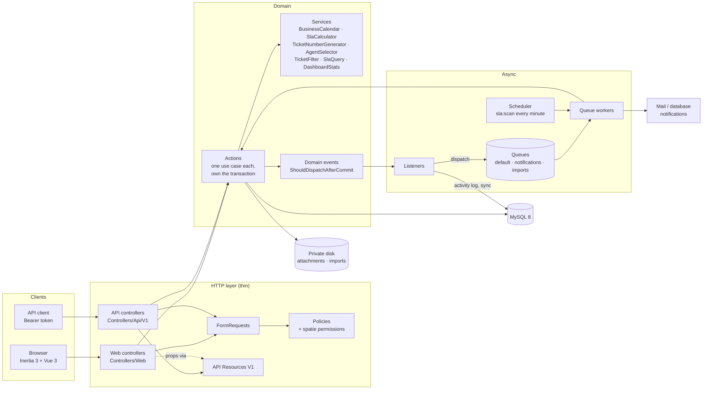

# T14 — Hardening and documentation

## 1. Header

- **Objective:** prove the system's performance and security claims with tests, publish the generated OpenAPI spec, and write the reviewer-facing documentation (`docs/API.md`, `docs/TECHNICAL.md`, `README.md`). End with a clean full gate.
- **Depends on:** T00–T13, all merged into `main`.
- **Wave:** 5 (alone).
- **TDs implemented:**
  - TD-021 (EXPLAIN audit of the index strategy)
  - TD-101 (`preventLazyLoading` confirmed)
  - TD-120 (security checklist, each item proven by a test)
  - TD-012 (404 for foreign tickets)
  - TD-033 (Scramble export, admin-gated docs)
  - TD-034 (final gate)
  - TD-070 (the event→listener table documented)
  - TD-005 and TD-072 (local runtime and queue topology documented; Docker packaging is the final task after T14)

## 2. Files

**Create**
- `tests/Feature/Performance/IndexUsageTest.php`
- `tests/Feature/Performance/LazyLoadingTest.php`
- `tests/Feature/Security/SecurityChecklistTest.php`
- `tests/Feature/Docs/ApiDocsTest.php`
- `app/Http/Middleware/AuthorizeApiDocs.php`
- `config/scramble.php`
- `docs/api/openapi.json` (generated by `scramble:export`)
- `docs/API.md`
- `docs/TECHNICAL.md`
- `README.md` (replaces the Laravel skeleton README)

**Modify:** none outside the list above.

**Must not touch:**
- application code from T00–T13. When a test here exposes a missing measure, stop and report it (see §5, T14.3 Step 4) instead of patching another task's file.
- `bootstrap/app.php`, `bootstrap/providers.php`
- `app/Providers/*`
- the migrations
- `phpunit.xml`, `tests/Pest.php`

## 3. Interfaces

### Consumes (README §3)

- **Services:** `SlaQuery::whereBreached/whereApproaching`, `TicketFilter::apply(Builder, array, User, CarbonImmutable)`.
- **Actions:** `Conversation\AddReply::handle`.
- **Models:** `Ticket::activities()`, `TicketReply::scopeVisibleTo`.
- **Policies:** `UserPolicy::viewAny`.
- **Routes:**
  - `api.v1.auth.tokens.store`, `api.v1.auth.tokens.destroy`, `api.v1.auth.me`
  - `api.v1.tickets.*`, `api.v1.tickets.replies.*`, `api.v1.attachments.download`
  - `tickets.show`, `profile.update` (starter kit)
- **Factories:** every factory in §3.3.

### Produces

- `docs/api/openapi.json`: the OpenAPI 3.1 document for every `api/v1` route.
- The `/docs/api` UI and `/docs/api.json`. They are open in `local`, and outside `local` only to users who pass `UserPolicy::viewAny`, meaning admins.
- `App\Http\Middleware\AuthorizeApiDocs`, referenced from `config/scramble.php`.
- `docs/API.md`, `docs/TECHNICAL.md`, `README.md`.

No new runtime interface crosses a task boundary.

## 4. Subtasks & mini-waves

| Subtask | Files | Depends on | Parallel-safe with |
|---|---|---|---|
| T14.1 EXPLAIN index audit | `IndexUsageTest.php` | — | T14.2, T14.3, T14.4 |
| T14.2 Lazy-loading guard | `LazyLoadingTest.php` | — | T14.1, T14.3, T14.4 |
| T14.3 Security checklist suite | `SecurityChecklistTest.php` | — | T14.1, T14.2, T14.4 |
| T14.4 Scramble: gated docs and export | `AuthorizeApiDocs.php`, `config/scramble.php`, `docs/api/openapi.json`, `ApiDocsTest.php` (access tests) | — | T14.1, T14.2, T14.3 |
| T14.5 `docs/API.md` and its drift test | `docs/API.md`, `ApiDocsTest.php` (reference test added) | T14.4 | T14.6, T14.7 |
| T14.6 `docs/TECHNICAL.md` | `docs/TECHNICAL.md` | — | T14.5, T14.7 |
| T14.7 `README.md` | `README.md` | — | T14.5, T14.6 |
| T14.8 Final gate | none | T14.1–T14.7 | — |

Mini-waves:
- **Wave A (parallel, 4 subagents):** T14.1 ∥ T14.2 ∥ T14.3 ∥ T14.4.
- **Wave B (parallel, 3 subagents):** T14.5 ∥ T14.6 ∥ T14.7.
- **Wave C:** T14.8.

---

## 5. Subtasks

### T14.1 — EXPLAIN index audit

This test is the evidence for TD-021. It builds each hot query **through the real application code** (`SlaQuery`, `TicketFilter`, `Ticket::activities()`). It runs `EXPLAIN FORMAT=JSON`, and asserts that MySQL picks the intended composite index. The expected index name is looked up from `information_schema` by its column list, so the test doesn't depend on Laravel's naming convention.

**Why the data volume.** On a near-empty table MySQL often chooses a full scan, because it is cheaper. So the test inserts about 3,000 tickets with a realistic shape: 85% finished, a few breached, one customer with 30 tickets, one agent with 60. The rows live inside the test's transaction. That's enough for an honest plan:
- For range predicates the optimizer uses index dives, which read the B-tree directly.
- InnoDB keeps the table row estimate up to date as rows are inserted.

`ANALYZE TABLE` is deliberately not used. It commits implicitly and would break `RefreshDatabase`.

- [ ] **Step 1: Write the test** `tests/Feature/Performance/IndexUsageTest.php`.

```php
<?php

declare(strict_types=1);

use App\Enums\TicketPriority;
use App\Enums\TicketStatus;
use App\Models\Category;
use App\Models\Ticket;
use App\Models\User;
use App\Services\Sla\SlaQuery;
use App\Services\Tickets\TicketFilter;
use Carbon\CarbonImmutable;
use Illuminate\Database\Query\Builder as QueryBuilder;
use Illuminate\Support\Facades\DB;

/** @param  list<string>  $columns */
function indexOnColumns(string $table, array $columns): string
{
    $rows = DB::select(
        'SELECT INDEX_NAME AS index_name, GROUP_CONCAT(COLUMN_NAME ORDER BY SEQ_IN_INDEX) AS index_columns
           FROM information_schema.STATISTICS
          WHERE TABLE_SCHEMA = DATABASE() AND TABLE_NAME = ?
          GROUP BY INDEX_NAME',
        [$table],
    );

    foreach ($rows as $row) {
        if ($row->index_columns === implode(',', $columns)) {
            return (string) $row->index_name;
        }
    }

    throw new RuntimeException(sprintf('No index on %s(%s). TD-021 promises one.', $table, implode(', ', $columns)));
}

/** @return array{tables: array<string, string|null>, plan: string} */
function explainQuery(QueryBuilder $query): array
{
    $row = (array) DB::selectOne('EXPLAIN FORMAT=JSON '.$query->toSql(), $query->getBindings());
    $json = (string) ($row['EXPLAIN'] ?? reset($row));
    $plan = json_decode($json, true, 512, JSON_THROW_ON_ERROR);

    $tables = [];
    $walk = function (array $node) use (&$walk, &$tables): void {
        if (isset($node['table_name']) && is_string($node['table_name']) && ! array_key_exists($node['table_name'], $tables)) {
            $tables[$node['table_name']] = isset($node['key']) ? (string) $node['key'] : null;
        }
        foreach ($node as $child) {
            if (is_array($child)) {
                $walk($child);
            }
        }
    };
    $walk($plan);

    return ['tables' => $tables, 'plan' => $json];
}

beforeEach(function (): void {
    $this->travelTo(CarbonImmutable::parse('2026-10-29 06:00:00', 'UTC'));
    $now = CarbonImmutable::now();

    $category = Category::factory()->create();
    $this->agent = User::factory()->agent([$category->id])->create();
    $this->customer = User::factory()->customer()->create();
    $others = User::factory()->customer()->count(20)->create()->pluck('id')->all();
    $otherAgent = User::factory()->agent([$category->id])->create();

    $active = [TicketStatus::Open, TicketStatus::InProgress, TicketStatus::WaitingForCustomer];
    $priorities = TicketPriority::cases();
    $rows = [];

    for ($i = 1; $i <= 3000; $i++) {
        $finished = $i % 20 < 17;
        $status = $finished ? ($i % 2 === 0 ? TicketStatus::Closed : TicketStatus::Resolved) : $active[$i % 3];
        $created = $now->subMinutes($i * 37);
        $due = $finished ? $created->addHours(8) : ($i % 10 === 0 ? $now->subHour() : $now->addDays(2));

        $rows[] = [
            'number' => sprintf('TKT-2026-%06d', $i),
            'subject' => "Ticket {$i}",
            'description' => 'Generated for the EXPLAIN audit.',
            'priority' => $priorities[$i % 4]->value,
            'status' => $status->value,
            'category_id' => $category->id,
            'customer_id' => $i % 100 === 0 ? $this->customer->id : $others[$i % 20],
            'created_by_id' => $others[$i % 20],
            'assigned_agent_id' => $i % 50 === 0 ? $this->agent->id : ($i % 3 === 0 ? $otherAgent->id : null),
            'sla_started_at' => $created,
            'sla_due_at' => $due,
            'sla_warning_at' => $due->subHours(2),
            'sla_paused_at' => null,
            'escalation_level' => 0,
            'resolved_at' => $finished ? $created->addHours(4) : null,
            'closed_at' => $status === TicketStatus::Closed ? $created->addHours(5) : null,
            'created_at' => $created,
            'updated_at' => $created,
        ];
    }

    foreach (array_chunk($rows, 500) as $chunk) {
        DB::table('tickets')->insert($chunk);
    }

    $this->ticket = Ticket::query()->where('customer_id', $this->customer->id)->firstOrFail();
    $morph = $this->ticket->getMorphClass();
    $activities = [];
    foreach (Ticket::query()->pluck('id') as $index => $ticketId) {
        $count = $ticketId === $this->ticket->id ? 40 : 1;
        for ($n = 0; $n < $count; $n++) {
            $activities[] = [
                'log_name' => 'ticket',
                'description' => 'Generated',
                'subject_type' => $morph,
                'subject_id' => $ticketId,
                'event' => 'updated',
                'properties' => '{}',
                'created_at' => $now->subMinutes($index + $n),
                'updated_at' => $now->subMinutes($index + $n),
            ];
        }
    }
    foreach (array_chunk($activities, 500) as $chunk) {
        DB::table('activity_log')->insert($chunk);
    }
});

it('serves the breach scan from tickets(status, sla_due_at)', function (): void {
    $query = SlaQuery::whereBreached(Ticket::query(), CarbonImmutable::now())->select('id')->toBase();
    $explain = explainQuery($query);

    expect($explain['tables']['tickets'] ?? null)
        ->toBe(indexOnColumns('tickets', ['status', 'sla_due_at']), $explain['plan']);
});

it('serves "my tickets" from tickets(assigned_agent_id, status)', function (): void {
    $query = Ticket::query()
        ->where('assigned_agent_id', $this->agent->id)
        ->whereIn('status', array_map(fn (TicketStatus $s): string => $s->value, TicketStatus::active()))
        ->toBase();
    $explain = explainQuery($query);

    expect($explain['tables']['tickets'] ?? null)
        ->toBe(indexOnColumns('tickets', ['assigned_agent_id', 'status']), $explain['plan']);
});

it("serves a customer's ticket list from tickets(customer_id, created_at)", function (): void {
    $query = app(TicketFilter::class)
        ->apply(Ticket::query(), [], $this->customer, CarbonImmutable::now())
        ->limit(20)
        ->toBase();
    $explain = explainQuery($query);

    expect($explain['tables']['tickets'] ?? null)
        ->toBe(indexOnColumns('tickets', ['customer_id', 'created_at']), $explain['plan']);
});

it('serves the activity timeline from activity_log(subject_type, subject_id, created_at)', function (): void {
    $query = $this->ticket->activities()->where('log_name', 'ticket')->latest()->limit(100)->toBase();
    $explain = explainQuery($query);

    expect($explain['tables']['activity_log'] ?? null)
        ->toBe(indexOnColumns('activity_log', ['subject_type', 'subject_id', 'created_at']), $explain['plan']);
});
```

  > `toBe($expected, $message)`: Pest prints the full EXPLAIN JSON as the failure message, so a wrong plan can be diagnosed straight from the test output.

- [ ] **Step 2: Run it.**
  `./vendor/bin/pest tests/Feature/Performance/IndexUsageTest.php`
  Expected: PASS (4 tests). This is a characterization test of code that already exists, so it should be green on the first run. If a test fails, the message is the EXPLAIN plan. Treat it as a real finding:
  - `key: null` with `access_type: ALL` means the query shape defeats the index.
  - Another key's name means a different index wins.

  Report the plan to the controller. Don't change the test to match.

- [ ] **Step 3: Prove the test can fail.**
  1. Temporarily change the first test's expected columns to `['status', 'sla_warning_at']`.
  2. Run `./vendor/bin/pest tests/Feature/Performance/IndexUsageTest.php --filter="breach scan"`.
     Expected: FAIL, printing the EXPLAIN JSON, which shows the `(status, sla_due_at)` index.
  3. Restore the line. Expected: PASS.

- [ ] **Step 4: Format and analyse.**
  `./vendor/bin/pint --dirty && ./vendor/bin/phpstan analyse --memory-limit=1G`
  Expected: `[OK] No errors`.

- [ ] **Step 5: Commit.**

```bash
git add tests/Feature/Performance/IndexUsageTest.php
git commit -m "test(db): verify indexes are used with an EXPLAIN audit" --trailer "Refs: T14.1" --trailer "Implements: TD-021"
```

---

### T14.2 — Lazy-loading guard

- [ ] **Step 1: Write the test** `tests/Feature/Performance/LazyLoadingTest.php`.

```php
<?php

declare(strict_types=1);

use App\Models\Ticket;
use Illuminate\Database\Eloquent\Model;
use Illuminate\Database\LazyLoadingViolationException;

it('has lazy loading disabled outside production', function (): void {
    expect(app()->isProduction())->toBeFalse()
        ->and(Model::preventsLazyLoading())->toBeTrue();
});

it('throws on an N+1 relation access', function (): void {
    Ticket::factory()->count(2)->create();

    $tickets = Ticket::query()->get();

    expect(fn () => $tickets->first()?->customer)->toThrow(LazyLoadingViolationException::class);
});
```

- [ ] **Step 2: Run it.**
  `./vendor/bin/pest tests/Feature/Performance/LazyLoadingTest.php`
  Expected: PASS (2 tests). If the first test fails, then T00's `AppServiceProvider` doesn't call `Model::preventLazyLoading(! app()->isProduction())` (or `Model::shouldBeStrict(...)`). Stop and report it as a T00 gap, since T14 doesn't own that file.

- [ ] **Step 3: Commit.**

```bash
git add tests/Feature/Performance/LazyLoadingTest.php
git commit -m "test(core): confirm lazy-loading prevention is active" --trailer "Refs: T14.2"
```

---
### T14.3 — Security checklist (TD-120), each item proven by a test

Earlier tasks test their own slice: T04 the matrix, T07 leakage, T10 notification routing. This file is a **cross-cutting regression suite**. Every TD-120 row (plus TD-012) whose guarantee spans tasks has a `describe()` block that proves the measure end to end, through the public surface. A measure that one task fully owns at the same layer (tokens, upload naming and download headers, the sort whitelist) is not repeated here; the table names the owning test. A future change in any one task then can't quietly undo a guarantee.

| TD-120 item | Proven by (`SecurityChecklistTest.php`) | Also covered by |
|---|---|---|
| Server-side authorization | `server-side authorization` → every non-public route requires auth; every admin or import route carries `can:` | T04 `TicketPolicyTest`; T05–T13 `*AuthorizationTest.php` |
| Internal-note leakage, 3 layers | `internal-note leakage` → scope, HTTP/Resource and Inertia props, attachment download, notifications | T07, T10 |
| Mass assignment | `mass assignment` → protected columns not fillable; injected fields ignored by `tickets.store`; profile update can't change role | T05 |
| File uploads | `file uploads` → PHP disguised as PDF rejected | T07 (UUID name on a private disk, download headers) |
| Rate limiting | `rate limiting` → 6th token request is 429; every API route is in the throttled `api` group; reply upload route throttled | T00 |
| Tokens | — (not repeated here) | T00 `AuthTokenTest`: abilities mirror permissions; `DELETE auth/tokens/current` revokes |
| Inertia props | `inertia shared props` → `auth.user` has exactly id, name, email, email_verified_at, roles; `auth.can` holds only booleans | T04 |
| Search input | `search input` → FULLTEXT operators don't 500; injection text is bound | T08 (unknown sort is 422) |
| CSRF / XSS | `csrf and xss` → no `v-html` anywhere in `resources/js`. CSRF is the framework's `web` group default (`PreventRequestForgery`), so it isn't re-tested | — |
| 404 not 403 (TD-012) | `foreign tickets` → web and API return 404 to another customer | T04 |

**Field names** come from the sibling plans:
- token request: `email`, `password`, `device_name` (T00 `LoginTokenRequest`); wrong credentials return 422
- reply upload: `body`, `is_internal`, `attachments[]` (T07 `StoreReplyRequest`), throttled with `throttle:20,1`

- [ ] **Step 1: Write the test** `tests/Feature/Security/SecurityChecklistTest.php`. The public-by-design routes are: the guest-only auth screens (Fortify registers them as `guest:web`), the landing page, the token endpoint, Sanctum's CSRF cookie, the kit's passkey discovery document, the signed-URL local file route, the health check, and the docs routes, which have their own `AuthorizeApiDocs` gate.

```php
<?php

declare(strict_types=1);

use App\Actions\Conversation\AddReply;
use App\Enums\TicketStatus;
use App\Models\Attachment;
use App\Models\Category;
use App\Models\Ticket;
use App\Models\TicketReply;
use App\Models\User;
use Illuminate\Http\UploadedFile;
use Illuminate\Routing\Route as RoutingRoute;
use Illuminate\Support\Facades\File;
use Illuminate\Support\Facades\Notification;
use Illuminate\Support\Facades\Route;
use Illuminate\Support\Facades\Storage;
use Inertia\Testing\AssertableInertia;
use Laravel\Sanctum\Sanctum;

beforeEach(function (): void {
    config(['tickets.auto_assign' => false]);
    Storage::fake((string) config('attachments.disk', 'local'));

    $this->category = Category::factory()->create(['is_active' => true]);
    $this->admin = User::factory()->admin()->create();
    $this->agent = User::factory()->agent([$this->category->id])->create();
    $this->customer = User::factory()->customer()->create();
    $this->otherCustomer = User::factory()->customer()->create();
    $this->ticket = Ticket::factory()->create([
        'customer_id' => $this->customer->id,
        'category_id' => $this->category->id,
        'assigned_agent_id' => $this->agent->id,
        'status' => TicketStatus::InProgress,
    ]);
});

describe('server-side authorization', function (): void {
    it('requires authentication on every route that is not public by design', function (): void {
        $publicNames = ['home', 'api.v1.auth.tokens.store', 'sanctum.csrf-cookie', 'well-known.passkeys'];
        $publicPrefixes = ['storage.', 'scramble.'];
        $publicUris = ['up', '/'];

        $offenders = collect(Route::getRoutes()->getRoutes())
            ->reject(function (RoutingRoute $route) use ($publicNames, $publicPrefixes, $publicUris): bool {
                $name = (string) $route->getName();
                $middleware = $route->gatherMiddleware();

                return in_array($name, $publicNames, true)
                    || collect($publicPrefixes)->contains(fn (string $prefix): bool => str_starts_with($name, $prefix))
                    || in_array($route->uri(), $publicUris, true)
                    || collect($middleware)->contains(fn (mixed $m): bool => is_string($m) && ($m === 'guest' || str_starts_with($m, 'guest:')))
                    || collect($middleware)->contains(fn (mixed $m): bool => is_string($m) && ($m === 'auth' || str_starts_with($m, 'auth:')));
            })
            ->map(fn (RoutingRoute $route): string => implode('|', $route->methods()).' '.$route->uri())
            ->values()
            ->all();

        expect($offenders)->toBe([]);
    });

    it('puts a can: policy check on every admin and import route', function (): void {
        $offenders = collect(Route::getRoutes()->getRoutes())
            ->filter(fn (RoutingRoute $route): bool => preg_match('/^(admin\.|api\.v1\.admin\.|api\.v1\.imports\.)/', (string) $route->getName()) === 1)
            ->reject(fn (RoutingRoute $route): bool => collect($route->gatherMiddleware())
                ->contains(fn (mixed $m): bool => is_string($m) && str_starts_with($m, 'can:')))
            ->map(fn (RoutingRoute $route): string => (string) $route->getName())
            ->values()
            ->all();

        expect($offenders)->toBe([]);
    });
});

describe('internal-note leakage', function (): void {
    beforeEach(function (): void {
        Notification::fake();
        $this->note = app(AddReply::class)->handle(
            $this->agent,
            $this->ticket,
            'SECRET-NOTE do not tell the customer',
            true,
            [UploadedFile::fake()->create('secret-plan.pdf', 10, 'application/pdf')],
        );
        app(AddReply::class)->handle($this->agent, $this->ticket, 'Public answer', false);
    });

    it('layer 1: the reply scope excludes internal notes for customers', function (): void {
        $visible = TicketReply::query()->visibleTo($this->customer)->pluck('id')->all();

        expect($visible)->not->toContain($this->note->id)
            ->and(TicketReply::query()->visibleTo($this->agent)->pluck('id')->all())->toContain($this->note->id);
    });

    it('layer 2: neither the API nor the Inertia page reveals the note, its file, or its activity', function (): void {
        Sanctum::actingAs($this->customer, ['*']);
        $this->getJson(route('api.v1.tickets.replies.index', $this->ticket))
            ->assertOk()
            ->assertDontSee('SECRET-NOTE')
            ->assertDontSee('secret-plan.pdf')
            ->assertSee('Public answer');

        $this->getJson(route('api.v1.tickets.activities', $this->ticket))
            ->assertOk()
            ->assertDontSee('SECRET-NOTE')
            ->assertDontSee('internal_note');

        app('auth')->forgetGuards();
        $this->actingAs($this->customer)
            ->get(route('tickets.show', $this->ticket))
            ->assertOk()
            ->assertDontSee('SECRET-NOTE')
            ->assertDontSee('secret-plan.pdf');
    });

    it('layer 2b: a customer cannot download an internal attachment', function (): void {
        $attachment = Attachment::query()->where('reply_id', $this->note->id)->sole();

        $status = $this->actingAs($this->customer)->get(route('attachments.download', $attachment))->status();

        expect($status)->toBeIn([403, 404]);
    });

    it('layer 3: the customer is never notified about an internal note', function (): void {
        Notification::assertNothingSentTo($this->customer);
    });
});

describe('mass assignment', function (): void {
    it('keeps protected columns out of $fillable', function (): void {
        $ticketProtected = ['number', 'status', 'assigned_agent_id', 'assigned_at', 'sla_started_at', 'sla_due_at',
            'sla_warning_at', 'sla_paused_at', 'escalation_level', 'escalated_at', 'resolved_at', 'closed_at'];

        expect(array_values(array_intersect((new Ticket())->getFillable(), $ticketProtected)))->toBe([])
            ->and(array_values(array_intersect((new User())->getFillable(), ['roles', 'permissions', 'last_assigned_at', 'email_verified_at'])))->toBe([])
            ->and((new Ticket())->getGuarded())->not->toBe([]);
    });

    it('ignores privileged fields injected into ticket creation', function (): void {
        Sanctum::actingAs($this->customer, ['*']);

        $this->postJson(route('api.v1.tickets.store'), [
            'subject' => 'Injected',
            'description' => 'Trying to set protected columns',
            'priority' => 'low',
            'category_id' => $this->category->id,
            'number' => 'TKT-1999-999999',
            'status' => 'closed',
            'assigned_agent_id' => $this->agent->id,
            'sla_due_at' => '2099-01-01 00:00:00',
            'escalation_level' => 2,
            'customer_id' => $this->otherCustomer->id,
            'created_by_id' => $this->admin->id,
        ])->assertCreated();

        $ticket = Ticket::query()->where('subject', 'Injected')->sole();
        expect($ticket->number)->not->toBe('TKT-1999-999999')
            ->and($ticket->status)->toBe(TicketStatus::Open)
            ->and($ticket->assigned_agent_id)->toBeNull()
            ->and($ticket->escalation_level->value)->toBe(0)
            ->and($ticket->customer_id)->toBe($this->customer->id)
            ->and($ticket->created_by_id)->toBe($this->customer->id)
            ->and($ticket->sla_due_at->year)->not->toBe(2099);
    });

    it('does not let a user grant themselves a role through the profile form', function (): void {
        $this->actingAs($this->customer)->patch(route('profile.update'), [
            'name' => $this->customer->name,
            'email' => $this->customer->email,
            'role' => 'admin',
            'roles' => ['admin'],
        ]);

        expect($this->customer->fresh()?->getRoleNames()->all())->toBe(['customer']);
    });
});

describe('file uploads', function (): void {
    it('rejects a PHP script disguised as a PDF', function (): void {
        $path = tempnam(sys_get_temp_dir(), 'evil');
        file_put_contents((string) $path, "<?php echo 'pwned';");
        $evil = new UploadedFile((string) $path, 'invoice.pdf', 'application/pdf', null, true);

        Sanctum::actingAs($this->customer, ['*']);
        $this->postJson(route('api.v1.tickets.replies.store', $this->ticket), [
            'body' => 'See attached',
            'attachments' => [$evil],
        ])->assertUnprocessable();

        expect(Attachment::query()->count())->toBe(0);
    });
});

describe('rate limiting', function (): void {
    it('allows five token requests per minute and refuses the sixth', function (): void {
        for ($i = 1; $i <= 5; $i++) {
            $status = $this->postJson(route('api.v1.auth.tokens.store'), [
                'email' => $this->customer->email, 'password' => 'wrong-password', 'device_name' => 'test',
            ])->status();

            expect($status)->toBeIn([401, 422]);
        }

        $this->postJson(route('api.v1.auth.tokens.store'), [
            'email' => $this->customer->email, 'password' => 'wrong-password', 'device_name' => 'test',
        ])->assertStatus(429);
    });

    it('runs every API route through the throttled api group', function (): void {
        $apiGroup = app('router')->getMiddlewareGroups()['api'] ?? [];
        expect(collect($apiGroup)->contains(fn (string $m): bool => str_contains($m, 'throttle') || str_contains($m, 'ThrottleRequests')))->toBeTrue();

        $outside = collect(Route::getRoutes()->getRoutes())
            ->filter(fn (RoutingRoute $route): bool => str_starts_with((string) $route->getName(), 'api.v1.'))
            ->reject(fn (RoutingRoute $route): bool => in_array('api', $route->gatherMiddleware(), true))
            ->map(fn (RoutingRoute $route): string => (string) $route->getName())
            ->values()
            ->all();

        expect($outside)->toBe([]);
    });

    it('throttles the upload routes', function (string $name): void {
        $middleware = Route::getRoutes()->getByName($name)?->gatherMiddleware() ?? [];

        expect(collect($middleware)->contains(fn (mixed $m): bool => is_string($m) && str_starts_with($m, 'throttle:')))->toBeTrue();
    })->with(['tickets.replies.store', 'api.v1.tickets.replies.store', 'admin.imports.store', 'api.v1.imports.store']);
});

describe('inertia shared props', function (): void {
    it('shares only id, name, email and roles for the user and only booleans for abilities', function (): void {
        $this->actingAs($this->agent)
            ->get(route('dashboard'))
            ->assertOk()
            ->assertInertia(fn (AssertableInertia $page) => $page
                ->has('auth.user', fn (AssertableInertia $user) => $user->hasAll(['id', 'name', 'email', 'email_verified_at', 'roles']))
                ->has('auth.can', fn (AssertableInertia $can) => $can->whereAllType([
                    'viewDashboard' => 'boolean',
                    'manageImports' => 'boolean',
                    'manageUsers' => 'boolean',
                    'manageCategories' => 'boolean',
                    'manageHolidays' => 'boolean',
                    'createOnBehalf' => 'boolean',
                ])))
            ->assertDontSee((string) $this->agent->password);
    });
});

describe('search input', function (): void {
    it('treats FULLTEXT operators as text, never as an error', function (string $q): void {
        Sanctum::actingAs($this->agent, ['*']);

        $this->getJson(route('api.v1.tickets.index', ['q' => $q]))->assertOk();
    })->with(['+foo -bar*', '"unclosed', '((( )))', '~<>@', "' OR 1=1 --"]);

    it('does not widen a customer\'s results through injection text', function (): void {
        Ticket::factory()->create(['customer_id' => $this->otherCustomer->id, 'subject' => 'Other customer secret']);
        Sanctum::actingAs($this->customer, ['*']);

        $this->getJson(route('api.v1.tickets.index', ['q' => "' OR 1=1 --"]))
            ->assertOk()
            ->assertDontSee('Other customer secret');
    });
});

describe('csrf and xss', function (): void {
    it('never renders raw HTML in Vue', function (): void {
        $offenders = collect(File::allFiles(resource_path('js')))
            ->filter(fn (\SplFileInfo $file): bool => str_contains((string) file_get_contents($file->getPathname()), 'v-html'))
            ->map(fn (\SplFileInfo $file): string => $file->getPathname())
            ->values()
            ->all();

        expect($offenders)->toBe([]);
    });
});

describe('foreign tickets', function (): void {
    it('answers 404, not 403, when a customer asks for another customer\'s ticket', function (): void {
        $this->actingAs($this->otherCustomer)->get(route('tickets.show', $this->ticket))->assertNotFound();

        app('auth')->forgetGuards();
        Sanctum::actingAs($this->otherCustomer, ['*']);
        $this->getJson(route('api.v1.tickets.show', $this->ticket))->assertNotFound();
    });
});
```

  > `assertDontSee` on an Inertia response searches the whole HTML, including the JSON-encoded page props. It is the broadest possible leakage check. The password check compares against the hash, which must never be serialized.

- [ ] **Step 2: Run it.**
  `./vendor/bin/pest tests/Feature/Security/SecurityChecklistTest.php`
  Expected: PASS (25 tests, counting dataset rows). Every assertion describes behavior that T00–T13 committed to.

- [ ] **Step 3: Prove the suite can fail.**
  1. Temporarily add `<div v-html="'x'" />` to any page.
  2. Run `./vendor/bin/pest tests/Feature/Security/SecurityChecklistTest.php --filter="never renders raw HTML"`.
     Expected: FAIL, listing that file.
  3. Revert the edit. Expected: PASS.

- [ ] **Step 4: Handle real failures.** A failing assertion here means a TD-120 guarantee is missing. It is not a test bug. For each failure:
  1. Identify the owning task from the "Also covered by" column.
  2. Report to the controller: the measure, the failing assertion, and the owning file.
  3. Do not edit that file from T14 (TD-140).

  The controller schedules the fix as an amendment on the owning task. Re-run this file once it has merged.

- [ ] **Step 5: Format and analyse.**
  `./vendor/bin/pint --dirty && ./vendor/bin/phpstan analyse --memory-limit=1G`
  Expected: `[OK] No errors`.

- [ ] **Step 6: Commit.**

```bash
git add tests/Feature/Security/SecurityChecklistTest.php
git commit -m "test(security): add one test per security checklist measure" --trailer "Refs: T14.3" --trailer "Implements: TD-120"
```

---
### T14.4 — Scramble: admin-gated docs and the exported spec

Scramble's default `RestrictedDocsAccess` middleware needs a `viewApiDocs` gate, and a gate would have to be defined in a provider that T14 doesn't own. So `config/scramble.php` points the docs routes at a T14-owned middleware instead. It applies the same rule, "open in `local`, otherwise admins only", through `UserPolicy::viewAny`, the admin capability that T04 already defines (TD-010: the Policy is the entry point).

- [ ] **Step 1: Write the failing test** `tests/Feature/Docs/ApiDocsTest.php`.

```php
<?php

declare(strict_types=1);

use App\Models\User;

it('serves the API docs UI and JSON to admins outside local', function (): void {
    expect(app()->environment('local'))->toBeFalse();
    $admin = User::factory()->admin()->create();

    $this->actingAs($admin)->get('/docs/api')->assertOk();
    $this->actingAs($admin)->get('/docs/api.json')
        ->assertOk()
        ->assertJsonPath('info.version', '1.0.0')
        ->assertJsonStructure(['openapi', 'info' => ['title', 'version'], 'paths']);
});

it('hides the API docs from agents, customers and guests outside local', function (): void {
    $this->get('/docs/api')->assertForbidden();
    $this->actingAs(User::factory()->agent()->create())->get('/docs/api')->assertForbidden();
    $this->actingAs(User::factory()->customer()->create())->get('/docs/api.json')->assertForbidden();
});

it('has an exported OpenAPI document covering the v1 endpoints', function (): void {
    $path = base_path('docs/api/openapi.json');
    expect(is_file($path))->toBeTrue();

    $spec = json_decode((string) file_get_contents($path), true, 512, JSON_THROW_ON_ERROR);

    expect($spec['openapi'])->toStartWith('3.')
        ->and(array_keys($spec['paths']))->toContain('/tickets', '/tickets/{ticket}', '/dashboard', '/imports');
});
```

- [ ] **Step 2: Run it and expect FAIL.**
  `./vendor/bin/pest tests/Feature/Docs/ApiDocsTest.php`
  Expected: FAIL.
  - The first test fails with `Expected response status code [200] but received 403.` (Scramble's default denies non-local requests without a gate.)
  - The third fails at `is_file`: `Failed asserting that false is true.`

- [ ] **Step 3: Create** `app/Http/Middleware/AuthorizeApiDocs.php`. The docs are open in local development; elsewhere only for users the `UserPolicy` treats as admins.

```php
<?php

declare(strict_types=1);

namespace App\Http\Middleware;

use App\Models\User;
use Closure;
use Illuminate\Http\Request;
use Symfony\Component\HttpFoundation\Response;

final class AuthorizeApiDocs
{
    public function handle(Request $request, Closure $next): Response
    {
        if (app()->environment('local')) {
            return $next($request);
        }

        $user = $request->user();

        abort_unless($user instanceof User && $user->can('viewAny', User::class), 403);

        return $next($request);
    }
}
```

- [ ] **Step 4: Create** `config/scramble.php`. It follows the layout of Scramble 0.13's own `vendor/dedoc/scramble/config/scramble.php`. Two 0.13 details matter:
  - The OpenAPI `info.title` comes from `ui.title` (falling back to `app.name`); there is no `info.title` key.
  - `api_path` limits documentation to routes under that prefix, so servers become `{APP_URL}/api/v1`.
  - `ui.title` is used as the document's `info.title` and the docs page `<title>`.
  - The Stoplight Elements options (`theme`, `hideTryIt`, `logo`, `tryItCredentialsPolicy`) live under `renderers.elements`, not under `ui`.

  The `web` middleware gives the docs session auth, so an admin signed in to the app can open them. The `security_strategy` key adds the bearer securityScheme to every route behind `auth`/`auth:*` (auth:sanctum) and marks the rest (POST auth/tokens) as public, without a `Scramble::configure()` call in a provider.

  Laravel merges a package config only at the top level, so every key left out here (`cache`, `openapi_version`, `dev_tools`, the enum strategies, `flatten_deep_query_parameters`) keeps Scramble's default.

```php
<?php

declare(strict_types=1);

use App\Http\Middleware\AuthorizeApiDocs;
use Dedoc\Scramble\SecurityDocumentation\MiddlewareAuthSecurityStrategy;

return [
    'api_path' => 'api/v1',

    'api_domain' => null,

    'export_path' => 'docs/api/openapi.json',

    'info' => [
        'version' => env('API_VERSION', '1.0.0'),
        'description' => 'Support Ticket & SLA Management API. Authenticate with a Sanctum bearer token from '
            .'`POST /api/v1/auth/tokens`. The narrative guide (auth flow, error codes, examples) is docs/API.md.',
    ],

    'ui' => [
        'title' => env('APP_NAME', 'Laravel').' API',
    ],

    'renderer' => 'elements',

    'renderers' => [
        'elements' => [
            'view' => 'scramble::docs',
            'theme' => 'system',
            'hideTryIt' => false,
            'hideSchemas' => false,
            'logo' => '',
            'tryItCredentialsPolicy' => 'include',
            'layout' => 'responsive',
            'router' => 'hash',
        ],
    ],

    'servers' => null,

    'middleware' => [
        'web',
        AuthorizeApiDocs::class,
    ],

    'extensions' => [],

    'security_strategy' => MiddlewareAuthSecurityStrategy::class,
];
```

- [ ] **Step 5: Export the spec.**
  `mkdir -p docs/api && php artisan scramble:export --path=docs/api/openapi.json`
  Expected: exit code 0, and `docs/api/openapi.json` exists. Scramble writes it pretty-printed (`JSON_PRETTY_PRINT`), so `head -n 2 docs/api/openapi.json` prints `{` and then `    "openapi": "3.1.2",` (Scramble 0.13's `OpenApiVersion::V3_1`). `jq '.info.title, (.components.securitySchemes | keys)' docs/api/openapi.json` prints the `"<APP_NAME> API"` title and `["http"]`, the bearer scheme added by `security_strategy`.

  Scramble infers types statically. If the export prints a warning for an endpoint, it falls back to a generic schema for it. List these warnings in the commit body. Don't add docblocks to another task's files.

- [ ] **Step 6: Run the test and expect PASS.**
  `./vendor/bin/pest tests/Feature/Docs/ApiDocsTest.php`
  Expected: PASS (3 tests). If the `paths` assertion fails because of a key format (for example `/tickets/{number}`), open `docs/api/openapi.json` and use the key exactly as exported. Route parameters keep their route names, so `{ticket}` and `{import}` are expected.

- [ ] **Step 7: Format and analyse.**
  `./vendor/bin/pint --dirty && ./vendor/bin/phpstan analyse --memory-limit=1G`
  Expected: `[OK] No errors`.

- [ ] **Step 8: Commit.**

```bash
git add app/Http/Middleware/AuthorizeApiDocs.php config/scramble.php docs/api/openapi.json tests/Feature/Docs/ApiDocsTest.php
git commit -m "feat(docs): serve admin-gated API docs and export OpenAPI spec" --trailer "Refs: T14.4"
```

---
### T14.5 — `docs/API.md` and its drift test

The API reference is hand-written prose next to the generated spec. A test keeps it honest:
- every `api.v1.*` route must appear in API.md as `` `METHOD` | `/uri` | `name` ``
- every route name the document mentions must exist

Every URI, verb and request field below is taken from the route files and FormRequests in the T00, T05–T08 and T10–T13 plans. **The code stays the source of truth.** If the drift test reports a row, correct that row from the `php artisan route:list --path=api/v1` output.

- [ ] **Step 1: Add the failing drift test** to the end of `tests/Feature/Docs/ApiDocsTest.php`.

```php
it('documents every api/v1 route in docs/API.md, and nothing that does not exist', function (): void {
    $doc = (string) file_get_contents(base_path('docs/API.md'));
    $routes = collect(\Illuminate\Support\Facades\Route::getRoutes()->getRoutes())
        ->filter(fn (\Illuminate\Routing\Route $route): bool => str_starts_with((string) $route->getName(), 'api.v1.'));

    $missing = $routes
        ->map(function (\Illuminate\Routing\Route $route): string {
            $method = collect($route->methods())->reject(fn (string $m): bool => $m === 'HEAD')->first();

            return sprintf('`%s` | `/%s` | `%s`', $method, $route->uri(), $route->getName());
        })
        ->reject(fn (string $row): bool => str_contains($doc, $row))
        ->values()
        ->all();

    preg_match_all('/`(api\.v1\.[a-z0-9_.\-]+)`/', $doc, $matches);
    $known = $routes->map(fn (\Illuminate\Routing\Route $route): string => (string) $route->getName())->all();
    $unknown = array_values(array_diff(array_unique($matches[1]), $known));

    expect($missing)->toBe([], 'Rows missing from docs/API.md')
        ->and($unknown)->toBe([], 'Route names in docs/API.md that do not exist');
});
```

- [ ] **Step 2: Run it and expect FAIL.**
  `./vendor/bin/pest tests/Feature/Docs/ApiDocsTest.php --filter="documents every"`
  Expected: FAIL with `file_get_contents(.../docs/API.md): Failed to open stream: No such file or directory`.

- [ ] **Step 3: Write** `docs/API.md` with exactly this content.

````markdown
# Support Ticket & SLA API — v1

A JSON REST API over the same Actions, FormRequests and Policies as the web UI (TD-001, TD-003). Every rule the UI enforces is enforced here too: authorization, SLA handling, status transitions and internal-note privacy.

- **Base URL:** `{APP_URL}/api/v1` (locally: `http://techzu.test/api/v1`)
- **Format:** send `Accept: application/json` on every request, and `Content-Type: application/json` on JSON bodies. Uploads use `multipart/form-data`.
- **Versioning:** the major version is in the path. Breaking changes ship as `/api/v2`; additive fields can appear in v1 at any time.
- **Machine-readable spec:** [`docs/api/openapi.json`](api/openapi.json) (OpenAPI 3.1, generated by Scramble), browsable at `/docs/api`. The browsable docs are open in `local` and admin-only elsewhere.
- **Times:** ISO 8601 in UTC (`2026-11-01T04:00:00+00:00`). SLA deadlines are computed in business hours (`Asia/Dhaka`, Sunday–Thursday 09:00–18:00) and returned in UTC.

## 1. Authentication

The API uses **Sanctum personal access tokens** in the `Authorization: Bearer` header. A token's abilities mirror the permissions of the user's role at the time it was issued.

### 1.1 Get a token

```bash
curl -s -X POST http://techzu.test/api/v1/auth/tokens \
  -H 'Accept: application/json' -H 'Content-Type: application/json' \
  -d '{"email":"agent1@example.com","password":"password","device_name":"cli"}'
```

`201 Created`:

```json
{ "data": { "token": "3|q9ZkVv0bH4...", "token_type": "Bearer", "abilities": ["tickets.view.any", "tickets.reply", "tickets.claim", "dashboard.view"] } }
```

`device_name` (at most 255 characters) labels the token, so a user can tell their tokens apart. `abilities` lists the permission names of the user's role. Limited to **5 requests per minute** per client. The 6th gets `429 Too Many Requests` with a `Retry-After` header. Wrong credentials return `422` with `errors.email`.

### 1.2 Call the API

```bash
TOKEN='3|q9ZkVv0bH4...'
curl -s http://techzu.test/api/v1/me -H 'Accept: application/json' -H "Authorization: Bearer $TOKEN"
```

```json
{ "data": { "id": 2, "name": "Agent One", "email": "agent1@example.com", "roles": ["agent"], "permissions": ["tickets.view.any", "tickets.reply", "…"] } }
```

### 1.3 Revoke the current token

```bash
curl -s -X DELETE http://techzu.test/api/v1/auth/tokens/current \
  -H 'Accept: application/json' -H "Authorization: Bearer $TOKEN"
```

Returns `204 No Content`. The token stops working immediately. Other tokens of the same user keep working.

## 2. Errors

Every error has the same shape:

```json
{ "message": "Human-readable explanation.", "code": "stable_machine_code", "errors": { "field": ["…"] } }
```

`errors` appears only on validation failures. **Branch on `code` or the status, never on `message`.**

| Status | `code` | When |
|---|---|---|
| 401 | — | Missing, invalid or revoked token (`{"message":"Unauthenticated."}`) |
| 403 | — | The Policy forbids the action for your role (for example an agent calling an admin endpoint) |
| 404 | — | Not found. Customers also get 404, never 403, for tickets they don't own (TD-012) |
| 409 | `ticket_already_claimed` | Another agent claimed the ticket first. Refresh to see the owner |
| 422 | — | Validation failed; see `errors` |
| 422 | `invalid_status_transition` | The status change isn't allowed from the current status (see §5) |
| 422 | `agent_not_eligible` | The assignee isn't an available agent |
| 422 | `ticket_closed` | Replies are not accepted on Closed tickets |
| 422 | `import_header_invalid` | The CSV header is missing required columns or has unknown or duplicate ones |
| 422 | `cannot_change_own_role` | An admin tried to change their own role |
| 429 | — | Rate limit exceeded; wait for `Retry-After` seconds |

Example: a lost claim race.

```json
HTTP/1.1 409 Conflict
{ "message": "Ticket TKT-2026-000123 has already been claimed.", "code": "ticket_already_claimed" }
```

## 3. Pagination

Every list endpoint is paginated.

| Parameter | Default | Limits |
|---|---|---|
| `page` | 1 | ≥ 1 |
| `per_page` | 20 | 1–100. Larger values return 422 |

Responses use Laravel's resource pagination envelope:

```json
{
  "data": [ { "…": "…" } ],
  "links": { "first": "…?page=1", "last": "…?page=7", "prev": null, "next": "…?page=2" },
  "meta": { "current_page": 1, "from": 1, "last_page": 7, "per_page": 20, "to": 20, "total": 131, "path": "…" }
}
```

## 4. Filtering and sorting tickets

`GET /api/v1/tickets` accepts these query parameters (validated by `IndexTicketsRequest`, TD-080). They combine with AND. Visibility is applied first: customers only ever see their own tickets.

| Parameter | Example | Meaning |
|---|---|---|
| `scope` | `active` / `resolved` | Active = Open, In progress, Waiting for customer. Resolved = Resolved, Closed |
| `number` | `TKT-2026-0001` | Exact ticket number, or a prefix of one (at most 32 characters) |
| `q` | `printer jam` | Keyword search on subject and description (at most 200 characters; MySQL FULLTEXT, so terms under 3 characters are ignored) |
| `status[]` | `status[]=open&status[]=in_progress` | One or more statuses |
| `priority[]` | `priority[]=critical` | One or more of `low`, `medium`, `high`, `critical` |
| `category_id` | `3` | Category |
| `assigned_agent_id` | `7` | Assigned agent |
| `unassigned` | `1` | Only tickets without an agent |
| `customer_id` | `12` | Customer |
| `created_from`, `created_to` | `2026-10-01` | Creation date range (`Y-m-d`), inclusive; `created_to` ≥ `created_from` |
| `sla_state` | `breached` | `within`, `approaching`, `breached`, `paused` or `stopped` |
| `sort` | `-sla_due_at` | One of `created_at`, `updated_at`, `sla_due_at`, `priority`, ascending; prefix `-` for descending. Default `-created_at`, newest first. Anything else is 422 |

```bash
curl -s -G http://techzu.test/api/v1/tickets -H 'Accept: application/json' -H "Authorization: Bearer $TOKEN" \
  --data-urlencode 'scope=active' --data-urlencode 'sla_state=breached' --data-urlencode 'sort=sla_due_at' \
  --data-urlencode 'per_page=50'
```

## 5. Ticket lifecycle in brief

- **Statuses and transitions:**
  - `open` → `in_progress` | `waiting_for_customer` | `resolved`
  - `in_progress` → `waiting_for_customer` | `resolved`
  - `waiting_for_customer` → `in_progress` | `resolved`
  - `resolved` → `closed` | `in_progress` (reopen)
  - `closed` is final.
- **SLA:** the resolution deadline comes from the priority (low 48 h, medium 24 h, high 8 h, critical 2 h), counted in business minutes. It pauses while the ticket is `waiting_for_customer`. A customer reply resumes it automatically.
- **Customers** may close or reopen their own resolved tickets, and nothing else.

## 6. Endpoints

All endpoints except `POST /auth/tokens` require a bearer token. "Who" lists the roles the Policies allow.

### Authentication

| Method | URI | Route name | Who | Notes |
|---|---|---|---|---|
| `POST` | `/api/v1/auth/tokens` | `api.v1.auth.tokens.store` | anyone | Body: `email`, `password`, `device_name`. 5/min |
| `DELETE` | `/api/v1/auth/tokens/current` | `api.v1.auth.tokens.destroy` | any user | Revokes the calling token |
| `GET` | `/api/v1/me` | `api.v1.auth.me` | any user | The authenticated user and roles |

### Tickets

| Method | URI | Route name | Who | Notes |
|---|---|---|---|---|
| `GET` | `/api/v1/tickets` | `api.v1.tickets.index` | all (customers: own) | Filters in §4 |
| `POST` | `/api/v1/tickets` | `api.v1.tickets.store` | all | Body: `subject` (≤ 255), `description` (≤ 20,000), `priority`, `category_id` (active category). Staff must send `customer_email` (an existing customer), and customers must not. Optional `attachments[]`. 201 |
| `GET` | `/api/v1/tickets/{ticket}` | `api.v1.tickets.show` | all (customers: own, else 404) | `{ticket}` is the number, e.g. `TKT-2026-000001`. Includes `sla` and `can` |
| `PATCH` | `/api/v1/tickets/{ticket}` | `api.v1.tickets.update` | admin; assigned agent; owner while Open | Any of `subject`, `description`. `category_id` only for those who may change priority (admin, assigned agent); others get 422 |
| `PATCH` | `/api/v1/tickets/{ticket}/status` | `api.v1.tickets.status` | admin; assigned agent; owner (close/reopen) | Body: `status`. 422 `invalid_status_transition` |
| `PATCH` | `/api/v1/tickets/{ticket}/priority` | `api.v1.tickets.priority` | admin; assigned agent | Body: `priority`. Recomputes the SLA from the original start |
| `GET` | `/api/v1/tickets/{ticket}/activities` | `api.v1.tickets.activities` | all (customers: own) | Audit timeline, newest first; internal-note entries hidden from customers |

```bash
curl -s -X POST http://techzu.test/api/v1/tickets -H 'Accept: application/json' -H "Authorization: Bearer $TOKEN" \
  -F subject='Printer on fire' -F description='Third floor, again.' -F priority=critical -F category_id=1 \
  -F customer_email=customer1@example.com -F 'attachments[]=@photo.jpg'   # customer_email: staff tokens only
```

### Assignment

| Method | URI | Route name | Who | Notes |
|---|---|---|---|---|
| `POST` | `/api/v1/tickets/{ticket}/claim` | `api.v1.tickets.claim` | agent, admin | Atomic. 409 `ticket_already_claimed` if someone was faster |
| `POST` | `/api/v1/tickets/{ticket}/assign` | `api.v1.tickets.assign` | admin; assigned agent (hand-off) | Body: `agent_id`. 422 `agent_not_eligible` |

### Conversation and attachments

| Method | URI | Route name | Who | Notes |
|---|---|---|---|---|
| `GET` | `/api/v1/tickets/{ticket}/replies` | `api.v1.tickets.replies.index` | all (customers: public replies only) | Oldest first, with attachments. `per_page`, `page` |
| `POST` | `/api/v1/tickets/{ticket}/replies` | `api.v1.tickets.replies.store` | all | Multipart: `body` (≤ 20,000), `is_internal` (staff only), `attachments[]`: up to 5 files of at most 10 MB each, of types pdf, png, jpg, jpeg, gif, txt, csv, doc, docx, xls, xlsx, zip. 422 `ticket_closed` |
| `GET` | `/api/v1/attachments/{attachment}` | `api.v1.attachments.download` | anyone who can see the ticket; internal files staff only | Streams the file, `Content-Disposition: attachment` |

### Notifications

| Method | URI | Route name | Who | Notes |
|---|---|---|---|---|
| `GET` | `/api/v1/notifications` | `api.v1.notifications.index` | any user | Own notifications, newest first: `{ticket_number, title, body, url}`. `?unread=1`, `per_page`, `page` |
| `POST` | `/api/v1/notifications/{notification}/read` | `api.v1.notifications.read` | owner | Marks one as read and returns it |
| `POST` | `/api/v1/notifications/read-all` | `api.v1.notifications.read-all` | any user | Marks all as read. 204 |

### Dashboard

| Method | URI | Route name | Who | Notes |
|---|---|---|---|---|
| `GET` | `/api/v1/dashboard` | `api.v1.dashboard` | agent, admin | `totals`, `by_priority`, `by_agent`, `my_tickets`. Cached 60 s |

### CSV import

| Method | URI | Route name | Who | Notes |
|---|---|---|---|---|
| `POST` | `/api/v1/imports` | `api.v1.imports.store` | admin | Multipart `file` (CSV or TXT, at most 50 MB). 202, then processed in the background |
| `GET` | `/api/v1/imports/{import}` | `api.v1.imports.show` | admin | Status and counters. Poll until `is_finished` |
| `GET` | `/api/v1/imports/{import}/errors` | `api.v1.imports.errors.index` | admin | Rejected rows: `row_number`, `errors{field:[…]}`, `raw` |

CSV header (any order; `?` = optional): `external_reference?, subject, description, priority, category, customer_email, status?, created_at?`.
- `category` is a category slug.
- `created_at` without an offset is read in business time, and the SLA is measured from it.
- A repeated `external_reference` is reported as a duplicate row.

```bash
curl -s -X POST http://techzu.test/api/v1/imports -H 'Accept: application/json' -H "Authorization: Bearer $TOKEN" \
  -F file=@tickets.csv
# → 202 {"data":{"id":4,"status":"pending",...}}
curl -s http://techzu.test/api/v1/imports/4 -H 'Accept: application/json' -H "Authorization: Bearer $TOKEN"
```

### Categories

| Method | URI | Route name | Who | Notes |
|---|---|---|---|---|
| `GET` | `/api/v1/categories` | `api.v1.categories.index` | all | Active categories, for the create-ticket form |

### Administration

| Method | URI | Route name | Who | Notes |
|---|---|---|---|---|
| `GET` | `/api/v1/admin/categories` | `api.v1.admin.categories.index` | admin | Includes `tickets_count` |
| `POST` | `/api/v1/admin/categories` | `api.v1.admin.categories.store` | admin | `name`, `slug` (kebab-case, unique), `is_active`. 201 |
| `PATCH` | `/api/v1/admin/categories/{category}` | `api.v1.admin.categories.update` | admin | |
| `DELETE` | `/api/v1/admin/categories/{category}` | `api.v1.admin.categories.destroy` | admin | 204 deleted; 200 with `is_active:false` when tickets reference it |
| `GET` | `/api/v1/admin/holidays` | `api.v1.admin.holidays.index` | admin | `?year=2026` (default: the current year) |
| `POST` | `/api/v1/admin/holidays` | `api.v1.admin.holidays.store` | admin | `date` (`Y-m-d`, unique), `name`. 201. New SLA deadlines skip it |
| `PATCH` | `/api/v1/admin/holidays/{holiday}` | `api.v1.admin.holidays.update` | admin | |
| `DELETE` | `/api/v1/admin/holidays/{holiday}` | `api.v1.admin.holidays.destroy` | admin | 204 |
| `GET` | `/api/v1/admin/users` | `api.v1.admin.users.index` | admin | `?q=` (name or email prefix), `?role=` |
| `POST` | `/api/v1/admin/users` | `api.v1.admin.users.store` | admin | `name`, `email`, `password`, `role`; agents: `category_ids[]`, `is_available`. 201 |
| `PATCH` | `/api/v1/admin/users/{user}` | `api.v1.admin.users.update` | admin | `password` optional. 422 `cannot_change_own_role` on self-demotion |

## 7. Rate limits

| Scope | Limit |
|---|---|
| `POST /auth/tokens` | 5 per minute |
| Every other API route | 60 per minute per user (`throttle:api`) |
| Uploads (`replies.store`, `imports.store`) | 20 per minute |

Throttled responses carry `X-RateLimit-Limit`, `X-RateLimit-Remaining` and, on a 429, `Retry-After`.
````

- [ ] **Step 4: Run the drift test.**
  `./vendor/bin/pest tests/Feature/Docs/ApiDocsTest.php`
  Expected: PASS (4 tests). On failure, the message lists each row as `` `METHOD` | `/uri` | `name` ``. Run `php artisan route:list --path=api/v1`, then correct the METHOD or URI cells in API.md to match. Never change routes to match the document.

- [ ] **Step 5: Commit.**

```bash
git add docs/API.md tests/Feature/Docs/ApiDocsTest.php
git commit -m "docs(api): add API reference with auth flow and error codes" --trailer "Refs: T14.5"
```

---
### T14.6 — `docs/TECHNICAL.md`

- [ ] **Step 1: Write** `docs/TECHNICAL.md` with exactly this content.

````markdown
# Technical overview

How the Support Ticket & SLA system is built, how a request flows through it, and how to operate it. The *why* behind each choice lives in [`TECHNICAL_DECISIONS.md`](../TECHNICAL_DECISIONS.md) (cited as TD-xxx). The API contract is in [`API.md`](API.md).

## 1. Architecture



Rules that keep it this shape (CLAUDE.md, TD-001):
- **Controllers** authorize, validate, call one Action or Service, and render. There are no queries and no business logic in them.
- **Only Actions change state.** Each owns its `DB::transaction()` and dispatches events.
- **Side effects live in listeners:** the activity log, notifications and auto-assignment. Events implement `ShouldDispatchAfterCommit`, so a rolled-back write never notifies anyone.
- **`BusinessCalendar` is pure.** It takes no config, no facades and no `now()`. Everything is injected, so the hardest logic is the easiest to test.

## 2. Directory map

```text
app/
  Actions/
    Tickets/        CreateTicket, UpdateTicket, ChangeTicketStatus, ChangeTicketPriority
    Assignment/     ClaimTicket, AssignTicket, AssignTicketAutomatically
    Conversation/   AddReply
    Imports/        StartTicketImport, ImportTicketRow
    Admin/          ChangeUserRole, SyncAgentProfile, Create/Update/Delete{Category,Holiday}, Create/UpdateUser
  Services/
    Sla/            BusinessCalendar, SlaCalculator, SlaDeadlines, SlaQuery, HolidayRepository
    Tickets/        TicketNumberGenerator, TicketFilter
    Assignment/     AgentSelector
    Attachments/    AttachmentStorer
    Imports/        TicketCsvReader, ImportTicketRowRules, TicketImportQuery, ImportErrorCsvWriter
    Dashboard/      DashboardStats
    Admin/          AdminDirectory
  Enums/            Role, Permission, TicketStatus, TicketPriority, SlaState, EscalationLevel,
                    AssignmentMethod, ActivityType, ImportStatus
  Events/           Ticket* domain events, TicketImportFinished
  Listeners/        RecordTicketActivity, QueueAutoAssignment, Send*Notifications
  Jobs/             AutoAssignTicket, PrepareTicketImport, ImportTicketsChunk, FinalizeTicketImport
  Notifications/    one class per notification (mail + database, queued)
  Console/Commands/ ScanSlaCommand (sla:scan)
  Exceptions/Domain DomainException + subclasses with stable codes
  Http/
    Controllers/Web, Controllers/Api/V1, Requests, Resources/V1, Middleware
  Policies/         TicketPolicy, TicketReplyPolicy, AttachmentPolicy, admin policies
  Models/           User, Category, Ticket, TicketReply, Attachment, Holiday, TicketImport, TicketImportError
config/             sla.php, business_hours.php, tickets.php, attachments.php, imports.php, scramble.php
routes/web/*.php, routes/api/v1/*.php      one file per feature, auto-loaded by bootstrap/app.php
resources/js/
  pages/<feature>/  Inertia pages        components/<feature>/  feature components
  config/navigation/<feature>.ts         menu items, each feature in its own file
  types/            shared TypeScript types
tests/
  Unit/             pure (calendar, CSV reader); no database
  Feature/          HTTP, Actions, jobs; MySQL with RefreshDatabase
  Feature/Authorization/   one matrix file per feature
  Feature/Security/        TD-120 checklist        Feature/Performance/  EXPLAIN + lazy loading
docs/               API.md, TECHNICAL.md, ERD.md, api/openapi.json, plans/
```

## 3. Request lifecycle: an agent claims a ticket

This walkthrough follows `POST /tickets/TKT-2026-000123/claim` (web) or `POST /api/v1/tickets/TKT-2026-000123/claim` (API).

1. **Routing.** `bootstrap/app.php` loaded `routes/web/assignment.php` into the `web` group. That group provides the session, CSRF and Inertia middleware. The API file is loaded into `api`: Sanctum plus `throttle:api`.
2. **Binding.** `{ticket}` resolves by `number` (`Ticket::getRouteKeyName()`).
3. **Authorization.** `TicketPolicy::claim` requires the `tickets.claim` permission (agents and admins) and an active ticket. A customer gets 403. A customer asking for a ticket they don't own gets 404 earlier, from `view`.
4. **Action.** `ClaimTicket::handle($agent, $ticket)` runs one conditional `UPDATE` (§8.1):
   - It sets `assigned_agent_id`, `assigned_at`, and moves `open` to `in_progress`.
   - If the update affected 0 rows, it throws `TicketAlreadyClaimed`.
   - If it affected 1 row, it dispatches `TicketAssigned(method: Claimed)`.
5. **After commit.** `RecordTicketActivity` writes the `claimed` activity synchronously. `SendTicketAssignedNotifications` queues mail and database notifications to the customer on `notifications`.
6. **Response.**
   - Web: a redirect back with `flash.success`. Inertia reloads the page props.
   - API: a `TicketResource`.
   - The losing agent: web gets a flash error; API gets `409 {"code":"ticket_already_claimed"}`. A single renderer in `bootstrap/app.php` produces both (TD-110).
7. **Later.** A worker sends the mail. The request never waited for SMTP.

## 4. Domain events and listeners

Events are created up front (T05) and are `final`, `ShouldDispatchAfterCommit`, with readonly properties. Listeners are auto-discovered. Confirm the live wiring with `php artisan event:list`.

| Event | Listener | Mode | Effect |
|---|---|---|---|
| `TicketCreated` | `RecordTicketActivity` | sync | `created` (or `imported`) activity |
| | `QueueAutoAssignment` | sync → job | dispatches `AutoAssignTicket` on `default`, unless imported or `tickets.auto_assign=false` |
| | `SendTicketCreatedNotifications` | queued notifications | confirmation to the customer, and to admins when not auto-assigned. Skipped for imports |
| `TicketUpdated` | `RecordTicketActivity` | sync | `updated` / `category_changed` |
| `TicketAssigned` | `RecordTicketActivity` | sync | `assigned` / `claimed` |
| | `SendTicketAssignedNotifications` | queued | the agent and the customer |
| `TicketStatusChanged` | `RecordTicketActivity` | sync | `status_changed`, `sla_paused`, `sla_resumed` |
| `TicketResolved` | `RecordTicketActivity` | sync | — |
| | `SendTicketResolvedNotifications` | queued | the customer |
| `TicketPriorityChanged` | `RecordTicketActivity` | sync | `priority_changed` |
| `TicketReplied` | `RecordTicketActivity` | sync | `replied` / `internal_note` |
| | `SendTicketRepliedNotifications` | queued | public agent reply → customer; customer reply → agent or admins; internal note → the assigned agent, database only, **never the customer** |
| `TicketSlaApproaching` | `RecordTicketActivity` | sync | `sla_approaching` |
| | `SendSlaNotifications` | queued | the assigned agent, or all admins if unassigned |
| `TicketSlaBreached` | `RecordTicketActivity` | sync | `escalated` |
| | `SendSlaNotifications` | queued | the assigned agent and all admins |
| `TicketImportFinished` | `SendImportFinishedNotification` | queued | the importing admin, database only |

The actor never receives a notification about their own action.

## 5. Queues, workers and the scheduler

| Queue | Jobs | Why separate |
|---|---|---|
| `default` | `AutoAssignTicket` (unique per ticket) | fast, user-facing |
| `notifications` | every queued notification (`afterCommit`) | mail latency must not depend on bulk work |
| `imports` | `PrepareTicketImport`, `ImportTicketsChunk` (batched), `FinalizeTicketImport` | a 100k-row import must not delay "your ticket was assigned" |

Reliability:
- Jobs use `tries=3` and `backoff=[10,60,300]`, and log in `failed()`.
- Import chunks run once (`tries=1`) because rows commit individually. Failures go to the error report instead of being retried.

Run workers. In development one process is enough, and the queue order sets the priority:

```bash
php artisan queue:work --queue=default,notifications,imports --tries=3
```

In production, run two supervised pools so imports never starve the others:

```ini
[program:techzu-worker]
command=php /var/www/artisan queue:work --queue=default,notifications --sleep=1 --max-time=3600
numprocs=2
autorestart=true

[program:techzu-imports]
command=php /var/www/artisan queue:work --queue=imports --sleep=3 --timeout=600 --max-time=3600
numprocs=1
autorestart=true
```

Scheduler:
- **Development:** `php artisan schedule:work`.
- **Production:** one cron entry: `* * * * * cd /var/www && php artisan schedule:run >> /dev/null 2>&1`.
- **Scheduled commands:** `sla:scan` runs every minute, `withoutOverlapping()->onOneServer()`.
- **Inspect:** `php artisan schedule:list`, `php artisan queue:failed`, `php artisan queue:retry all`.

## 6. SLA and business hours

**Configuration** (TD-045, TD-130). Nothing else hard-codes these values:
- `config/sla.php`: resolution minutes per priority (low 2880, medium 1440, high 480, critical 120) and the warning threshold (75%).
- `config/business_hours.php`: timezone (`Asia/Dhaka`) and weekly windows (Sunday–Thursday 09:00–18:00).
- `holidays`: a table that admins edit. It is cached as `sla.holidays` and flushed after every change.

### 6.1 The algorithm (TD-041)

`BusinessCalendar::addBusinessMinutes($from, $minutes)`:

1. Convert `$from` from UTC to the business timezone.
2. Find the open window that contains the cursor, or the next one. Skip closed weekdays and holidays.
3. Consume `min(remaining, windowEnd − cursor)` minutes. If nothing remains, the deadline is `cursor + remaining`.
4. Otherwise jump to the start of the next window and repeat.
5. Convert the result back to UTC.

The loop steps through whole windows, not minutes, so a 48-hour SLA crosses about 6 windows. A 366-day lookahead cap throws if the schedule has no working windows at all.

`businessMinutesBetween($a, $b)` is the inverse: it sums the overlap of `[a, b)` with each window.

When a ticket is created (`SlaCalculator::applyInitial`):
- `sla_started_at = start`
- `sla_due_at = add(start, minutes)`
- `sla_warning_at = add(start, floor(minutes × 75%))`

### 6.2 The PRD worked example

A **Critical** ticket (120 business minutes) is created on **Thursday 29 Oct 2026 at 17:00** Asia/Dhaka (11:00 UTC).

| Step | Cursor (Dhaka) | Window | Used | Remaining |
|---|---|---|---|---|
| 1 | Thu 17:00 | Thu 09:00–18:00 | 60 | 60 |
| 2 | Fri, Sat | closed | 0 | 60 |
| 3 | Sun 09:00 | Sun 09:00–18:00 | 60 | 0 |

**Due: Sunday 1 Nov 2026 at 10:00 Dhaka (04:00 UTC)**, not Thursday 19:00 as adding clock hours would give.

The warning point is 75% of 120, so 90 minutes: 60 on Thursday, then 30 on Sunday, giving **Sunday 09:30** (03:30 UTC). If Sunday 1 Nov is a holiday, the same steps give Monday 10:00.

### 6.3 Pause, resume, priority change, state

- **Pause** (→ `waiting_for_customer`): set `sla_paused_at`.
- **Resume** (leaving `waiting_for_customer`, also triggered by a customer reply):
  1. Compute `remaining = businessMinutesBetween(paused_at, due_at)`.
  2. Set `due_at = add(now, remaining)`, and recompute `warning_at` the same way (floored at 0).
  3. Clear the pause, and lower `escalation_level` if the new deadline warrants it (TD-042).
- **Priority change:** recompute from the original `sla_started_at`, so upgrading to Critical can breach the ticket immediately. That is deliberate (TD-043).
- **State** is derived at read time from the stored columns and one `now` (TD-023):
  - `stopped` if Resolved or Closed
  - `paused` if `sla_paused_at` is set
  - `breached` if `now ≥ due`
  - `approaching` if `warning ≤ now < due`
  - otherwise `within`

  `SlaQuery` expresses the same rules as index-backed `WHERE` clauses (on `(status, sla_due_at)` and `(status, sla_warning_at)`). The dashboard repeats them inside `SUM(CASE …)`, and a test checks the two agree.

## 7. Escalation (TD-044)

`sla:scan` streams active, unpaused tickets by id in batches of 500 and makes two passes:

1. **Approaching.** `escalation_level = 0 AND warning_at ≤ now < due_at`:
   - Run `UPDATE … SET escalation_level = 1 WHERE id IN (…) AND escalation_level = 0`.
   - Fire `TicketSlaApproaching` only for the rows that update changed.
2. **Breached.** `escalation_level < 2 AND due_at ≤ now`:
   - Set level 2 and `escalated_at`.
   - Fire `TicketSlaBreached`.

Because the `WHERE` clause is re-checked inside the `UPDATE`, overlapping runs, retries and a second server cannot double-escalate or double-notify. If the scheduler was down, the next run catches up.

## 8. Concurrency

### 8.1 Two agents claim the same ticket (TD-051)

```sql
UPDATE tickets
   SET assigned_agent_id = :agent, assigned_at = NOW(),
       status = CASE WHEN status = 'open' THEN 'in_progress' ELSE status END
 WHERE id = :id AND assigned_agent_id IS NULL;
```

InnoDB takes the row lock, re-evaluates the `WHERE`, and applies the write atomically. The second claim waits for the first to commit, then finds `assigned_agent_id` no longer NULL and affects 0 rows. That becomes `TicketAlreadyClaimed` (409).

There is no PHP-side check-then-write, so there is no race window. Only one statement is involved, so it cannot deadlock. A test proves this with two real database connections (TD-032).

### 8.2 Auto-assignment under bursts (TD-052)

`AutoAssignTicket` runs in a transaction:
1. It locks the candidate agents with `lockForUpdate`, sorted by id so lock order is consistent.
2. It computes their active loads and picks one: least load, then oldest `last_assigned_at`, then id.
3. It assigns with the same conditional `UPDATE` as §8.1.

Two simultaneous jobs therefore cannot both give work to the same "least loaded" agent. If an agent claimed the ticket manually in the meantime, the job ends quietly.

### 8.3 Ticket numbers (TD-022)

Inside `CreateTicket`'s transaction:
1. `INSERT IGNORE` the year row in `ticket_sequences`.
2. `SELECT … FOR UPDATE` it.
3. Increment it, and format the number as `TKT-YYYY-NNNNNN`. The width is a minimum, so number 1,000,000 still fits.

The row lock serializes allocation per year for microseconds. A rollback returns the number. The unique index on `tickets.number` is the final guard.

### 8.4 CSV de-duplication across parallel chunks (TD-090)

Each row checks `external_reference` during validation. That is only a fast path: two chunks running in parallel can both pass it. The unique index decides. `ImportTicketRow` catches `UniqueConstraintViolationException`, rolls back that row's transaction, including its ticket number, and records a "duplicate" error row.

### 8.5 Other ordering guarantees

- **Domain events** are dispatched after commit (`ShouldDispatchAfterCommit`), and notifications use `afterCommit()`.
- **The holiday cache** is flushed in `DB::afterCommit`. A concurrent request therefore cannot re-cache the old list in the window before the new row commits.
- **Category deletion** locks the category row. A concurrent ticket insert, whose foreign-key check needs that row, waits for the delete-or-deactivate decision.

## 9. CSV import pipeline

```mermaid
sequenceDiagram
    actor Admin
    participant Web as Web/API controller
    participant Start as StartTicketImport
    participant Prep as PrepareTicketImport
    participant Chunk as ImportTicketsChunk ×N
    participant Row as ImportTicketRow
    participant Fin as FinalizeTicketImport
    Admin->>Web: upload CSV (≤ 50 MB)
    Web->>Start: handle(admin, file)
    Start->>Start: store privately, insert ticket_imports(pending)
    Start-->>Prep: dispatch (queue imports)
    Web-->>Admin: redirect to progress page (web) / 202 (API)
    Prep->>Prep: stream header → ImportHeaderInvalid? mark failed
    Prep->>Prep: stream once to count rows; status processing
    Prep-->>Chunk: Bus::batch(500-record ranges)->allowFailures()
    loop each record in range
        Chunk->>Chunk: validate (ImportTicketRowRules)
        alt valid
            Chunk->>Row: one transaction per row
            Row->>Row: number + SLA from created_at, TicketCreated(imported)
        else invalid / duplicate
            Chunk->>Chunk: ticket_import_errors(row_number, errors, raw)
        end
        Chunk->>Chunk: incrementEach(processed, succeeded|failed)
    end
    Chunk-->>Fin: batch finally
    Fin->>Fin: completed / completed_with_errors / failed; TicketImportFinished
```

How it handles the PRD's concerns:
- **Memory:** constant, because the file is streamed by `SplFileObject` record by record. A test proves it: preparing a 6 MB, 10,000-row file grows peak memory by under 2 MB.
- **Validation:** per row.
- **Invalid and duplicate rows:** reported with spreadsheet row numbers, a paginated error table, and a CSV download. The export escapes formula injection.
- **Long-running work:** queued, chunked and parallel, with progress polled every 2 s.
- **Noise:** none. Imported tickets don't email customers and aren't auto-assigned.

## 10. Dashboard queries (TD-100)

The dashboard runs three statements, cached for 60 s under `dashboard:staff`:

1. Conditional totals: open, unassigned, critical, breached, approaching, resolved in the last 30 days. Their `WHERE` maps to ranges on `tickets(status, resolved_at)`.
2. `GROUP BY priority` over active tickets.
3. Agents (from the role pivot) `LEFT JOIN` active tickets through `(assigned_agent_id, status)`.

A test enforces at most 3 queries on a cold cache and 0 on a warm one. "My tickets" is a separate, uncached, 5-row query.

## 11. Security model in one page (TD-010, TD-120)

- **Authorization:**
  - Roles and permissions come from spatie/laravel-permission, referenced only through the `Role` and `Permission` enums.
  - Every route goes through a Policy, which combines a permission with ownership.
  - Customers get 404 for foreign tickets.
  - Matrix tests cover web and API for every feature, and `SecurityChecklistTest` fails if a route lacks `auth` or an admin route lacks `can:`.
- **Internal notes** are guarded in three layers: the query scope, the Resources and props, and the notification listeners. Each layer has its own test.
- **Mass assignment:** `$fillable` is explicit. Status, assignee, SLA columns and numbers are set only by Actions. Roles are set only by `ChangeUserRole`, and admins cannot demote themselves.
- **Files:**
  - Content-sniffed types, size limits, UUID names and the private disk only.
  - Policy-checked streamed downloads with `nosniff`.
- **Rate limits:** API 60/min, token issuance 5/min, uploads 20/min.
- **Tokens:** abilities mirror permissions, and `DELETE /auth/tokens/current` revokes.
- **Output:** Vue escapes everything, and `v-html` is banned (a test enforces it). Inertia shares only `id, name, email, roles` and boolean abilities.

## 12. Testing

```bash
./vendor/bin/pest --parallel                 # full suite on MySQL (techzu_testing)
./vendor/bin/pest tests/Unit                 # pure calendar / reader tests, no DB
./vendor/bin/pest --filter=Authorization     # the role matrices
./vendor/bin/pest tests/Feature/Security tests/Feature/Performance
```

Priorities follow risk (TD-030):
1. SLA math
2. Authorization
3. Concurrency
4. Assignment
5. The state machine
6. Escalation
7. Imports
8. Notifications
9. Query counts and index use
10. Endpoint smoke tests

Tests run on MySQL, not SQLite, because row locks, FULLTEXT and `INSERT IGNORE` are part of what is being proven (TD-031).

## 13. Known limitations

- There is one company-wide calendar and timezone; per-team calendars are out of scope. Holiday edits affect new and recalculated deadlines only.
- Agent load counts every active ticket equally, whatever its priority (TD-050).
- SLA breaches are detected up to one minute late (the scan interval).
- Uploaded files are not virus-scanned. On S3, downloads should move to `temporaryUrl()` after the policy check (TD-061).
- Offset pagination: at very deep pages the fix is cursor pagination (TD-080).
````

- [ ] **Step 2: Check the event table against the code.**
  `php artisan event:list | grep -E "Ticket|Import"`
  Expected: each event listed with the listeners in §4. Edit the table for any difference: the code wins. If a listener named in the contract is missing, report it.

- [ ] **Step 3: Check the scheduler line.**
  `php artisan schedule:list`
  Expected: a row for `sla:scan` with the `* * * * *` expression.

- [ ] **Step 4: Commit.**

```bash
git add docs/TECHNICAL.md
git commit -m "docs: add technical overview of architecture and operations" --trailer "Refs: T14.6"
```

---
### T14.7 — `README.md`

- [ ] **Step 1: Replace** `README.md` with exactly this content.

````markdown
# Support Ticket & SLA Management System

A Laravel 13 help desk with:
- business-hours SLAs, automatic escalation, and concurrency-safe claiming and auto-assignment
- internal notes, private attachments and a streamed CSV import
- an Inertia/Vue UI and a versioned REST API that share the same rules

**Stack:** PHP 8.3, Laravel 13, MySQL 8, Inertia 3 + Vue 3 (TypeScript, Tailwind, shadcn-vue, `@lucide/vue` icons), built on `laravel/vue-starter-kit` (Fortify, Wayfinder, Vite+). Sanctum 4, spatie/laravel-permission 8, spatie/laravel-activitylog 4, Scramble 0.13. Tests: Pest 4 on PHPUnit 12, Larastan, Pint.

| Document | What it covers |
|---|---|
| [`PRD.md`](PRD.md) | The requirements |
| [`docs/TECHNICAL.md`](docs/TECHNICAL.md) | Architecture, request flow, SLA algorithm, concurrency, operations |
| [`TECHNICAL_DECISIONS.md`](TECHNICAL_DECISIONS.md) | Every decision with alternatives and trade-offs (TD-xxx) |
| [`docs/API.md`](docs/API.md) | API guide: auth, errors, pagination, every endpoint |
| [`docs/api/openapi.json`](docs/api/openapi.json) | Generated OpenAPI 3.1 spec (also at `/docs/api`) |
| [`docs/ERD.md`](docs/ERD.md) | Database diagram |
| [`docs/DEVELOPMENT.md`](docs/DEVELOPMENT.md) | Developer runbook: local runtime, Apache virtual host, workers, per-worktree test databases |
| [`CLAUDE.md`](CLAUDE.md) | Contributor guardrails |

## Requirements

- PHP 8.3 with `pdo_mysql`, `mbstring`, `intl`, `fileinfo`, and Composer 2
- Node ≥ 22
- MySQL 8
- Apache 2.4 with `php8.3-fpm` (a dedicated pool for this site; see [`docs/DEVELOPMENT.md`](docs/DEVELOPMENT.md#apache-virtual-host-one-time-owner-runs-with-sudo))

Docker packaging is planned as the final task after T14.

## Setup

```bash
git clone <repo-url> techzu && cd techzu
cp .env.example .env            # the local profile: MySQL 127.0.0.1:3306, database queue/cache/session, log mailer
```

In `.env`, set `DB_USERNAME` and `DB_PASSWORD` to a MySQL user with ALL privileges on `techzu%` (see [`docs/DEVELOPMENT.md`](docs/DEVELOPMENT.md#databases-and-credentials)). Then:

```bash
mysql -u <your-mysql-user> -p -e "CREATE DATABASE IF NOT EXISTS techzu; CREATE DATABASE IF NOT EXISTS techzu_testing;"
composer install
php artisan key:generate
php artisan migrate --seed
npm install && npm run build    # or: npm run dev, for hot reload
```

Serve the app with Apache: the one-time PHP 8.3-FPM pool and `techzu.test` virtual host are in [`docs/DEVELOPMENT.md`](docs/DEVELOPMENT.md#apache-virtual-host-one-time-owner-runs-with-sudo). Then:

- App: <http://techzu.test>
- API docs: <http://techzu.test/docs/api>. They are open while `APP_ENV=local`.
- Mail: with `MAIL_MAILER=log`, every email the app sends is written to `storage/logs/laravel.log`.

## Demo accounts

`php artisan migrate --seed` (`DatabaseSeeder` → `RolesAndPermissionsSeeder` + `DemoSeeder`) creates these accounts, all with the password **`password`**:

| Role | Email | Can |
|---|---|---|
| Admin | `admin@example.com` | everything, including users, categories, holidays, CSV import, `/docs/api` |
| Agent | `agent1@example.com` … `agent4@example.com` | the whole queue, claim, reply, internal notes, dashboard; change their own tickets |
| Customer | `customer1@example.com` … `customer5@example.com` | create tickets, see and reply to their own, close or reopen their resolved ones |

The seed spreads four agents over three categories and creates about 60 tickets in mixed states, some breached and some approaching.

An API token for a demo user:

```bash
curl -s -X POST http://techzu.test/api/v1/auth/tokens -H 'Accept: application/json' \
  -H 'Content-Type: application/json' -d '{"email":"agent1@example.com","password":"password","device_name":"cli"}'
```

## Background processing

Notifications, auto-assignment and CSV imports run on queues, and SLA escalation runs on the scheduler. **Without a worker, emails and imports wait in the queue.** They are not lost.

| Process | Command |
|---|---|
| Queue worker | `php artisan queue:work --queue=default,notifications,imports` |
| Scheduler (`sla:scan` every minute) | `php artisan schedule:work` |

Run each in its own terminal. `composer run dev` doesn't replace them: its queue listener covers only the `default` queue and it runs no scheduler (see [`docs/DEVELOPMENT.md`](docs/DEVELOPMENT.md#workers)). In production:
- run `* * * * * php /path/artisan schedule:run` from cron
- run supervised workers, with a separate pool for `imports`

See [`docs/TECHNICAL.md` §5](docs/TECHNICAL.md#5-queues-workers-and-the-scheduler).

Useful commands:

```bash
php artisan sla:scan            # run one escalation pass now
php artisan queue:failed        # inspect failed jobs
php artisan queue:retry all
php artisan schedule:list
```

## Running the tests

Tests run on **MySQL** (`techzu_testing`), not SQLite, because row locks, FULLTEXT and `INSERT IGNORE` are part of what they prove.

```bash
./vendor/bin/pest --parallel                # every suite, on techzu_testing (created in Setup)
./vendor/bin/pest tests/Unit                # pure SLA calendar tests, no database
./vendor/bin/pest --filter=Authorization    # role/permission matrices (web + API)
```

The full quality gate, also run in CI:

```bash
./vendor/bin/pint --test
./vendor/bin/phpstan analyse --memory-limit=1G
./vendor/bin/pest --parallel
npm run build && npx vue-tsc --noEmit
```

Regenerate the OpenAPI spec after changing an endpoint:

```bash
php artisan scramble:export --path=docs/api/openapi.json
```

## Configuration at a glance

| File | Controls |
|---|---|
| `config/sla.php` | Resolution minutes per priority (low 2880, medium 1440, high 480, critical 120), warning at 75% |
| `config/business_hours.php` | Timezone (`BUSINESS_TIMEZONE`, default `Asia/Dhaka`); Sunday–Thursday 09:00–18:00 |
| `config/tickets.php` | Number prefix (`TKT`), auto-assignment on or off, page size |
| `config/attachments.php` | Disk (`ATTACHMENTS_DISK`), allowed types, 10 MB per file, 5 files per reply |
| `config/imports.php` | Disk, 50 MB upload limit, 500-row chunks, `imports` queue |

Holidays are managed in the app, under Admin → Holidays.

## Troubleshooting

- **Emails never arrive.** Start the queue worker, then check `storage/logs/laravel.log` (the `log` mailer).
- **An import stays at "Pending".** No worker is listening on the `imports` queue.
- **Tickets never become "escalated".** The scheduler isn't running (`schedule:work`).
- **Tests fail to connect.** Create the `techzu_testing` database and check the `DB_*` values in `.env` (`phpunit.xml` sets only `DB_DATABASE`).
- **`http://techzu.test` doesn't answer.** Check the vhost and FPM pool from `docs/DEVELOPMENT.md`: `sudo apache2ctl configtest`, `systemctl status php8.3-fpm`, and `/var/log/apache2/techzu-error.log`.

## Development tooling

This repository is built by AI agents under the rules in [`CLAUDE.md`](CLAUDE.md) (TD-141):
- **Laravel Boost** (`laravel/boost`, dev only) runs an MCP server that gives the agent documentation search for the exact installed versions (Laravel 13, Inertia 3, Pest 4, permission 8), the database schema, tinker and the application logs. `php artisan boost:install` set it up; `php artisan boost:update` refreshes its guidelines, and its diffs are reviewed like any other change.
- **Playwright MCP** (`.mcp.json`) is the only browser automation. It drives its own local browser profile against a worktree's `php artisan serve` and the demo accounts, for the per-task UI check. Claude in Chrome and the built-in Claude browser are denied in `.claude/settings.json`.

See [`docs/DEVELOPMENT.md`](docs/DEVELOPMENT.md) for the day-to-day commands.
````

- [ ] **Step 2: Check the README commands on a fresh checkout.**
  `php artisan migrate:fresh --seed && php artisan schedule:list && php artisan route:list --path=api/v1 | tail -n 1`
  Expected: the seed completes, `sla:scan` is listed, and the route count line prints. With the owner's Apache vhost in place, `curl -sI http://techzu.test/login | head -1` prints `HTTP/1.1 200 OK`; a worktree checks against its own `php artisan serve --port=80NN` instead. Then log in as each demo role and confirm the abilities in the demo table.

- [ ] **Step 3: Commit.**

```bash
git add README.md
git commit -m "docs: add README with setup, demo accounts, workers and tests" --trailer "Refs: T14.7"
```

---

### T14.8 — Final gate

- [ ] **Step 1: Check formatting.**
  `./vendor/bin/pint --test`
  Expected: `PASS` with no files listed.

- [ ] **Step 2: Run static analysis.**
  `./vendor/bin/phpstan analyse --memory-limit=1G`
  Expected: `[OK] No errors`.

- [ ] **Step 3: Run the full suite.**
  `./vendor/bin/pest --parallel`
  Expected: `Tests: N passed`, with 0 failed and 0 risky.

- [ ] **Step 4: Build the frontend.**
  `npm run build && npx vue-tsc --noEmit`
  Expected: `✓ built in …` and no type errors.

- [ ] **Step 5: Check the spec is current.**
  `php artisan scramble:export --path=docs/api/openapi.json && git diff --exit-code docs/api/openapi.json`
  Expected: exit code 0, meaning the committed spec matches the code. If there is a diff, commit the regenerated file:

```bash
git add docs/api/openapi.json
git commit -m "docs(api): regenerate OpenAPI spec" --trailer "Refs: T14.8"
```

- [ ] **Step 6: Confirm the docs are complete.**
  `test -s docs/API.md && test -s docs/TECHNICAL.md && test -s README.md && test -s docs/ERD.md && echo docs-ok`
  Expected: `docs-ok`.

---

## 6. Acceptance criteria

- [ ] The EXPLAIN audit proves four hot queries, built through the real code, use their TD-021 index:
  - the breach scan uses `(status, sla_due_at)`
  - "my tickets" uses `(assigned_agent_id, status)`
  - the customer list uses `(customer_id, created_at)`
  - the activity timeline uses `activity_log(subject_type, subject_id, created_at)`
- [ ] `Model::preventsLazyLoading()` is true in tests, and an N+1 access throws.
- [ ] Every TD-120 row, plus TD-012, maps to a passing test: in `SecurityChecklistTest.php`, or in the owning task's test named in its "Also covered by" column. Missing measures were reported to the controller, not patched from T14.
- [ ] Scramble documents `api/v1`. `/docs/api` is open in `local` and admin-only elsewhere (agents, customers and guests get 403). `docs/api/openapi.json` is committed and current.
- [ ] `docs/API.md` covers the auth flow with curl examples, the error-code table (TD-110 plus `cannot_change_own_role`), pagination, the filter parameters, and every endpoint grouped by feature. The drift test passes in both directions.
- [ ] `docs/TECHNICAL.md` contains:
  - the Mermaid architecture diagram
  - the claim request walkthrough
  - the event→listener table, verified against `event:list`
  - the queue topology and worker and scheduler commands
  - the SLA algorithm with the PRD worked example
  - the concurrency explanations
  - the import sequence diagram
  - the directory map
- [ ] `README.md` covers the local setup only (requirements, `.env`, migrate and seed, the Apache vhost via `docs/DEVELOPMENT.md`), demo credentials, workers and scheduler, tests and the gate, and says Docker packaging is the final task after T14. It contains no Sail commands.
- [ ] The final gate is green.

## 7. Verification

```bash
./vendor/bin/pest tests/Feature/Performance tests/Feature/Security tests/Feature/Docs
./vendor/bin/pint --test
./vendor/bin/phpstan analyse --memory-limit=1G
./vendor/bin/pest --parallel
npm run build && npx vue-tsc --noEmit
php artisan scramble:export --path=docs/api/openapi.json && git diff --exit-code docs/api/openapi.json
```

Expected:
- The T14 tests pass: 4 index, 2 lazy-loading, 25 security and 4 docs.
- `pint --test` passes, PHPStan reports no errors, and the full suite has no failures.
- The build succeeds with no type errors.
- The spec diff is empty.

## Contract notes for controller

1. **Docs gate without touching providers.** TD-033 implies a `viewApiDocs` Gate, but `app/Providers/*` and `bootstrap/providers.php` are not T14's (§4). T14 swaps Scramble's middleware for `App\Http\Middleware\AuthorizeApiDocs` in `config/scramble.php`, using `UserPolicy::viewAny`. **Resolved for Scramble 0.13:** the bearer `securityScheme` no longer needs a `Scramble::configure()` call in a provider. The `security_strategy` config key (`MiddlewareAuthSecurityStrategy`) adds it to every route behind `auth:sanctum` and marks `POST auth/tokens` as public.
2. **Resolved:** the API.md URIs and verbs now come from the sibling route files: T00 `auth.php`, T05 `tickets.php`, T06 `assignment.php`, T07 `conversation.php`, T10 `notifications.php`, T11 `imports.php`, T12 `dashboard.php`, T13 `admin.php`. `ApiDocsTest` still forces the document to follow `route:list`.
3. **Resolved:** request fields and responses now come from the sibling FormRequests and controllers:
   - token: `{email, password, device_name}` returns `201 {"data": {token, token_type, abilities}}`
   - `me` includes `permissions`
   - ticket create uses `customer_email`, which staff must send and customers must not
   - ticket update allows `category_id` only for users who may change priority
   - sort accepts a `-` prefix for descending
   - replies take `body`, `is_internal`, `attachments[]`
   - notifications accept `?unread=1`
4. **Possible gaps outside T14.** These checks may turn up missing measures that T14 cannot fix, because it doesn't own the files (TD-140); they would need amendments on the owning tasks:
   - none is expected. T07 throttles both reply routes (`throttle:20,1`); T00 puts `throttle:api` in the `api` group and calls `preventLazyLoading(! isProduction())`. The checks remain as regression guards.
5. **Error codes.** `cannot_change_own_role` (from T13) is in the API.md error table. Keep §3.2 and TD-110 in sync with it.
